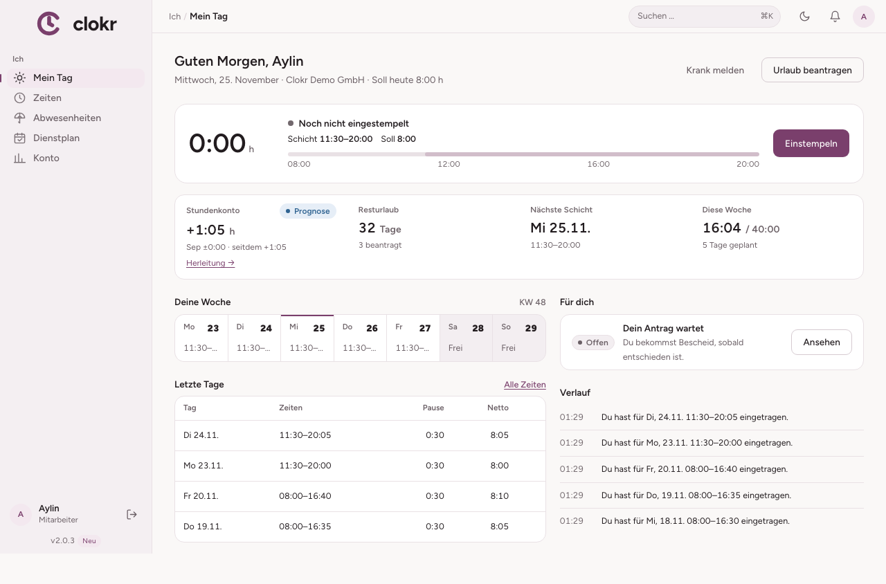
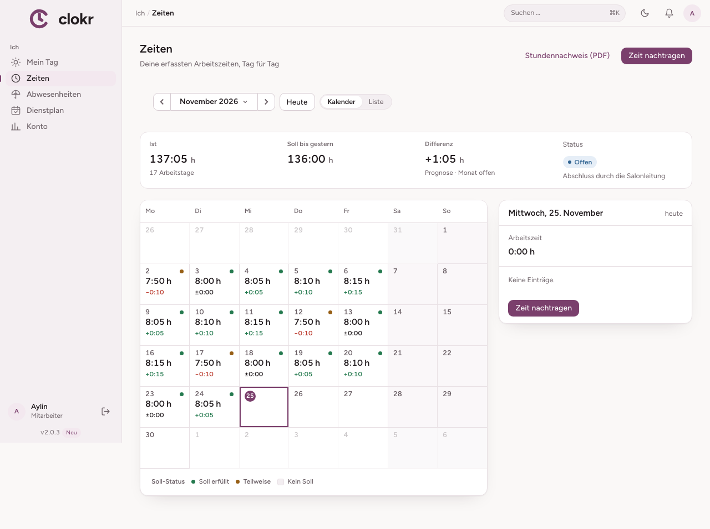
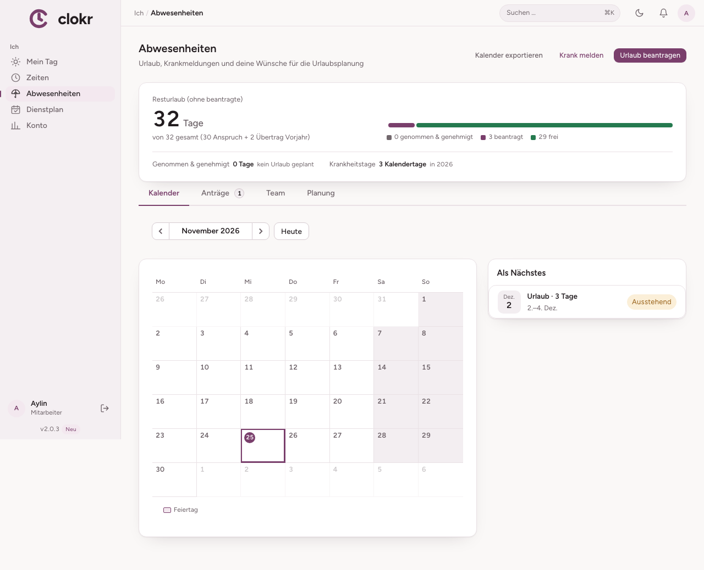
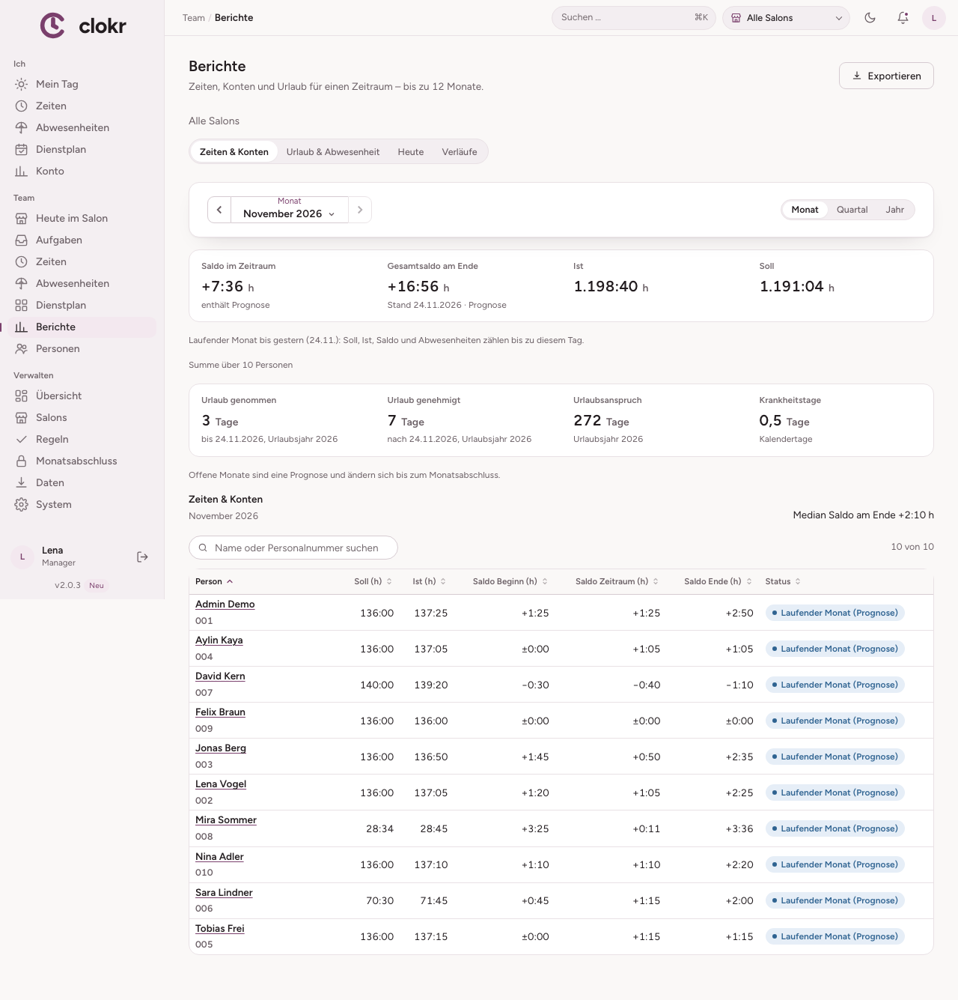
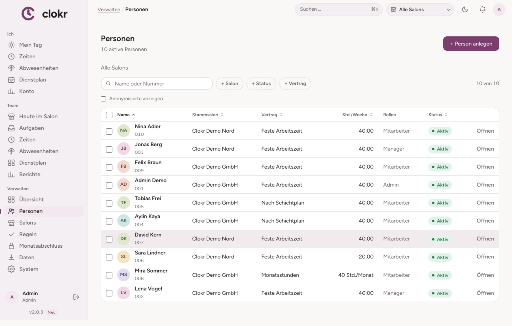
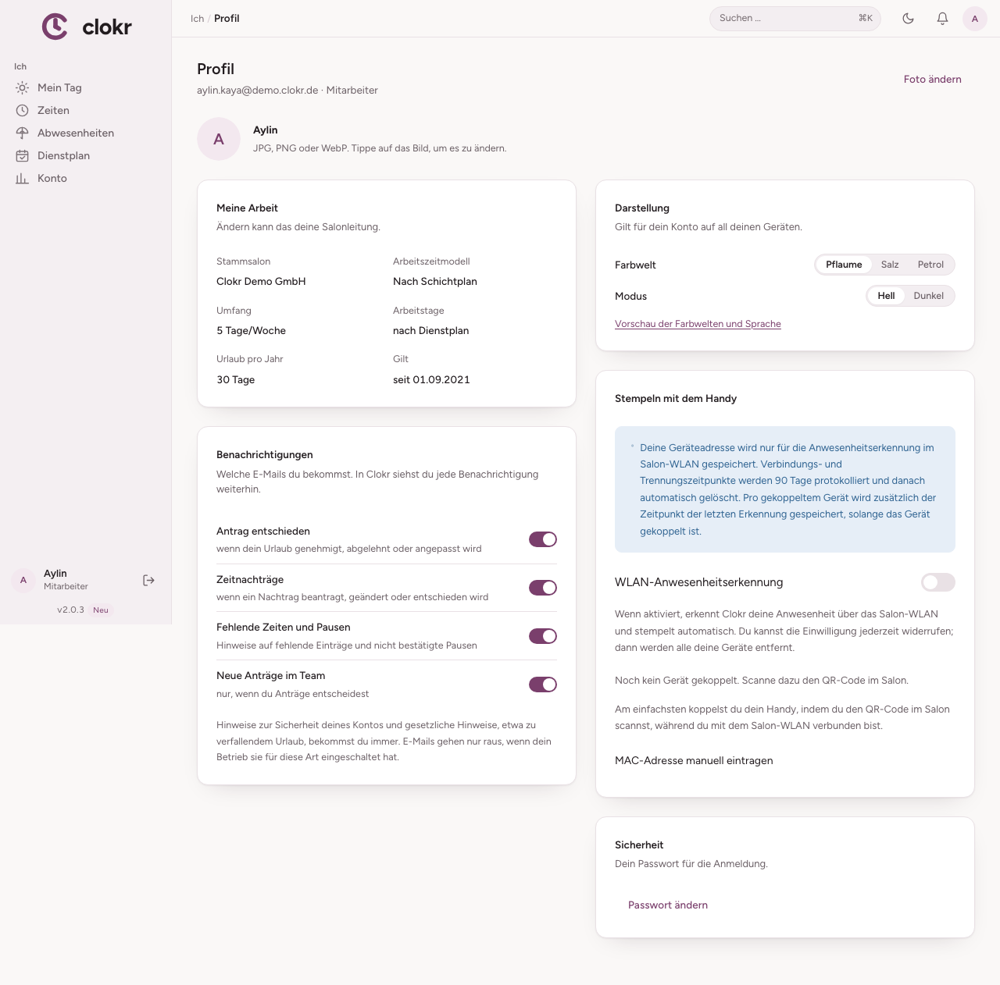

<p align="center">
  
</p>

<p align="center"><strong>Audit-proof time tracking, leave management and shift planning for German businesses — built for salons and salon chains.</strong></p>

<p align="center">
  <a href="LICENSE"></a>
  <a href="https://github.com/getclokr/clokr/releases"></a>
  <a href="https://getclokr.github.io/clokr/"></a>
  
  
  
</p>

---

Clokr is a self-hosted web application for recording working hours, managing leave and overtime, and planning shifts. It is built for German-speaking businesses that need a complete, legally compliant solution without a SaaS subscription, and it fits salons and salon chains in particular: several salons per company, a home salon per person, per-salon holidays and rosters.

Since v2 the German user interface is organised in three areas: **Ich** (your own day, times, absences, roster and account), **Team** (today in the salon, tasks, your team's times, absences, roster and reports) and **Verwalten** (people, salons, rules, month close, data and system). Everyone sees only the areas their roles need.

## Documentation

- **[Handbuch](https://getclokr.github.io/clokr/handbuch/)** (German) — the user and admin guide: first steps, the three areas, month close, roles and rights, FAQ.
- **[Entwickler-Doku](https://getclokr.github.io/clokr/entwickler/)** (English) — architecture, configuration, deployment, migrations, tests, release process, ADRs.

Both are built from [`docs/`](docs/) in this repository and published with GitHub Pages on every merge to `main`.

## Why Clokr?

- **Self-hosted** — your data stays on your server. No vendor lock-in, no monthly fees.
- **Legally compliant** — built for German labour law: ArbZG daily and weekly limits and breaks, BUrlG leave and carry-over rules, DSGVO anonymization of former employees, retention of working-time records (default 10 years, § 147 AO).
- **Audit-proof** — soft deletes, a full audit trail (who, when, what), closed months are immutable; corrections of a closed month are booked into the running month.
- **Complete** — time tracking, leave, overtime account, shift planning, reports and DATEV export, Phorest import — in one place.

## Screenshots

| Mein Tag                                     | Zeiten                                        |
| -------------------------------------------- | --------------------------------------------- |
|  |  |

| Abwesenheiten                                 | Berichte                                   |
| --------------------------------------------- | ------------------------------------------ |
|  |  |

| Personen                                     | Profil                                    |
| -------------------------------------------- | ----------------------------------------- |
|  |  |

---

## Features

- **Time tracking** — clock in and out, manual entries, a monthly calendar, one or more non-overlapping entries per day (each in its own salon) with several breaks, ArbZG checks (§ 3, § 4, § 5, and § 11 JArbSchG for minors), and the Zeitnachtrag (a request to add a missing entry afterwards, decided by a manager).
- **Leave and absences** — vacation, sick leave, special leave, maternity and parental leave, overtime compensation; approval workflow with cancellation flow; BUrlG carry-over; vacation limits and blocked periods per salon; a non-binding vacation planner that turns wishes into real requests.
- **Working-time account** — Soll against Ist, running saldo, Monatsabschluss with a completeness check, and month corrections (a four-eyes request, booked into the running month, never into the closed one).
- **Shift planning (Dienstplan)** — weekly grid with the tabs Woche, Bedarf, Hinweise and Verfügbarkeit, shift templates, patterns, coverage rules and per-person availability; shift reminders; a personal roster calendar feed ("Mein Dienstplan") for Google or Apple Calendar.
- **Phorest integration** — one-way shift import (Phorest as master) and a read-only appointment cache without personal data.
- **Salons** — several salons per company, a home salon per person, a federal state per salon with its own public holidays.
- **Roles and rights** — permission-based roles with a scope (whole company, selected salons, selected people); seven system roles you can copy and adapt.
- **People** — invitation-based onboarding, contracts and working-time models (fixed schedule, flexible, monthly hours, shift-based), CSV import, employment exit and DSGVO anonymization.
- **Reports and export** — monthly and period reports, PDF, DATEV CSV export.
- **Presence and devices** — web push on phones, clock-in by NFC terminal (terminal API keys, no desktop client), and WLAN presence with QR pairing through the FRITZ!Box adapter.
- **Audit trail and retention** — every create, update and delete is logged; configurable retention of records.
- **Notifications and security** — in-app notifications, optional e-mail two-factor sign-in, account lockout, API keys.
- **Themes** — Pflaume, Salz and Petrol, each in light and dark mode.

---

## Tech Stack

| Layer    | Technology                                                      |
| -------- | --------------------------------------------------------------- |
| Frontend | SvelteKit 2 + Svelte 5, TypeScript                              |
| Backend  | Fastify 5, TypeScript                                           |
| Database | PostgreSQL 18 + Prisma 7                                        |
| Storage  | MinIO (S3-compatible)                                           |
| Cache    | Redis 7 (part of the compose stack, reserved)                   |
| Auth     | JWT (access + refresh), optional e-mail OTP, API keys           |
| Runtime  | Node.js 24, pnpm 10 workspaces                                  |
| Tests    | Vitest, Playwright                                              |
| Docs     | VitePress, published to GitHub Pages ([`apps/docs`](apps/docs)) |

---

## Quick Start

```bash
# 1. Download compose file and env template
curl -fsSLO https://raw.githubusercontent.com/getclokr/clokr/main/docker-compose.prod.yml
curl -fsSLO https://raw.githubusercontent.com/getclokr/clokr/main/.env.example
cp .env.example .env

# 2. Generate secrets and edit .env
node -e "console.log(require('crypto').randomBytes(32).toString('hex'))"
# Paste output into JWT_SECRET, JWT_REFRESH_SECRET, ENCRYPTION_KEY in .env
# Also replace the change-me values of POSTGRES_PASSWORD and MINIO_ROOT_USER / MINIO_ROOT_PASSWORD in .env

# 3. Start
docker compose -f docker-compose.prod.yml up -d
```

Open **http://localhost:3000**. `docker-compose.prod.yml` creates **no demo data** (`SEED_DEMO_DATA` is fixed to `false`); the first company and its administrator are created through the operator console, see the [operator accounts runbook](docs/runbooks/operator-accounts.md) and [Getting started](docs/getting-started.md).

### Updates

```bash
docker compose -f docker-compose.prod.yml pull
docker compose -f docker-compose.prod.yml up -d
```

The API applies pending database migrations (`prisma migrate deploy`) on startup.

### Pin a version

Set both `CLOKR_API_IMAGE` and `CLOKR_WEB_IMAGE` in `.env` to the same release, e.g.
`ghcr.io/getclokr/clokr-api:2.0.3` / `ghcr.io/getclokr/clokr-web:2.0.3` (tags have
no leading `v`; `.env.example` ships `latest`).

More on operating Clokr: [Deployment](docs/deployment.md), [Configuration](docs/entwickler/configuration.md).

---

## Local Development with Docker

```bash
cp .env.example .env
# Set POSTGRES_PASSWORD, JWT_SECRET, JWT_REFRESH_SECRET, ENCRYPTION_KEY
docker compose up --build -d
```

| Service      | Port      | Description          |
| ------------ | --------- | -------------------- |
| **web**      | 3000      | SvelteKit frontend   |
| **api**      | 4000      | Fastify backend      |
| **postgres** | 5432      | PostgreSQL 18        |
| **redis**    | 6379      | Redis 7              |
| **minio**    | 9000/9001 | MinIO object storage |

This development stack seeds a demo company on first start (`SEED_DEMO_DATA` defaults to `true` here):

| Role     | Email          | Password        |
| -------- | -------------- | --------------- |
| Admin    | admin@clokr.de | admin1234       |
| Employee | max@clokr.de   | mitarbeiter5678 |

These credentials are public. Never use them on a system with real data.

## Local Development without Docker for the app

**Prerequisites:** Node.js 24+, pnpm 10+, Docker (for the infrastructure)

```bash
pnpm install

# Start infrastructure
docker compose up postgres redis minio -d

cp .env.example .env

# Schema changes are versioned migrations — never `db push`
pnpm --filter @clokr/db exec prisma migrate deploy
pnpm --filter @clokr/db exec prisma generate
pnpm --filter @clokr/db seed

pnpm dev
```

- Frontend: http://localhost:5173
- API: http://localhost:4000
- Swagger: http://localhost:4000/docs

How to create a migration (not with `prisma migrate dev`): [docs/migrations.md](docs/migrations.md). How to run the test suites, which use their own databases: [docs/testing.md](docs/testing.md).

---

## Project Structure

```
clokr/
├── apps/
│   ├── api/               # Fastify backend (four business contexts + shared substrate)
│   ├── web/               # SvelteKit frontend
│   ├── docs/              # VitePress site: renders docs/ in place
│   ├── e2e/               # Playwright tests
│   ├── fritzbox-adapter/  # WLAN presence and QR pairing via the FRITZ!Box
│   └── sim/               # Simulation instance (not part of any release image)
├── packages/
│   ├── db/                # Prisma schema, migrations, seeds
│   ├── types/             # Shared TypeScript types
│   └── mcp/               # MCP server for development tooling
├── docs/                  # Handbuch, developer docs, ADRs, release notes
├── docker-compose.yml
├── docker-compose.prod.yml
└── .env.example
```

---

## Roles and Permissions

Access is decided by permissions, never by a hard-coded role. A person holds one or more role assignments, each with a scope (whole company, selected salons or selected people). Clokr ships seven system roles (Mitarbeiter, Manager, Admin, Inhaber, Salonmanager, Personalabteilung and Ausbilder), and you can copy a role and adapt the copy. See the Handbuch page [Rollen und Rechte](https://getclokr.github.io/clokr/handbuch/verwalten/rollen-und-rechte) and the permission catalogue in [docs/permissions.md](docs/permissions.md).

---

## API

Swagger UI at `/docs` when the API is running. Key endpoints:

- `POST /api/v1/auth/login`
- `GET/POST /api/v1/time-entries`
- `GET/POST /api/v1/leave/requests`
- `GET /api/v1/reports/monthly`
- `GET /api/v1/reports/datev`

---

## Contributing

PRs welcome. See [CONTRIBUTING.md](CONTRIBUTING.md) for setup instructions and guidelines.

---

## License

[MIT](LICENSE)
