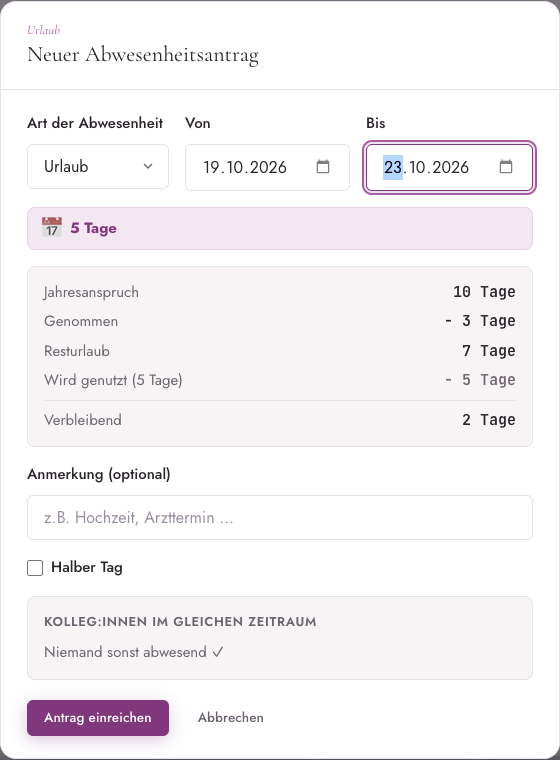
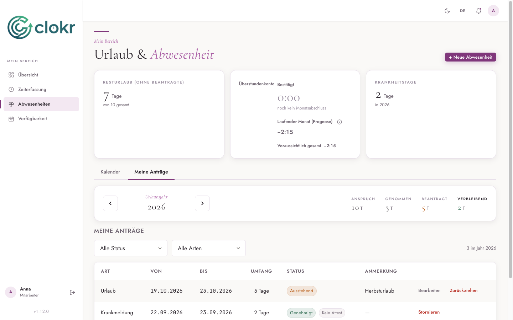
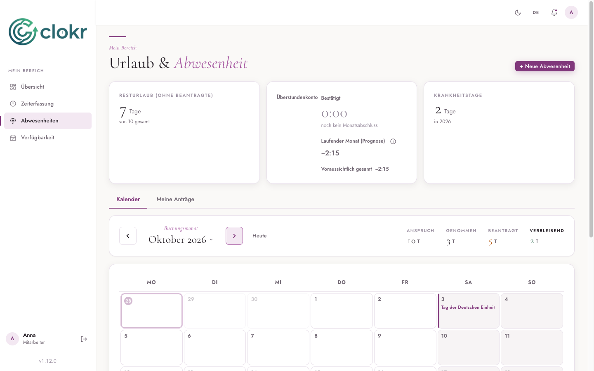

# Abwesenheiten

Diese Seite beschreibt, wie Sie als Mitarbeiter Urlaub, Krankmeldungen und andere Abwesenheiten in Clokr beantragen, verwalten und stornieren – inklusive der Auswirkung auf Ihre Zeiterfassung. Die Genehmigung selbst liegt bei Ihrer Führungskraft.

## Antrag stellen

Unter **Abwesenheiten** öffnen Sie über **+ Neue Abwesenheit** das Formular **„Neuer Abwesenheitsantrag"**.

**So geht's:**

1. **Art der Abwesenheit** wählen (siehe Übersicht unten)
2. **Von** und **Bis** eintragen
3. Bei eintägigen Anträgen optional **Halber Tag** aktivieren
4. Optional eine **Anmerkung** hinterlegen (z. B. „Hochzeit", „Arzttermin")
5. Mit **Antrag einreichen** absenden

Das Formular zeigt Ihnen währenddessen live an, welche Kolleginnen und Kollegen im selben Zeitraum ebenfalls abwesend sind, sowie – je nach Art – Ihren aktuellen Resturlaub oder Ihr Überstundenguthaben.

<!-- SCREENSHOT file=images/abwesenheiten-01-antrag.png role=mitarbeiter url=/leave show="Dialog 'Neuer Abwesenheitsantrag' mit Art 'Urlaub', ausgefülltem Zeitraum 19.10.–23.10.2026 und sichtbarer Resturlaub-Berechnung im Formular" -->

### Verfügbare Abwesenheitsarten

| Art | Bezahlt | Genehmigung nötig |
| --- | --- | --- |
| Urlaub | ja | ja |
| Überstundenausgleich | ja | ja |
| Sonderurlaub | ja | ja |
| Bildungsurlaub | ja | ja |
| Krankmeldung | ja | nein – gilt sofort |
| Kinderkrank | ja | nein – gilt sofort |
| Unbezahlter Urlaub | nein | ja |
| Mutterschutz | ja | Meldung |
| Elternzeit | nein | Meldung |

### Urlaub beantragen

Wählen Sie **Urlaub** als Art. Oberhalb des Kalenders zeigt eine Jahresübersicht:

- **Anspruch** – Ihr gesetzlicher und vertraglicher Jahresanspruch
- **Übertrag Vorjahr** und **Übertrag Vorjahr (Rest)** – aus dem Vorjahr übernommene, noch nicht verbrauchte Tage
- **Genommen**, **Beantragt** (noch offene Anträge) und **Verbleibend**

Im Antragsformular selbst sehen Sie zusätzlich die gleichen Werte sowie eine Live-Berechnung, wie viele Tage der aktuelle Antrag verbraucht. Reicht Ihr Resturlaub nicht aus, warnt Sie das Formular mit **„⚠ Nicht genug Resturlaub vorhanden"**.

> Übertragene Urlaubstage aus dem Vorjahr können verfallen. Zeigt das Formular bei „Übertrag Vorjahr" den Zusatz **„(verfällt TT.MM.JJJJ)"**, sollten Sie diese Tage vorrangig verplanen.

### Krankmeldung

Wählen Sie **Krankmeldung** (oder **Kinderkrank**) als Art und tragen Sie den Zeitraum ein. Eine Krankmeldung benötigt **keine Genehmigung** und wird sofort wirksam. Ein halber Krankheitstag ist rechtlich nicht vorgesehen – die Option „Halber Tag" ist für diese Arten daher deaktiviert.

Ein ärztliches Attest tragen Ihre Führungskraft bzw. Administration im System ein; Sie selbst laden kein Dokument hoch. Ob ein Attest hinterlegt ist, erkennen Sie am Badge **Attest** bzw. **Kein Attest** an Ihrem Antrag.

### Sonderurlaub und Überstundenausgleich

Beide Arten beantragen Sie selbst über dasselbe Formular:

- **Sonderurlaub** – zusätzlich wählen Sie einen **Anlass** aus einer von der Administration gepflegten Liste (z. B. „Hochzeit (2 Tage)")
- **Überstundenausgleich** – das Formular zeigt Ihr aktuelles Überstundenguthaben inklusive Toleranz und warnt, falls der Antrag Ihr Guthaben übersteigen würde

Beide Arten benötigen die Genehmigung Ihrer Führungskraft.

## Antragsstatus

| Status (Badge) | Bedeutung |
| --- | --- |
| **Ausstehend** | Antrag wartet auf Genehmigung |
| **Genehmigt** | bestätigt, im Kalender sichtbar, saldowirksam |
| **Abgelehnt** | nicht genehmigt |
| **Stornierung beantragt** | Stornierung eines genehmigten Antrags läuft, wartet auf eine zweite Führungskraft |
| **Zurückgezogen** | von Ihnen selbst zurückgezogen oder nach abgeschlossener Stornierung storniert (im Filter „Storniert" genannt) |

Bei Schichtmodellen werden Urlaubstage nach den vertraglichen Arbeitstagen pro Woche gezählt – unabhängig davon, ob der Tag im Schichtplan steht. Bei älteren Anträgen kann noch der Hinweis **Vorläufig** oder **Angepasst: +N Tag(e)** erscheinen; neue Anträge erhalten ihn nicht mehr.

## Antrag zurückziehen / Stornierung beantragen

- **Noch ausstehender Antrag**: Über **Zurückziehen** an Ihrem Antrag können Sie ihn direkt selbst zurücknehmen – geben Sie im Dialog **„Antrag zurückziehen?"** eine kurze Begründung an.
- **Bereits genehmigter Antrag**: Über **Stornieren** stellen Sie im Dialog **„Stornierung beantragen?"** einen Stornierungsantrag. Der Urlaub bleibt bis zur Entscheidung aktiv (weiterhin im Kalender sichtbar und saldowirksam). Aus Revisionsgründen muss eine **andere** Führungskraft als die ursprünglich genehmigende die Stornierung bestätigen (Vier-Augen-Prinzip) – auch Sie selbst können Ihre eigene Stornierung nicht genehmigen.

> Solange die Stornierung aussteht, dürfen Sie für diesen Zeitraum bereits Zeiteinträge anlegen. Diese werden zunächst als ungültig markiert (Grund: „Urlaubsstornierung ausstehend") und zählen erst nach Genehmigung der Stornierung für Ihren Saldo. Wird die Stornierung abgelehnt, bleibt der Urlaub wie gehabt genehmigt.

<!-- SCREENSHOT file=images/abwesenheiten-02-status.png role=mitarbeiter url=/leave show="Liste 'Meine Anträge' mit mehreren Zeilen und unterschiedlichen Status-Badges: Genehmigt (grün) und Ausstehend (gelb); den Badge 'Stornierung beantragt' zeigt im Demo-Mandanten aktuell kein Antrag dieser Mitarbeiterin gleichzeitig mit den anderen beiden" -->

## Kalender und Kollegen

Die **Kalender**-Ansicht auf der Seite **Abwesenheiten** zeigt nicht nur Ihre eigenen, sondern auch die genehmigten Abwesenheiten Ihrer Kolleginnen und Kollegen im selben Zeitraum – so sehen Sie auf einen Blick, wer wann nicht da ist. Je nach Ihren Rechten wird die genaue Art angezeigt oder nur neutral als „abwesend" markiert. Ein separater Team-Kalender mit Legende ist Managerinnen und Managern vorbehalten.

Über **Team-Abwesenheiten** (iCal-Export) können Sie die Abwesenheiten des Teams zusätzlich in Ihre eigene Kalender-App abonnieren.

<!-- SCREENSHOT file=images/abwesenheiten-03-kalender.png role=mitarbeiter url=/leave show="Kalenderansicht Oktober 2026 mit ausstehendem (gestricheltem) Urlaub 19.–23.10. für Anna Beispiel; im Demo-Mandanten hat im Oktober kein Kollege/keine Kollegin eine Abwesenheit, daher ist hier keine neutrale Markierung zu sehen" -->

## Urlaub und Zeiteinträge

Für Tage mit **genehmigtem** Urlaub (oder Mutterschutz/Elternzeit) lässt sich **kein** neuer Zeiteintrag anlegen bzw. keine Stempelung durchführen – Clokr zeigt die Meldung „§ 8 BUrlG: An diesem Tag ist Urlaub genehmigt. Bitte zuerst stornieren." Möchten Sie an einem genehmigten Urlaubstag doch arbeiten, müssen Sie zuerst die Stornierung des Urlaubs beantragen (siehe oben).

## Urlaub bei Schichtplan – was beantragen?

Bei Mitarbeitenden mit Schichtplan steht der Plan oft erst fest, wenn der Urlaub längst beantragt ist. Daher:

- **Beantragen Sie alle Tage, die frei sein sollen** – auch den Samstag, wenn Sie z. B. ein langes Wochenende möchten. Ein nicht beantragter Tag kann später eingeplant werden.
- **Eine ganze Woche Urlaub** kostet höchstens so viele Tage, wie Ihr Vertrag Arbeitstage pro Woche vorsieht (z. B. 5). Sonntage und gesetzliche Feiertage kosten keinen Urlaubstag.
- **Einzelne Tage**, an denen Sie laut Ihrer üblichen Planung ohnehin frei hätten, müssen Sie nicht beantragen – beantragen Sie nur die Tage, an denen Sie sonst arbeiten würden.
- **Krank im Urlaub:** Reichen Sie die Arbeitsunfähigkeitsbescheinigung ein; Ihr Manager schreibt die betroffenen Tage über **Antrag korrigieren** wieder gut (§ 9 BUrlG).

### Wie werden Urlaubstage bei Schichtplan gezählt?

- **Eine volle Woche** (Montag bis Sonntag beantragt) kostet immer die vertraglichen Arbeitstage
  pro Woche – unabhängig davon, ob für Sie **Übliche Arbeitstage** hinterlegt sind.
- **Eine angebrochene Woche** (z. B. nur Montag bis Mittwoch) zählt entweder nach Ihren
  hinterlegten **Übliche Arbeitstage** (falls vorhanden) oder, ohne diese Angabe, nach den
  beantragten Tagen bis zur vertraglichen Obergrenze.
- **Mehrere Anträge in derselben Kalenderwoche** werden zusammen gerechnet, nicht einzeln: Stellen
  Sie z. B. zuerst einen Antrag für Montag bis Mittwoch (3 Tage bei einem 4-Tage-Vertrag) und
  später einen weiteren für Donnerstag bis Samstag derselben Woche, kostet der zweite Antrag nur
  noch den fehlenden 1 Tag – zusammen 3 + 1 = 4, nicht 3 + 3 = 6. Die Vorschau im Antragsformular
  zeigt Ihnen bereits beim Anlegen, wie viele Tage ein Antrag tatsächlich kosten wird.
- **Bereits genehmigte Anträge bleiben unverändert**, auch wenn Sie danach einen früheren Antrag
  derselben Woche zurückziehen oder er abgelehnt wird – es findet keine stillschweigende
  Neuberechnung statt.

## Siehe auch

- **[[Zeiterfassung]]** – Zusammenspiel von Urlaub und Zeiteinträgen im Detail
- **[[Urlaubsverwaltung]]** – wie Ansprüche, Übertrag und Fristen verwaltet werden
- **[[Genehmigungen]]** – der Ablauf aus Sicht der Führungskraft
- **[[Rollen & Rechte|Rollen-und-Rechte]]** – wer was sehen und genehmigen darf
- **[[FAQ]]** – häufige Fragen
