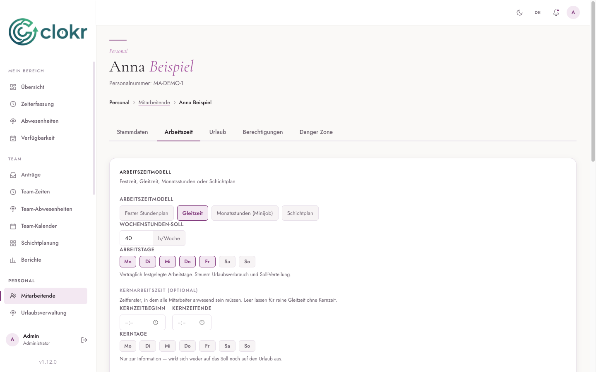
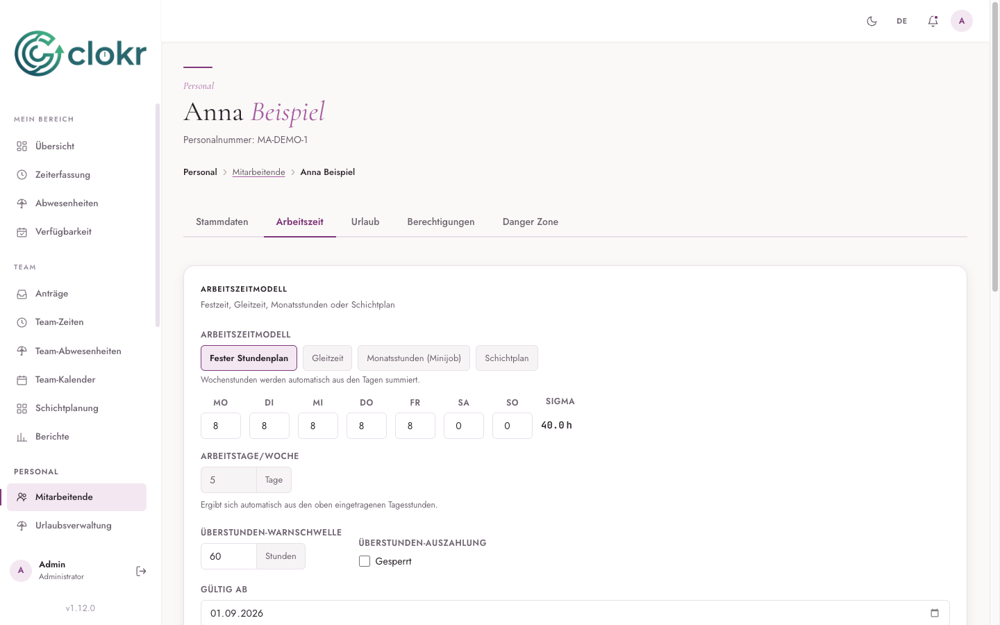

# Arbeitszeitmodelle

Clokr kennt vier Arbeitszeitmodelle, aus denen sich pro Mitarbeiter das Monats- bzw. Wochensoll ergibt. Diese Seite beschreibt die vier Modelle, wie Sie sie pro Mitarbeiter oder als Vorgabe für den ganzen Betrieb konfigurieren, sowie die Regel für Vertragswechsel. Konfiguriert wird das Arbeitszeitmodell auf dem Reiter **Arbeitszeit** in der Mitarbeiter-Detailansicht (**Mitarbeitende** → Person auswählen) bzw. tenantweit unter **Urlaubsverwaltung → Standards** (siehe **[[Mitarbeiter verwalten|Mitarbeiter-verwalten]]**).

## Die vier Modelle

Im Auswahlfeld **Arbeitszeitmodell** stehen zur Wahl:

### Fester Stundenplan

Pro Wochentag wird eine feste Stundenzahl hinterlegt (z. B. Mo–Fr je 8 Std.). Für jeden Wochentag (**Mo**–**So**) tragen Sie die Stunden einzeln ein; die **Wochenstunden** werden automatisch aus diesen Tageswerten summiert (Feld **Sigma**). Das Feld **Arbeitstage/Woche** wird daraus schreibgeschützt abgeleitet und zeigt, an wie vielen Tagen tatsächlich gearbeitet wird.

### Gleitzeit

Es wird nur ein **Wochenstunden-Soll** hinterlegt, die Verteilung auf die Tage ist frei. Zusätzlich lässt sich eine **Kernarbeitszeit** angeben:

- **Kernzeitbeginn** und **Kernzeitende** (Uhrzeit, beide optional)
- **Kerntage** – die Wochentage, an denen die Kernzeit gilt

Leer gelassen ergibt sich reine Gleitzeit ohne Kernzeit. Zusätzlich werden die **Arbeitstage** über Wochentag-Chips festgelegt – sie sind bei diesem Modell die maßgebliche Angabe für die Urlaubsberechnung (Verbrauch und anteiliger Anspruch), nicht die Kerntage.

<!-- SCREENSHOT file=images/arbeitszeitmodelle-02-gleitzeit.png role=admin url=/admin/employees show="Reiter 'Arbeitszeit' mit gewähltem Modell 'Gleitzeit': Feld Wochenstunden-Soll, Wochentag-Chips 'Arbeitstage' und darunter der Abschnitt 'Kernarbeitszeit (optional)' mit Kernzeitbeginn/-ende und Kerntage-Chips" -->

### Monatsstunden (Minijob)

Für flexible Beschäftigte wie Minijobber wird ein monatliches Stunden-Soll hinterlegt (**Stunden/Monat**, optional). Bleibt das Feld leer, findet reine Zeiterfassung ohne Soll-Vergleich statt. Bei diesem Modell gibt es kein Tages-Soll. Das Stunden/Monat-Soll ist geschuldet: Urlaub, Krankheit, angeordnete Abwesenheiten und Feiertage, die auf einen vereinbarten Arbeitstag fallen, mindern es um Stunden/Monat ÷ Anzahl der Arbeitstage des Monats (ein halber Tag mindert um die Hälfte); ein Feiertag an einem freien Tag mindert nichts. Arbeitstage sind die beim Mitarbeiter hinterlegten Arbeitstage, sonst der Firmenstandard, sonst Mo–Fr. Bereits abgeschlossene Monate bleiben unverändert.

### Schichtplan

Der Schichtplan ist führend: Das Wochenstunden-Soll wird als Gesamtstunden erfasst, welche konkreten Wochentage gearbeitet werden, ergibt sich aus der Schichtplanung, nicht aus einem festen Tagesraster. Zusätzlich zur Wochenstundenzahl tragen Sie die **vertragliche Anzahl Arbeitstage pro Woche** ein (Feld **Arbeitstage/Woche**, 1–7 Tage) – dieses Feld bestimmt nur die Anzahl, welche Wochentage das konkret sind, legt allein der Schichtplan fest. Details zur Schichtplanung: **[[Schichtplanung]]**.

Optional können Sie zusätzlich die **Übliche Arbeitstage** hinterlegen (Mitarbeiter → Arbeitszeit,
auch schon beim Anlegen des Mitarbeiters) – ein Häkchen pro Wochentag, an dem diese Person
normalerweise arbeitet. Diese Angabe ist freiwillig und wirkt sich NUR auf eine **angebrochene**
Urlaubswoche aus: Eine volle Urlaubswoche kostet immer die vertraglichen Arbeitstage, egal was
hinterlegt ist. Beispiel: Bei einem 4-Tage-Vertrag mit üblichen Arbeitstagen Dienstag bis Freitag
kostet ein Urlaubsantrag für Montag bis Mittwoch nur 2 Tage (Dienstag und Mittwoch zählen, Montag
nicht, da an diesem Tag ohnehin nicht gearbeitet wird). Ohne Angabe gilt weiterhin die bisherige
Regel (die beantragten Tage zählen bis zur vertraglichen Obergrenze).

<!-- SCREENSHOT file=images/arbeitszeitmodelle-01-typenwahl.png role=admin url=/admin/employees show="Reiter 'Arbeitszeit' in der Mitarbeiter-Detailansicht mit der Auswahl der vier Arbeitszeitmodelle (Fester Stundenplan aktiv) und dem darunterliegenden Tagesraster Mo-So mit Stundenwerten sowie dem Feld 'Gültig ab'" -->

## Pausendauer-Override

Auf dem Reiter Arbeitszeit können Sie im Abschnitt **Pausendauer (Optional)** die gesetzlichen Pausenzeiten pro Mitarbeiter individuell überschreiben (Standard: nach § 4 ArbZG 30 Minuten ab über 6 Std., 45 Minuten ab über 9 Std. Arbeitszeit). Leer gelassen gilt der betriebsweite Standard. Bei minderjährigen Auszubildenden (aus dem Geburtsdatum erkannt) bietet ein Button **Azubi-Vorschlag übernehmen (30 / 60 Min)** die JArbSchG-§9-Empfehlung zur direkten Übernahme an; die Mindestwerte (30 bzw. 45 Minuten) sind dabei durch das ArbZG vorgegeben.

## Vertragswechsel nur zum Monatsersten

Ein Arbeitszeitmodell ist immer **ab einem Datum gültig** (Feld **Gültig ab**). Für eine spätere Änderung des Modells (einen Vertragswechsel) lässt Clokr nur den 1. eines Kalendermonats zu – das Eingabefeld springt beim Ändern automatisch auf den nächsten Monatsersten. Versuchen Sie es dennoch mit einem anderen Datum, meldet Clokr:

> „Vertragswechsel sind nur zum Monats-1. erlaubt."

Diese Einschränkung gilt nur für **Änderungen** an einem bestehenden Vertrag. Das allererste Arbeitszeitmodell beim Anlegen eines Mitarbeiters ist davon ausgenommen und gilt ab dem Eintrittsdatum, auch wenn das kein Monatserster ist.

## Vorgaben für den ganzen Betrieb

Unter **Urlaubsverwaltung → Standards** legen Sie betriebsweite Vorgaben fest: die Standard-Wochenarbeitszeit je Wochentag (Mo–So) sowie eine Warnschwelle und Regeln zur Überstunden-Auszahlung. Beim Speichern können Sie die Checkbox **Auch auf bestehende Mitarbeiter anwenden** aktivieren – dann erstellt Clokr ab dem heutigen Tag neue Vertragsversionen für alle Mitarbeiter mit festem Wochenmodell. Minijobber und Mitarbeiter mit individuellen Einstellungen bleiben davon unberührt.

## Auswirkung auf Soll und Saldo

Das gewählte Modell bestimmt, wie das Arbeitszeitkonto das Soll berechnet:

- **Fester Stundenplan**: Soll ergibt sich direkt aus den hinterlegten Tagesstunden.
- **Gleitzeit**: Soll ergibt sich aus dem Wochenstunden-Soll, verteilt auf die hinterlegten Arbeitstage.
- **Monatsstunden**: ohne gesetztes Stunden-Soll kein Soll-Vergleich; mit gesetztem Soll mindern Urlaub, Krankheit, angeordnete Abwesenheiten und Feiertage an Arbeitstagen es anteilig.
- **Schichtplan**: das Soll ergibt sich aus den tatsächlich geplanten Schichten; Urlaub und Abwesenheiten reduzieren das Soll auf Basis der Wochentage, an denen laut Schichtplan gearbeitet worden wäre. Der **Urlaubsverbrauch** (wie viele Urlaubstage ein Antrag kostet) wird dagegen nach den vertraglichen Arbeitstagen pro Woche gezählt, nicht nach dem Schichtplan.

Details zur Saldoberechnung und zum Monatsabschluss: **[[Monatsabschluss]]**.

## Siehe auch

- **[[Mitarbeiter verwalten|Mitarbeiter-verwalten]]** – Arbeitszeitmodell beim Anlegen eines Mitarbeiters festlegen
- **[[Schichtplanung]]** – Schichten für das Modell „Schichtplan" planen
- **[[Monatsabschluss]]** – wie Soll und Saldo zusammenwirken
- **[[Compliance & Revisionssicherheit|Compliance-und-Revisionssicherheit]]** – ArbZG-Höchstarbeitszeit und Pausenpflicht
