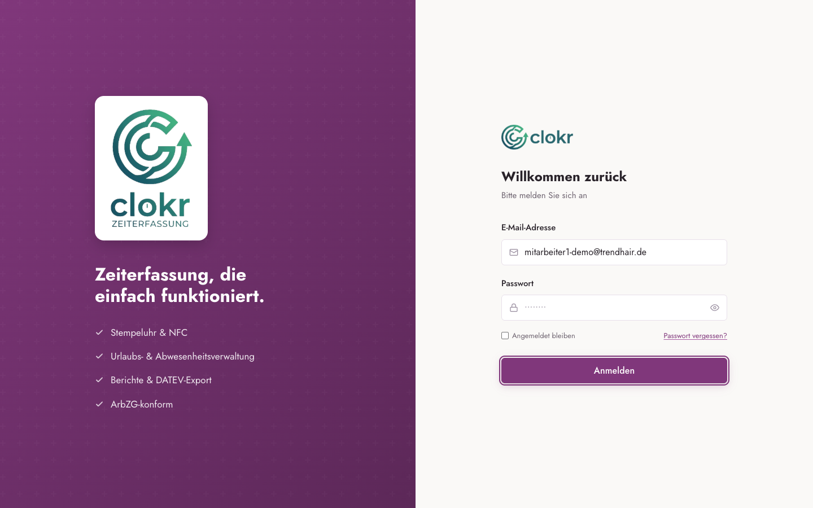
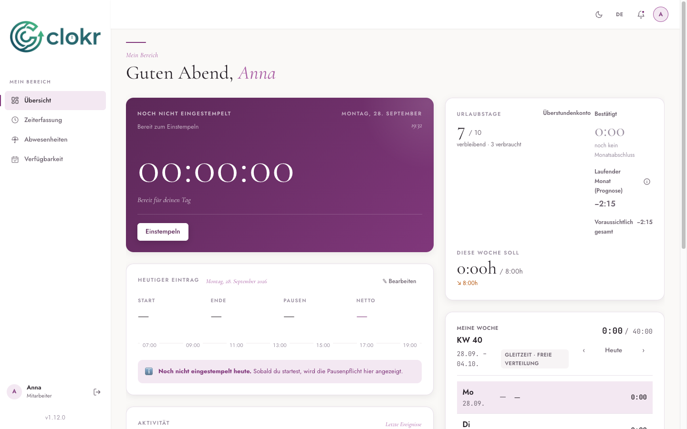
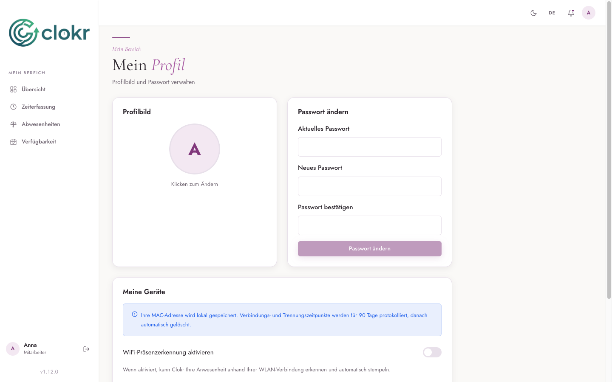

# Erste Schritte

Diese Seite richtet sich an Mitarbeitende (Rolle **Mitarbeiter**): Anmeldung, erster Zugang per Einladung, Aufbau der Oberfläche und persönliche Einstellungen. Die Installation und der Betrieb von Clokr selbst sind technische Aufgaben Ihrer IT-Administration und in **[[Deployment]]** beschrieben.

## Anmelden

Öffnen Sie die Clokr-Adresse Ihres Unternehmens. Sie landen auf der Anmeldeseite **„Willkommen zurück"**.

**So geht's:**

1. **E-Mail-Adresse** und **Passwort** eingeben
2. Optional **Angemeldet bleiben** aktivieren, damit Sie beim nächsten Besuch nicht erneut angemeldet werden müssen
3. Auf **Anmelden** klicken

> Über das Augen-Symbol im Passwortfeld können Sie die Eingabe sichtbar machen. Bei falschen Zugangsdaten erscheint eine Fehlermeldung oberhalb des Formulars.

Ist in Ihrem Unternehmen die Zwei-Faktor-Authentifizierung aktiviert, werden Sie nach dem Anmelden automatisch zur Code-Eingabe weitergeleitet (siehe unten).

<!-- SCREENSHOT file=images/erste-schritte-01-login.png role=mitarbeiter url=/login show="Anmeldeseite 'Willkommen zurück' mit ausgefülltem E-Mail-Feld, leerem Passwortfeld und Fokus auf dem Anmelden-Button" -->

## Einladung annehmen (erster Zugang)

Wenn Ihre Administration Sie neu in Clokr anlegt, erhalten Sie eine E-Mail mit einem Einladungslink. Dieser Link ist **24 Stunden** gültig.

**So geht's:**

1. Link aus der Einladungs-E-Mail öffnen – Sie landen auf **„Konto aktivieren"**
2. Ein **Passwort** vergeben (mindestens 12 Zeichen, mit Groß-/Kleinbuchstabe, Ziffer und Sonderzeichen – die Checkliste auf der Seite zeigt live an, was noch fehlt)
3. Passwort im Feld **Passwort bestätigen** wiederholen
4. Auf **Konto aktivieren** klicken

Nach erfolgreicher Aktivierung können Sie sich über **Zur Anmeldung** direkt einloggen.

> Ist der Link abgelaufen oder bereits verwendet, zeigt die Seite eine entsprechende Meldung („Link abgelaufen" bzw. „Bereits aktiviert"). Wenden Sie sich in diesem Fall an Ihre Administration – sie kann einen neuen Einladungslink versenden.

## Passwort vergessen / zurücksetzen

**So geht's:**

1. Auf der Anmeldeseite **Passwort vergessen?** anklicken
2. E-Mail-Adresse eingeben und **Link senden** klicken
3. Aus Sicherheitsgründen erscheint immer dieselbe Meldung, unabhängig davon, ob ein Konto mit dieser Adresse existiert: „Falls ein Konto mit dieser E-Mail existiert, haben wir einen Link zum Zurücksetzen gesendet."
4. Link aus der E-Mail öffnen, neues Passwort vergeben und **Passwort speichern** klicken

Anschließend können Sie sich mit dem neuen Passwort anmelden.

## Zwei-Faktor-Authentifizierung (falls aktiviert)

Manche Unternehmen aktivieren eine zusätzliche Sicherheitsstufe per E-Mail-Code. Ist das der Fall, werden Sie nach Eingabe von E-Mail und Passwort automatisch auf die Seite **„Zwei-Faktor-Authentifizierung"** weitergeleitet.

**So geht's:**

1. Den 6-stelligen Code aus der zugesendeten E-Mail eingeben – bei vollständiger Eingabe wird automatisch weitergeleitet
2. Alternativ über **Code erneut senden** einen neuen Code anfordern

> Der Code ist 10 Minuten gültig. Bei Ablauf werden Sie automatisch zurück zur Anmeldung geleitet. Ob diese Funktion aktiv ist, entscheidet Ihre Administration zentral für das ganze Unternehmen – Sie können sie nicht selbst ein- oder ausschalten.

## Aufbau der Oberfläche

### Navigation

Als Mitarbeiter finden Sie in der linken Seitenleiste den Bereich **Mein Bereich** mit folgenden Einträgen:

- **Übersicht** – Ihr Dashboard
- **Zeiterfassung** – eigene Zeiteinträge
- **Abwesenheiten** – Urlaub, Krankmeldungen etc.
- **Verfügbarkeit** – nur sichtbar, wenn Ihr Unternehmen diese Funktion nutzt

Managerinnen und Manager sowie Administratorinnen und Administratoren sehen zusätzliche Bereiche wie Genehmigungen, Schichtplanung oder Berichte – diese sind für die Rolle Mitarbeiter nicht sichtbar. Details zu den Rollen: **[[Rollen & Rechte|Rollen-und-Rechte]]**.

<!-- SCREENSHOT file=images/erste-schritte-02-navigation.png role=mitarbeiter url=/dashboard show="Dashboard mit sichtbarer linker Seitenleiste 'Mein Bereich' (Übersicht, Zeiterfassung, Abwesenheiten, Verfügbarkeit) und Kopfzeile mit Glocke, Hell/Dunkel-Schalter und Profil-Avatar oben rechts" -->

### Kopfzeile

Oben rechts finden Sie:

- **Glocken-Symbol** – Ihre Benachrichtigungen als Dropdown, mit **Alle als gelesen** zum Abhaken aller ungelesenen Einträge. Details zu den Benachrichtigungstypen: **[[Verfügbarkeit & Schichten|Verfuegbarkeit-und-Schichten]]**
- **Sonne/Mond-Symbol** – wechselt zwischen Hell- und Dunkelmodus
- **Ihr Profil-Avatar** – öffnet ein Menü mit **Mein Profil** und **Abmelden**

Das Farbschema (Theme) selbst legt Ihre Administration unter Systemeinstellungen fest; als Mitarbeiter können Sie nur zwischen Hell- und Dunkelmodus wechseln.

### Befehlspalette

Mit **Cmd+K** (macOS) bzw. **Strg+K** (Windows/Linux) öffnen Sie die Befehlspalette – eine Schnellsuche, mit der Sie direkt zu Ihrem Dashboard, zur Zeiterfassung, zu den Abwesenheiten oder zu den Berichten springen können. Mit **Esc** schließen Sie sie wieder.

### Mobile Ansicht

Auf schmalen Bildschirmen (Smartphone/Tablet) ersetzt eine untere Tab-Leiste die Seitenleiste, mit den Reitern **Übersicht**, **Zeit** und **Abwesenheiten** sowie einem **Mehr**-Button, der ein Menü mit **Verfügbarkeit** und **Mein Profil** öffnet.

## Persönliche Einstellungen

Über den Profil-Avatar oben rechts → **Mein Profil** gelangen Sie zur Seite **„Mein Profil"** mit folgenden Bereichen:

- **Profilbild** – per Klick ein neues Bild hochladen (JPEG/PNG/WebP)
- **Passwort ändern** – aktuelles Passwort, neues Passwort (mit Stärke-Checkliste), Bestätigung
- **Meine Geräte** – hier aktivieren Sie optional die WLAN-Präsenzerkennung (automatisches Ein-/Ausstempeln über Ihr Diensthandy/-tablet im Firmen-WLAN) und verwalten Ihre hinterlegten Geräte. Details dazu in **[[Zeiterfassung]]**

Am Seitenende sehen Sie außerdem Ihre hinterlegte E-Mail-Adresse und Ihre Rolle.

<!-- SCREENSHOT file=images/erste-schritte-03-mein-profil.png role=mitarbeiter url=/settings show="Seite 'Mein Profil' mit den Karten Profilbild, Passwort ändern und Meine Geräte, WLAN-Präsenzerkennung-Schalter deaktiviert" -->

## Sitzungs-Timeout

Aus Sicherheitsgründen werden Sie nach einer Zeit ohne Aktivität automatisch abgemeldet (Standard: 60 Minuten, die genaue Dauer legt Ihr Unternehmen fest). Jede Maus-, Tastatur- oder Touch-Eingabe setzt den Timer zurück. Wurden Sie unerwartet auf die Anmeldeseite geleitet, ist das meist die Ursache – melden Sie sich einfach erneut an.

> Haben Sie in einem Formular ungespeicherte Änderungen und verlassen die Seite, warnt Sie Clokr vorher mit dem Dialog **„Ungespeicherte Änderungen verwerfen?"**.

## Siehe auch

- **[[Zeiterfassung]]** – Ein-/Ausstempeln, Zeiteinträge, Pausen, Überstunden
- **[[Abwesenheiten]]** – Urlaub, Krankmeldung, Anträge
- **[[Verfügbarkeit & Schichten|Verfuegbarkeit-und-Schichten]]** – eigene Verfügbarkeit, Schichten, Benachrichtigungen
- **[[Rollen & Rechte|Rollen-und-Rechte]]** – welche Rolle sieht was
- **[[FAQ]]** – häufige Fragen
- **[[Deployment]]** – Installation und Betrieb (technisch)
