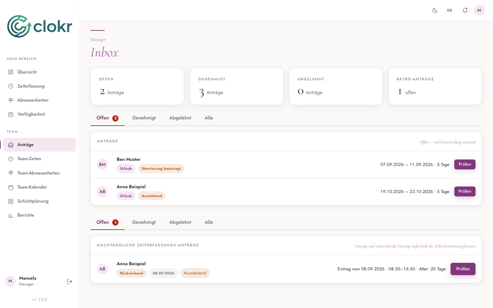
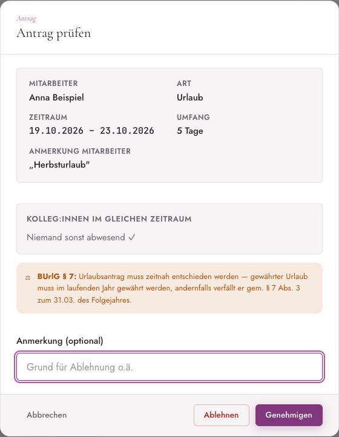
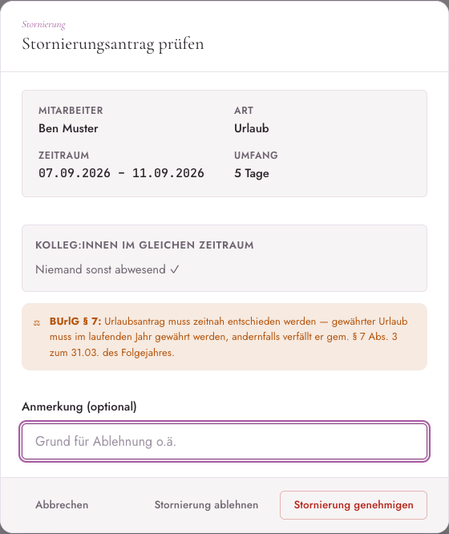
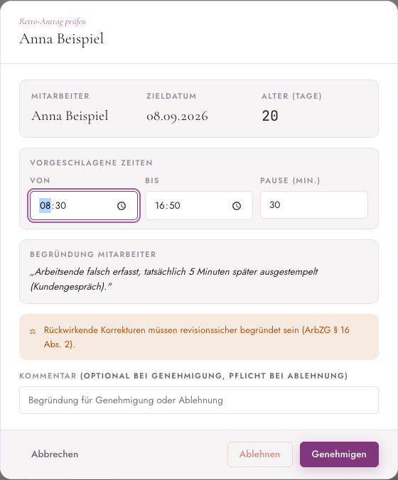

# Genehmigungen

Als Manager entscheiden Sie über Anträge Ihres Teams: Abwesenheitsanträge, Stornierungen genehmigter Abwesenheiten und nachträgliche Zeiterfassungs-Anträge (Zeitnachträge). Diese Seite zeigt, wo diese Anträge ankommen, wie Sie sie prüfen, und welche Vier-Augen-Regeln dabei gelten.

## Wo Genehmigungen ankommen

- **Inbox** – das zentrale Postfach für alle offenen Vorgänge: eine KPI-Zeile (Offen / Genehmigt / Abgelehnt / Retro-Anträge) und darunter zwei Listen, eine für Abwesenheitsanträge und eine für „Nachträgliche Zeiterfassungs-Anträge" (Zeitnachträge). Filterbar über die Tabs **Offen**, **Genehmigt**, **Abgelehnt**, **Alle**.
- **Team → Team-Anträge → Genehmigungen** – derselbe offene Bestand, aber im Team-Kontext: mit Kalender, Mitarbeiter-Filter und den § 9-BUrlG-Vorgängen (siehe unten). Der Tab zeigt die Anzahl offener Anträge als Badge.
- **Dashboard** – der Abschnitt „Offene Vorgänge" weist auf ausstehende Genehmigungen hin.
- **Benachrichtigungen** (Glocke oben rechts) – ein neuer Antrag löst eine Benachrichtigung aus, die direkt zum betroffenen Antrag springt.

<!-- SCREENSHOT file=images/genehmigungen-01-inbox-uebersicht.png role=manager url=/inbox show="Inbox-Seite mit KPI-Zeile (Offen/Genehmigt/Abgelehnt/Retro-Anträge) und der offenen Antragsliste, darin Anna Beispiels PENDING-Urlaubsantrag 19.–23.10.2026" -->

## Abwesenheitsanträge prüfen

### So geht's

1. Öffnen Sie **Inbox** oder **Team → Team-Anträge → Genehmigungen**.
2. Klicken Sie bei einem offenen Antrag auf **Prüfen**.
3. Im Dialog **Antrag prüfen** sehen Sie Mitarbeiter, Art, Zeitraum, Umfang, eine eventuelle Anmerkung des Mitarbeiters sowie die Liste **Kolleg:innen im gleichen Zeitraum** (bereits genehmigte Abwesenheiten anderer Mitarbeiter im selben Zeitraum – hilfreich, um Personalengpässe zu erkennen).
4. Bei Urlaubsanträgen erscheint ggf. ein Hinweis zu **§ 7 BUrlG**: Der Antrag muss zeitnah entschieden werden, da gewährter, nicht genommener Urlaub sonst zum 31.03. des Folgejahres verfällt.
5. Bei Krankmeldungen können Sie direkt im Dialog vermerken, ob ein **Attest** vorliegt (mit Gültigkeitszeitraum).
6. Optional eine **Anmerkung** eintragen (z. B. Ablehnungsgrund – ein Feld, kein Pflichtfeld).
7. **Genehmigen** oder **Ablehnen** klicken.

> Sind im gewählten Zeitraum Kundentermine gebucht, erscheint vor der Genehmigung die Warnung „Kundentermine im Zeitraum gebucht". Mit **Trotzdem fortfahren** genehmigen Sie den Antrag dennoch.

> Bei Mitarbeitenden mit Schichtplanung (`SHIFT_BASED`) kann ein Antrag mit dem Badge **Vorläufig** markiert sein – der verbrauchte Urlaubstage-Wert wurde geschätzt und wird automatisch angepasst, sobald der Schichtplan für den Zeitraum feststeht. Mehr dazu unter **[[Schichtplanung]]**.

<!-- SCREENSHOT file=images/genehmigungen-02-antrag-pruefen.png role=manager url=/team/leave show="Dialog „Antrag prüfen" für Anna Beispiels PENDING-Urlaubsantrag 19.–23.10.2026, mit sichtbarer Liste „Kolleg:innen im gleichen Zeitraum" und den Buttons Ablehnen/Genehmigen" -->

### Genehmigten Antrag nachträglich korrigieren

Über **Korrigieren** an einem bereits genehmigten Antrag können Sie Zeitraum, Art oder Halbtags-Angabe im Nachhinein anpassen. Eine **Begründung ist Pflichtfeld**. Liegt der betroffene Monat bereits im Monatsabschluss, wird die Korrektur mit einer Fehlermeldung abgelehnt. Bei Krankmeldungen lässt sich das Attest unabhängig davon jederzeit über **Attest erfassen/ändern** nachtragen – das wirkt sich nicht auf Zeiten oder Saldo aus und ist auch nach Monatsabschluss möglich.

## Stornierungsanträge

Ein genehmigter Antrag wird nie direkt storniert – das läuft in zwei Schritten:

1. **Stornierung beantragen**: Der Mitarbeiter selbst oder ein Manager stellt über den Button **Stornieren** an einem genehmigten Antrag eine Stornierung. Der Status wechselt zu **Stornierung beantragt**. Die Abwesenheit bleibt bis dahin aktiv – sie erscheint weiter im Kalender und blockiert weiterhin die reguläre Zeiterfassung.
2. **Stornierung prüfen**: Ein **anderer** Manager muss die Stornierung über **Stornierung prüfen** → **Stornierung genehmigen** oder **Stornierung ablehnen** freigeben.

> **Vier-Augen-Prinzip bei Stornierungen:** Weder die Person, die die Stornierung beantragt hat, noch der ursprüngliche Genehmiger des Urlaubs dürfen die Stornierung selbst freigeben. Clokr blockiert das unabhängig von Rolle oder Berechtigung: Die Schaltflächen im Dialog sind zwar aktiv, beim Speichern erscheint dann aber „Stornierung kann nicht vom ursprünglichen Genehmiger genehmigt werden" bzw. „Stornierung kann nicht vom Antragsteller genehmigt werden".

**Auswirkung auf Zeiteinträge:** Solange die Stornierung aussteht, dürfen für diesen Zeitraum Zeiteinträge angelegt werden – sie werden dabei automatisch als **ungültig** markiert und zählen nicht in Saldo oder Soll. Wird die Stornierung genehmigt, werden diese Einträge automatisch wieder gültig gesetzt. Wird sie abgelehnt, bleiben sie ungültig und müssen manuell bereinigt werden (siehe **[[Team-Zeiten]]**).

<!-- SCREENSHOT file=images/genehmigungen-03-stornierung-pruefen.png role=manager url=/inbox show="Dialog „Stornierungsantrag prüfen" mit den Buttons „Stornierung ablehnen" und „Stornierung genehmigen"" -->

### § 9 BUrlG – Krankheit während des Urlaubs

Überschneidet sich eine spätere Krankmeldung mit bereits genehmigtem Urlaub, legt Clokr einen eigenen § 9-Vorgang an, sichtbar unter **Team-Anträge → Genehmigungen**. Mit **AU liegt vor** bestätigen Sie die ärztliche Bescheinigung (eAU oder Papier-Upload) und die betroffenen Urlaubstage werden gutgeschrieben; mit **Ablehnen** weisen Sie den Vorgang zurück, mit **Wieder eröffnen** lässt er sich später erneut aufnehmen, falls die Bescheinigung nachgereicht wird. Details zur rechtlichen Einordnung: **[[Urlaubsverwaltung]]**.

## Zeitnachträge (rückwirkende Zeiterfassung) genehmigen

Mitarbeitende, die einen Tag außerhalb des normalen Bearbeitungsfensters nacherfassen wollen, stellen dafür einen **Zeitnachtrag**: Ein Zeiteintrag mit den vorgeschlagenen Zeiten wird sofort angelegt, aber als ungültig markiert, bis er entschieden ist.

### So geht's

1. Öffnen Sie **Inbox**, Abschnitt **Nachträgliche Zeiterfassungs-Anträge**.
2. Klicken Sie bei einem offenen Antrag auf **Prüfen**.
3. Sie sehen Mitarbeiter, Zieldatum, das Alter des Antrags in Tagen sowie die vorgeschlagenen Zeiten (**Von**, **Bis**, **Pause**) und die Begründung des Mitarbeiters.
4. Bei Bedarf können Sie die vorgeschlagenen Zeiten **vor der Genehmigung korrigieren** – die geänderten Werte werden dann statt der ursprünglichen übernommen und als Korrektur protokolliert.
5. Liegt der Antrag deutlich außerhalb des üblichen Fensters, zeigt ein Hinweis das Antragsalter im Vergleich zum erlaubten Fenster.
6. Ein **Kommentar** ist optional bei Genehmigung, **Pflicht bei Ablehnung** (revisionssicherheitspflichtig).
7. **Genehmigen** oder **Ablehnen** klicken.

Beim **Genehmigen** wird der zugehörige Zeiteintrag gültig (mit den ggf. korrigierten Zeiten). Beim **Ablehnen** wird der Eintrag entfernt.

> Betrifft der Antrag einen bereits **gesperrten Monat** (Monatsabschluss durchgeführt), lässt sich der Antrag nicht mehr entscheiden – Clokr zeigt „Eintrag ist gesperrt und kann nicht bearbeitet werden". Mehr zum Monatsabschluss: **[[Monatsabschluss]]**.

<!-- SCREENSHOT file=images/genehmigungen-04-zeitnachtrag-pruefen.png role=manager url=/inbox show="Dialog „Retro-Antrag prüfen" mit den editierbaren Feldern Von/Bis/Pause, der Begründung des Mitarbeiters und den Buttons Ablehnen/Genehmigen" -->

## Vier-Augen-Regel

Clokr erzwingt bei Anträgen konsequent das Vier-Augen-Prinzip:

- **Keine Selbstgenehmigung:** Ein Manager kann weder seinen eigenen Abwesenheitsantrag noch seinen eigenen Zeitnachtrag genehmigen oder ablehnen. Im Dialog erscheint stattdessen der Hinweis „Eigene Anträge können nicht selbst genehmigt werden" statt der Entscheidungs-Buttons.
- **Stornierung braucht eine zweite Person:** Weder der Antragsteller der Stornierung noch der ursprüngliche Genehmiger des Urlaubs dürfen die Stornierung selbst freigeben (siehe oben).
- **Zeiteintrags-Korrekturen sind davon ausgenommen:** Anders als bei Abwesenheits- und Zeitnachtrag-Genehmigungen gilt für die direkte Korrektur eines Zeiteintrags über **[[Team-Zeiten]]** kein Vier-Augen-Zwang – ein Manager darf dort auch seinen eigenen Zeiteintrag bearbeiten. Eine Begründung ist nur Pflicht, wenn Sie den Eintrag einer anderen Person korrigieren.

## Wer wen genehmigen darf

Ihre Genehmigungsrechte gelten nur für Mitarbeitende in Ihrem zugewiesenen Bereich – üblicherweise die Mitarbeitenden, deren **Stammsalon** zum Zeitpunkt des Antrags (Antragsbeginn bzw. Zieldatum des Zeitnachtrags) in Ihrem Zuständigkeitsbereich liegt. Anträge außerhalb Ihres Bereichs werden Ihnen entweder gar nicht angezeigt, oder Clokr meldet „Antrag nicht gefunden", wenn Sie versuchen, direkt darauf zuzugreifen. Wie Zuständigkeiten (Rollen, Salons, Mitarbeiterlisten) vergeben werden, steht unter **[[Rollen-und-Rechte]]**.

## Siehe auch

- **[[Team-Zeiten]]** – Zeiten Ihres Teams einsehen, korrigieren und nacherfassen
- **[[Abwesenheiten]]** – wie Mitarbeitende Anträge stellen
- **[[Urlaubsverwaltung]]** – Urlaubsansprüche, Übertrag, § 7 und § 9 BUrlG im Detail
- **[[Monatsabschluss]]** – gesperrte Monate und ihre Auswirkung auf Korrekturen
- **[[Rollen-und-Rechte]]** – wie Ihr Zuständigkeitsbereich festgelegt wird
