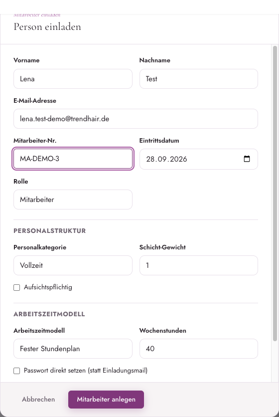
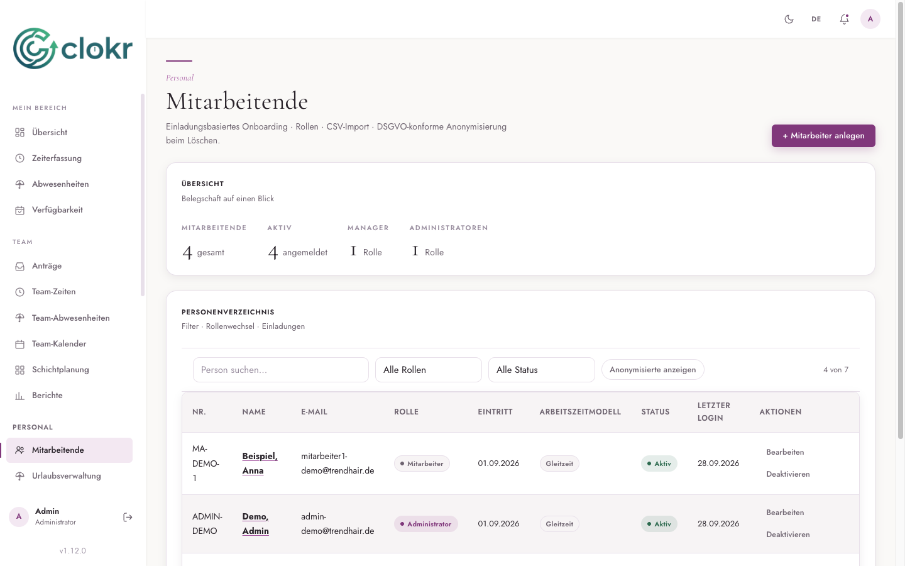

# Mitarbeiter verwalten

Diese Seite richtet sich an Administratorinnen und Administratoren: Mitarbeiter anlegen, Stammdaten und Personalstruktur pflegen, NFC-Karten zuordnen, Konten deaktivieren sowie – DSGVO-konform – anonymisieren und endgültig löschen. Die Seite finden Sie in der Seitenleiste unter **Mitarbeitende** (`/admin/employees`).

## Mitarbeiter anlegen

**So geht's:**

1. Auf der Seite **Mitarbeitende** oben auf **+ Mitarbeiter anlegen** klicken – es öffnet sich das Formular **„Person einladen"**
2. **Vorname**, **Nachname** und **E-Mail-Adresse** eintragen
3. **Mitarbeiter-Nr.** und **Eintrittsdatum** angeben
4. **Rolle** wählen: **Mitarbeiter**, **Manager** oder **Administrator**. Details zu den Rollen: **[[Rollen & Rechte|Rollen-und-Rechte]]**
5. Im Abschnitt **Personalstruktur** die **Personalkategorie** wählen (Vollzeit, Teilzeit, Minijob, Auszubildende:r, Aushilfe, Werkstudent:in, Praktikant:in) – **Schicht-Gewicht** und **Aufsichtspflichtig** werden dabei mit sinnvollen Standardwerten vorbelegt und lassen sich bei Bedarf manuell überschreiben (mit **Auf Standard zurück** wieder zurücksetzen)
6. Optional ein **Geburtsdatum** eintragen – bei der Personalkategorie Auszubildende:r wird damit zusätzlich geprüft, ob der im nächsten Schritt eingetragene Urlaubswert den gesetzlichen Mindesturlaub nach § 19 JArbSchG erreicht (siehe **[[Urlaubsverwaltung]]**). Bleibt das Geburtsdatum bei einer/einem Auszubildenden leer, erscheint der Hinweis **„Geburtsdatum fehlt – Mindesturlaub nach JArbSchG kann nicht geprüft werden"**; das Anlegen wird dadurch nicht blockiert.
7. Im Feld **Urlaubstage pro Jahr (5-Tage-Woche)** ist bereits ein Wert vorbelegt: bei der Personalkategorie Auszubildende:r der Mandantenwert „Urlaubstage Azubis", sonst der Mandantenwert „Jahresurlaub" (beide auf dem Reiter **Standards** von Urlaubsverwaltung gepflegt, siehe **[[Urlaubsverwaltung]]**). Ist bereits ein Geburtsdatum eingetragen, hebt sich der Vorschlag automatisch auf den gesetzlichen Mindesturlaub an, falls dieser höher liegt. Der Wert lässt sich jederzeit manuell überschreiben; bleibt das Feld leer, gilt dauerhaft der jeweils aktuelle Mandanten-Standard. Ein eingetragener Wert unterhalb des gesetzlichen Mindesturlaubs wird beim Speichern abgelehnt.
8. Im Abschnitt **Arbeitszeitmodell** das passende Modell wählen und die zugehörigen Werte (Wochenstunden, Stunden/Monat oder Kernarbeitszeit) eintragen. Details zu allen vier Modellen: **[[Arbeitszeitmodelle]]**
9. Zugangsart festlegen:
   - Standard: Die Person erhält eine **Einladungsmail** mit Aktivierungslink und vergibt ihr Passwort selbst
   - Alternativ die Checkbox **Passwort direkt setzen (statt Einladungsmail)** aktivieren und ein Passwort (mindestens 8 Zeichen) eintragen – die Person kann sich dann sofort anmelden, ohne Einladungslink
10. Auf **Mitarbeiter anlegen** klicken

> Ein neuer Mitarbeiter erhält automatisch ein Arbeitszeitmodell gültig ab dem Eintrittsdatum; ein Vertragswechsel später ist nur zum 1. eines Monats möglich (siehe **[[Arbeitszeitmodelle]]**). Solange es nur einen aktiven Salon im Mandanten gibt, wird dieser dem neuen Mitarbeiter automatisch als Stammsalon zugeordnet – das Anlage-Formular zeigt dafür kein eigenes Feld. Gibt es **mehrere** aktive Salons, lehnt Clokr das Anlegen mit der Meldung „Bei mehreren aktiven Salons ist die Angabe des Stammsalons erforderlich.“ ab; da das Formular dafür (noch) kein Auswahlfeld bietet, wenden Sie sich in diesem Fall an den Support (siehe **[[Salons und Feiertage|Salons-und-Feiertage]]**).

<!-- SCREENSHOT file=images/mitarbeiter-verwalten-01-anlegen.png role=admin url=/admin/employees show="Modal 'Person einladen' mit ausgefülltem Formular (Vorname, Nachname, E-Mail, Mitarbeiter-Nr., Eintrittsdatum, Rolle Mitarbeiter, Personalkategorie Vollzeit, Arbeitszeitmodell Fester Stundenplan mit Wochenstunden) und sichtbarem Button 'Mitarbeiter anlegen'" -->

## Mitarbeiter bearbeiten

Klicken Sie in der Liste auf eine Person, um zur Detailansicht zu gelangen. Die Ansicht ist in Reiter gegliedert:

- **Stammdaten** – Vorname, Nachname, Mitarbeiter-Nr., Personalstruktur, Geburtsdatum, Austrittsdatum, NFC-Karten-ID (siehe unten)
- **Arbeitszeit** – Arbeitszeitmodell, Wochenstunden/Arbeitstage, Pausendauer-Override, Vertragswechsel (siehe **[[Arbeitszeitmodelle]]**)
- **Urlaub** – Urlaubskonto der Person (siehe **[[Urlaubsverwaltung]]**)
- **Berechtigungen** – Rolle, E-Mail, Kontostatus (letzter Login steht in der Mitarbeiterliste, nicht auf diesem Reiter)
- **Danger Zone** – Anonymisieren und endgültig löschen

Auf dem Reiter **Stammdaten** finden Sie zusätzlich:

- **Geburtsdatum (optional)** – bei Auszubildenden unter 18 Jahren werden daraus automatisch die JArbSchG-§9-Pausenempfehlungen (30 / 60 Min.) vorgeschlagen; bei fehlendem Geburtsdatum einer/eines Auszubildenden erscheint hier ebenfalls der Hinweis **„Geburtsdatum fehlt – Mindesturlaub nach JArbSchG kann nicht geprüft werden"**
- **Urlaubstage pro Jahr (5-Tage-Woche)** – der persönliche Urlaubs-Basiswert; ist das Feld leer, zeigt ein Platzhalter **„Mandanten-Standard (N)"** den aktuell geltenden Wert an. Ein eingetragener Wert unterhalb des gesetzlichen Mindesturlaubs wird beim Speichern abgelehnt, es sei denn, der Wert bleibt unverändert (so lassen sich ältere Datensätze weiterhin bearbeiten). Eine Änderung wirkt sich nur auf künftige, noch nicht angelegte Urlaubsjahre aus – ein bereits für das laufende Jahr berechneter Anspruch wird dadurch nicht rückwirkend verändert (eine Korrektur des laufenden Jahres erfolgt über den Reiter **Urlaub**, siehe **[[Urlaubsverwaltung]]**)
- **Austrittsdatum (optional)** – ist es gesetzt, wird der Jahresurlaub anteilig nach § 5 Abs. 2 BUrlG berechnet
- Für Administratoren zusätzlich der Schalter **Keine Zeiterfassungs-Pflicht (§ 18 ArbZG)** für Inhaber, Geschäftsführung und leitende Angestellte – der Urlaubsanspruch nach BUrlG bleibt davon unberührt

In der Mitarbeiterliste wird eine/ein Auszubildende:r ohne hinterlegtes Geburtsdatum zusätzlich mit einem Hinweis-Chip gekennzeichnet, damit sie beim Abgleich mit dem gesetzlichen Mindesturlaub nicht übersehen wird.

Änderungen speichern Sie pro Abschnitt über den jeweiligen **Speichern**-Button.

## NFC-Karte zuordnen

Im Feld **NFC-Karten-ID** auf dem Reiter Stammdaten tragen Sie die Kartenkennung ein. Das Feld ist optional und ermöglicht der Person das Stempeln per NFC-Karte an einem Terminal. Die Terminals selbst werden zentral unter **Allgemein → Integration** verwaltet (siehe **[[Systemeinstellungen]]**).

## Deaktivieren und reaktivieren

Über das Aktionsmenü einer Person in der Liste können Sie das Konto **deaktivieren**. Eine deaktivierte Person kann sich danach nicht mehr anmelden – ihre Zeitdaten bleiben vollständig erhalten. Über dieselbe Aktion lässt sich das Konto anschließend wieder **reaktivieren**.

<!-- SCREENSHOT file=images/mitarbeiter-verwalten-02-liste.png role=admin url=/admin/employees show="Mitarbeiterliste mit Such-/Rollenfilter, KPI-Kacheln (Manager, Administratoren) und mehreren Zeilen inkl. Rollen-Chips (Mitarbeiter/Manager/Administrator) und Status" -->

## Löschen = DSGVO-Anonymisierung

Clokr löscht Mitarbeiterdaten nicht einfach hart, sondern **anonymisiert** sie nach Art. 17 DSGVO. Den entsprechenden Bereich finden Sie auf dem Reiter **Danger Zone** in der Detailansicht.

**So geht's:**

1. Auf **Anonymisieren** klicken
2. Im Bestätigungsdialog **„Mitarbeiter anonymisieren?"** die Aktion mit **Anonymisieren** bestätigen

**Was dabei passiert:**

- Name wird durch „Gelöscht" / „GELÖSCHT-XXX" ersetzt, die E-Mail-Adresse anonymisiert, das Konto deaktiviert
- Notizen in Zeiteinträgen, Urlaubsanträgen und Abwesenheiten werden entfernt
- Einladungen und Zugangs-Token werden endgültig gelöscht
- **Zeiterfassungen, Urlaubsanträge und Salden bleiben erhalten** – sie unterliegen der gesetzlichen Aufbewahrungspflicht (10 Jahre nach § 147 AO)

> Eine anonymisierte Person kann sich nicht mehr anmelden. Die Anonymisierung ist im Audit-Log nachvollziehbar (siehe **[[Systemeinstellungen]]**).

### Endgültig löschen

Erst nach Anonymisierung und nach Ablauf der gesetzlichen Aufbewahrungsfrist lässt sich ein Datensatz über **Endgültig löschen** vollständig entfernen. Die gesetzliche Mindestfrist von 2 Jahren (§ 16 ArbZG) lässt sich dabei nie unterschreiten.

Solange die Frist noch läuft, zeigt der Bereich das Ablaufdatum an und verlangt zusätzlich eine ausdrückliche Bestätigung per Checkbox, dass die Frist bekannt ist und der Datensatz trotzdem entfernt werden soll (z. B. bei Testdaten). Eine solche vorzeitige Löschung verlangt serverseitig zusätzlich die Freigabe durch eine **zweite**, andere Administratorin oder einen zweiten Administrator innerhalb von 15 Minuten (Vier-Augen-Prinzip) – ein einzelnes Konto kann sie nicht allein auslösen. Für diese zweite Freigabe gibt es in dieser Version noch keine eigene Bedienoberfläche; ein Versuch, den Datensatz allein vorzeitig endgültig zu löschen, schlägt entsprechend mit einer Fehlermeldung zum Vier-Augen-Prinzip fehl. In der Praxis lassen sich Datensätze aktuell also zuverlässig erst **nach Ablauf der Aufbewahrungsfrist** endgültig löschen.

## Siehe auch

- **[[Arbeitszeitmodelle]]** – Arbeitszeitmodell, Wochenstunden und Vertragswechsel im Detail
- **[[Urlaubsverwaltung]]** – Urlaubskonto und Urlaubsanspruch pro Mitarbeiter
- **[[Rollen & Rechte|Rollen-und-Rechte]]** – was Mitarbeiter, Manager und Administrator jeweils dürfen
- **[[Compliance & Revisionssicherheit|Compliance-und-Revisionssicherheit]]** – Aufbewahrungsfristen und Audit-Log
