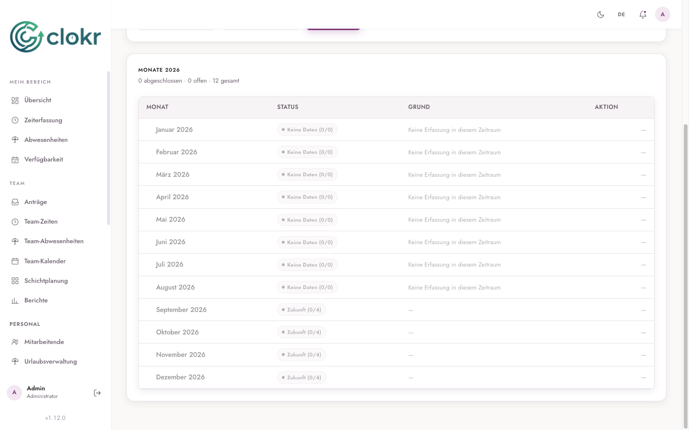

# Monatsabschluss

Der Monatsabschluss sperrt die Zeiterfassung eines Monats revisionssicher: Danach lassen sich Einträge nicht mehr direkt ändern, sondern nur noch durch neue Korrektur- bzw. Storno-Buchungen anpassen. Zuständig ist die Seite **Monatsabschluss** unter Compliance in der Seitenleiste (`/admin/month-close`).

Der Abschluss läuft **pro Mitarbeiter und Monat** und folgt vier Schritten: **Prüfen → Korrigieren → Bestätigen → Sperren**.

## Voraussetzungen prüfen

**So geht's:**

1. Auf der Seite **Monatsabschluss** das gewünschte **Jahr** und optional einen **Filter** wählen, dann **Aktualisieren** klicken
2. Einen Monat aufklappen, um die Mitarbeiter-Zeilen zu sehen

Jede Person erhält einen Status:

- **Bereit** – alle Voraussetzungen erfüllt, der Monat kann abgeschlossen werden
- **Fehlend** – es fehlen noch Tageseinträge; die fehlenden Daten werden aufgelistet
- **Abgeschlossen** – der Monat ist für diese Person bereits gesperrt

Zusätzlich zeigt ein Hinweis **„Attest fehlt (N)"**, wenn Krankheitstage ohne Attest über die Karenzzeit nach § 5 EFZG hinausgehen. Ist ein Monatsabschluss für eine oder mehrere Personen überfällig, erscheint oben auf der Seite ein Warnhinweis **„Monatsabschluss überfällig"** mit der Liste der betroffenen Mitarbeiter und dem ältesten offenen Monat.

<!-- SCREENSHOT file=images/monatsabschluss-01-uebersicht.png role=admin url=/admin/month-close show="Monatsliste mit Status-Chips je Monat (z. B. 'Keine Daten' für Monate ohne Zeiterfassung, 'Zukunft' für den laufenden/kommende Monate); im Demo-Mandanten ist aktuell kein Monat abschließbar und lässt sich daher nicht aufklappen, da September noch nicht beendet ist und für frühere Monate keine Erfassungsdaten vorliegen" -->

## Abschließen

Ist eine Person **Bereit** oder **Fehlend**, klicken Sie in ihrer Zeile auf **Abschließen**. Es öffnet sich der Dialog **„Endgültiger Monatsabschluss"**:

- Ein Warnhinweis macht deutlich: „Diese Aktion ist nicht rückgängig." Alle Zeiteinträge des Monats werden gesperrt; Korrekturen sind danach nur noch über Storno-Buchungen möglich.
- Gibt es Tage ohne Eintrag, zeigt ein zusätzlicher Warnhinweis, dass diese Tage als 0 Stunden gewertet werden (volles Soll, kein Abzug – der Saldo wird entsprechend negativ) und listet die betroffenen Tage auf. Sie müssen die Checkbox **„Ich habe die … fehlende(n) Tag(e) zur Kenntnis genommen"** aktivieren, bevor Sie fortfahren können.
- Mit **Endgültig sperren** wird der Monat für diese Person geschlossen.

## Gesperrte Monate

Ist ein Monat für eine Person abgeschlossen, sind ihre Zeiteinträge unveränderlich – auch für Administratoren. Korrekturen an einem gesperrten Monat erfolgen ausschließlich über neue, referenzierende Korrekturbuchungen, niemals durch nachträgliches Überschreiben. Details zur Revisionssicherheit: **[[Compliance & Revisionssicherheit|Compliance-und-Revisionssicherheit]]**.

## Monat entsperren

Ein bereits abgeschlossener Monat lässt sich über die Schaltfläche **Entsperren** in der jeweiligen Mitarbeiterzeile wieder öffnen.

**So geht's:**

1. Auf **Entsperren** klicken – Dialog **„Monat entsperren"** öffnet sich
2. Pflichtfeld **Grund für die Entsperrung** ausfüllen (der Grund wird dauerhaft gespeichert)
3. Mit **Entsperren bestätigen** abschließen

Die Entsperrung hebt den Monatsabschluss auf und wird zusammen mit dem angegebenen Grund im Audit-Log festgehalten.

## Automatischer Abschluss

Ist ein automatischer Monatsabschluss für Ihren Mandanten konfiguriert, zeigt die Seite oben einen Hinweis mit den Details dazu an.

## Siehe auch

- **[[Arbeitszeitmodelle]]** – wie sich das Soll je Modell zusammensetzt
- **[[Compliance & Revisionssicherheit|Compliance-und-Revisionssicherheit]]** – Audit-Log, Korrekturbuchungen und Aufbewahrungsfristen
- **[[Zeiterfassung]]** – wie Mitarbeitende Zeiteinträge erfassen und selbst korrigieren
