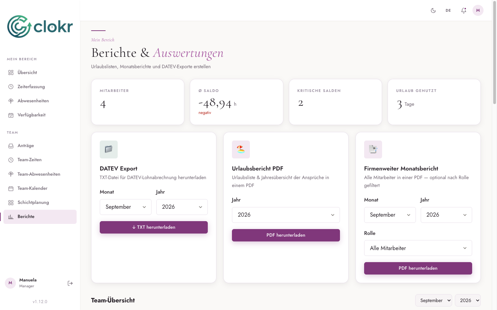
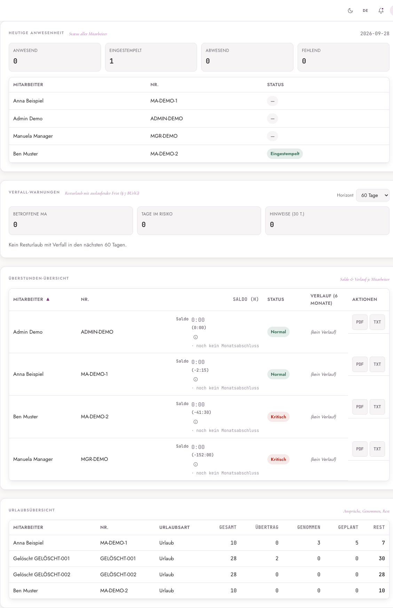
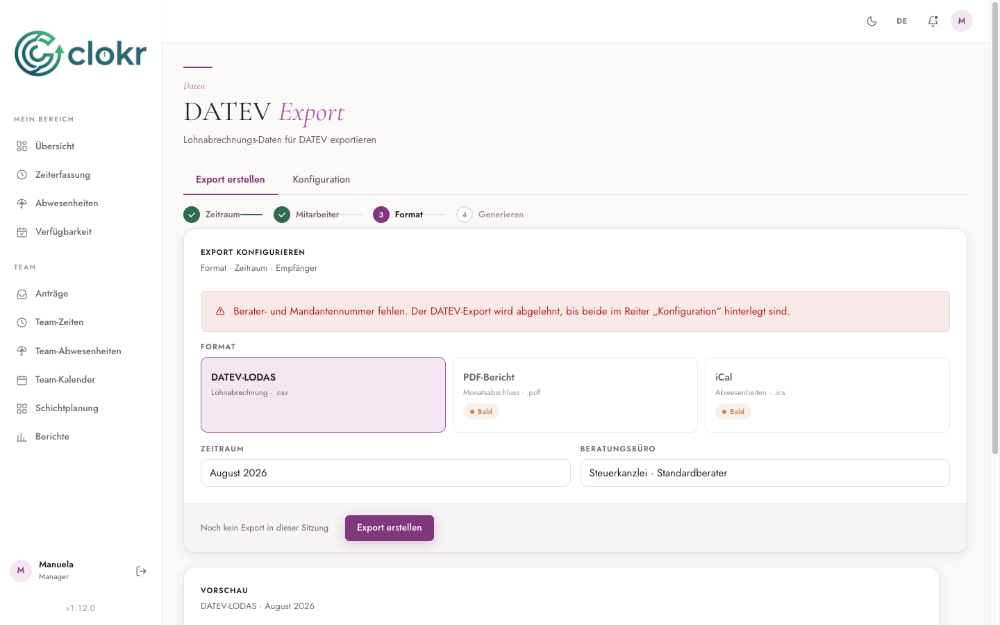

# Reports und Exporte

Unter **Berichte** finden Sie als Manager alle Auswertungen für Ihr Team: Monatsberichte, Urlaubsübersichten, Überstunden-Auswertungen und den DATEV-Export für die Lohnabrechnung. Alle Zahlen sind automatisch auf die Mitarbeitenden begrenzt, für die Sie zuständig sind (Ihr Stammsalon bzw. Ihr zugewiesener Bereich) – Sie sehen hier nie mehr Personen als in **[[Team-Zeiten]]** oder **[[Genehmigungen]]**.

## So geht's: einen Bericht erstellen

1. Öffnen Sie **Berichte**.
2. Wählen Sie die passende Kachel unter „Berichte & Auswertungen" (siehe Übersicht unten).
3. Stellen Sie die Filter ein (Monat/Jahr, ggf. Rolle).
4. Klicken Sie auf **PDF herunterladen** bzw. **↓ TXT herunterladen**. Die Datei wird sofort erzeugt und heruntergeladen – es gibt keine Warteschlange und keine Benachrichtigung, die Datei steht direkt zur Verfügung.

## Verfügbare Berichte

| Kachel | Inhalt | Filter | Export |
| --- | --- | --- | --- |
| **DATEV Export** | Lohnabrechnungsdaten für DATEV | Monat, Jahr | **↓ TXT herunterladen** (TXT/DATEV-LODAS) |
| **Urlaubsbericht PDF** | Urlaubsliste + Jahresübersicht der Urlaubsansprüche, kombiniert in einem PDF | Jahr | **PDF herunterladen** |
| **Firmenweiter Monatsbericht** | Alle Mitarbeiter in einem PDF, optional gefiltert | Monat, Jahr, Rolle (**Alle Mitarbeiter** / **Nur Mitarbeiter** / **Nur Manager**) | **PDF herunterladen** |

Beim Firmenweiten Monatsbericht kann ein Hinweis zu § 9 BUrlG (Anrechnung von Krankheit während des Urlaubs) eingeblendet werden, wenn er für den gewählten Monat zutrifft.

<!-- SCREENSHOT file=images/reports-und-exporte-01-berichte-uebersicht.png role=manager url=/reports show="Berichte-Seite oben mit den drei Kacheln DATEV Export, Urlaubsbericht PDF und Firmenweiter Monatsbericht" -->

## Team-Übersicht

Unterhalb der Berichts-Kacheln zeigt der Abschnitt **Team-Übersicht** (eigener Monats-/Jahres-Wähler) vier Widgets für Ihr Team:

### Heutige Anwesenheit

Statustabelle mit Zahlen zu **Anwesend**, **Eingestempelt**, **Abwesend**, **Fehlend** und **Feiertag** sowie einer Liste je Mitarbeiter. Kein Export – reine Live-Ansicht.

### Verfall-Warnungen (§ 7 BUrlG)

Zeigt Mitarbeitende, deren Resturlaub innerhalb eines wählbaren Zeithorizonts (**30**, **60**, **90** oder **180 Tage**) verfällt. Über den Button **Hinweis jetzt senden** in der jeweiligen Zeile verschicken Sie eine Erinnerungs-E-Mail an die betroffene Person – kein Download, sondern ein direkter Versand.

### Überstunden-Übersicht

Sortierbare Tabelle (Mitarbeiter, Saldo) mit 6-Monats-Sparkline. Pro Zeile stehen zwei Export-Buttons zur Verfügung:

- **PDF** – Stundennachweis dieses einen Mitarbeiters als PDF
- **TXT** – DATEV-LODAS-Datei nur für diesen einen Mitarbeiter

### Urlaubsübersicht

Tabelle mit Mitarbeiter, Urlaubsart, Gesamtanspruch, Übertrag, genommenen, geplanten und verbleibenden Tagen. Kein eigener Export-Button auf diesem Widget – nutzen Sie dafür die Kachel **Urlaubsbericht PDF** oben.

<!-- SCREENSHOT file=images/reports-und-exporte-02-team-uebersicht.png role=manager url=/reports show="Abschnitt Team-Übersicht mit den vier Widgets Heutige Anwesenheit, Verfall-Warnungen, Überstunden-Übersicht und Urlaubsübersicht, sichtbar für Anna Beispiel und Ben Muster" -->

## DATEV-Export im Detail (Admin → Export)

Unter **Admin → Export** finden Sie den DATEV-Export als eigenständigen Arbeitsbereich mit zwei Tabs. Diese Seite ist trotz des Pfads `/admin/export` **nicht** Admin-exklusiv – Manager mit Berichts-Berechtigung sehen und nutzen sie ebenso.

**Export erstellen**

1. Format wählen – aktuell ist nur **DATEV-LODAS** (.csv) verfügbar; **PDF-Bericht** und **iCal** sind als „Bald" markiert und noch nicht nutzbar.
2. Zeitraum wählen (die letzten 12 abgeschlossenen Monate, der laufende Monat steht nicht zur Auswahl).
3. Optional ein Beratungsbüro-Label eintragen (nur Anzeige, wird nicht gespeichert).
4. Eine Live-Vorschau zeigt das CSV-Format vorab.
5. **Export erstellen** klicken – der Download startet sofort.

**Konfiguration**

Hier hinterlegen Sie die für den Export nötigen Nummern: **Berater-Nr.**, **Mandanten-Nr.** (beide Pflichtfelder – ohne sie lehnt der Export mit einer Fehlermeldung ab) sowie die Lohnart-Nummern für **Normalstunden**, **Urlaub**, **Krank** und **Sonderurlaub**. Mit **Speichern** übernehmen.

<!-- SCREENSHOT file=images/reports-und-exporte-03-datev-export.png role=manager url=/admin/export show="Tab „Export erstellen" mit den drei Format-Kacheln (DATEV-LODAS aktiv, PDF-Bericht und iCal mit Chip „Bald") und der CSV-Vorschau" -->

## Hinweise

- Alle Downloads werden serverseitig sofort erzeugt (PDF via PDFKit, DATEV-Datei als CP1252-Text) und direkt als Datei ausgeliefert – es gibt keinen asynchronen Bericht-Job und keine Wartezeit.
- Als Mitarbeitende:r sehen Sie stattdessen nur Ihre eigenen abgeschlossenen Monate unter **Monatsabschlüsse** mit einem **PDF**-Button je Monat.
- Ein Kalender-Export für Team-Abwesenheiten (.ics) existiert bereits an anderer Stelle – siehe **[[Genehmigungen]]** bzw. die Kalenderansicht unter Team-Anträge; der iCal-Export auf dieser Seite ist noch nicht freigeschaltet.

## Siehe auch

- **[[Genehmigungen]]** – Abwesenheits- und Zeitnachtrags-Anträge entscheiden
- **[[Team-Zeiten]]** – tägliche Zeiten Ihres Teams einsehen und korrigieren
- **[[Monatsabschluss]]** – wie ein Monat abgeschlossen wird, bevor er im Bericht als „Gesperrt" erscheint
- **[[Urlaubsverwaltung]]** – Urlaubsansprüche, Übertrag und § 7 BUrlG im Detail
