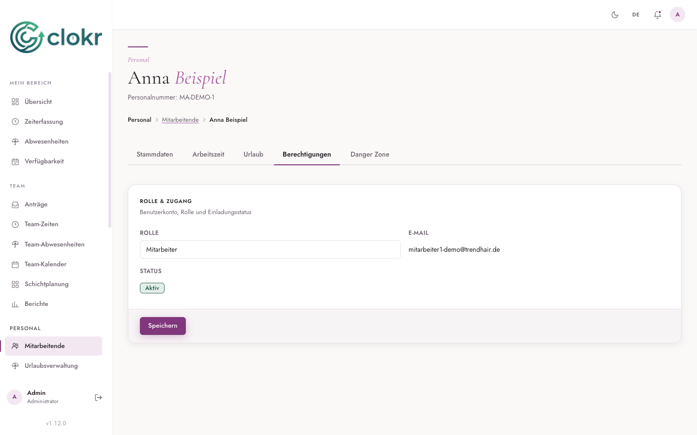

# Rollen & Rechte

Diese Seite erklärt, welche Rollen es in Clokr gibt, was sie jeweils dürfen, und wie Sie die Rolle einer Person ändern.

## Die drei Rollen

Jede Person in Clokr hat genau eine der folgenden Rollen:

| Rolle | Kurzbeschreibung |
| --- | --- |
| **Administrator** | Voller Zugriff: Mitarbeiterverwaltung, Systemeinstellungen, Urlaubsverwaltung, Audit-Log, CSV-Import, Monatsabschluss |
| **Manager** | Anträge (Urlaub, Zeitnachträge) genehmigen, Team-Ansichten, Berichte, Schichtplanung |
| **Mitarbeiter** | Eigene Zeiterfassung, eigene Abwesenheiten, eigener Überstunden-Saldo |

Die Rolle einer Person legen Sie beim Anlegen fest oder ändern sie nachträglich auf dem Reiter **Berechtigungen** in der Mitarbeiter-Detailansicht (Feld **Rolle**: Mitarbeiter / Manager / Administrator). Details zum Formular: **[[Mitarbeiter verwalten|Mitarbeiter-verwalten]]**.

<!-- SCREENSHOT file=images/rollen-und-rechte-01-rolle.png role=admin url=/admin/employees show="Reiter 'Berechtigungen' in der Mitarbeiter-Detailansicht mit dem Auswahlfeld 'Rolle' (Optionen Mitarbeiter/Manager/Administrator) sowie den schreibgeschützten Feldern E-Mail und Status" -->

## Was hinter der Rolle steckt

Im Hintergrund basiert der Zugriff nicht auf der Rolle als Etikett, sondern auf einem feingranularen Berechtigungssystem: Jede Zugriffsentscheidung prüft eine konkrete Berechtigung aus Ressource (z. B. Zeiteinträge, Urlaubsanträge, Mandanteneinstellungen), Aktion (lesen, anlegen, genehmigen, …) und Reichweite – entweder **eigene Daten** oder **zugewiesene Daten** (Mandant, bestimmte Salons oder eine feste Personenliste). Die drei Rollen Administrator, Manager und Mitarbeiter sind vordefinierte Bündel solcher Berechtigungen.

Über dieses System existieren zusätzlich weitere, vordefinierte Rollen-Vorlagen für speziellere Zuständigkeiten (z. B. für Salon-Leitung oder Personalabteilung) sowie die Möglichkeit, eigene Rollen mit einer frei wählbaren Zusammenstellung von Berechtigungen zu erstellen. **Zum jetzigen Stand steht dafür noch keine eigene Verwaltungsoberfläche in der Anwendung zur Verfügung** – über die Weboberfläche lässt sich pro Person nur zwischen den drei Standardrollen Administrator, Manager und Mitarbeiter wählen. Benötigen Sie eine feinere Zuweisung (z. B. Zugriff nur auf bestimmte Salons oder eine Rolle mit einer individuellen Rechte-Kombination), wenden Sie sich an Ihre IT bzw. an den Clokr-Support.

## Vier-Augen-Prinzip

Zwei sicherheitsrelevante Aktionen sind in Clokr bewusst nicht durch eine einzelne Person allein möglich:

- **Endgültiges Löschen eines Mitarbeiters** innerhalb der laufenden Aufbewahrungsfrist verlangt immer die Freigabe durch eine zweite, andere Administratorin oder einen zweiten Administrator (siehe **[[Mitarbeiter verwalten|Mitarbeiter-verwalten]]**).
- Eine Rolle, die zugleich erlaubt, **eigene Zeiten zu ändern** und **Zeitnachträge anderer zu genehmigen**, verlangt beim Speichern eine ausdrückliche Bestätigung – sonst könnte dieselbe Rolle Zeiten sowohl erfassen als auch selbst freigeben.

## Aussperrschutz

Clokr verhindert, dass ein Mandant versehentlich ganz ohne Administrator-Zugriff zurückbleibt: Eine Änderung, die die letzte Person mit Rollen- bzw. Rollenzuweisungs-Rechten entfernen würde, wird abgelehnt.

## Siehe auch

- **[[Mitarbeiter verwalten|Mitarbeiter-verwalten]]** – Rolle einer Person setzen, Anonymisierung und endgültiges Löschen
- **[[Genehmigungen]]** – was Manager im Freigabe-Workflow tun können
- **[[Systemeinstellungen]]** – Audit-Log, in dem Rollenänderungen protokolliert werden
