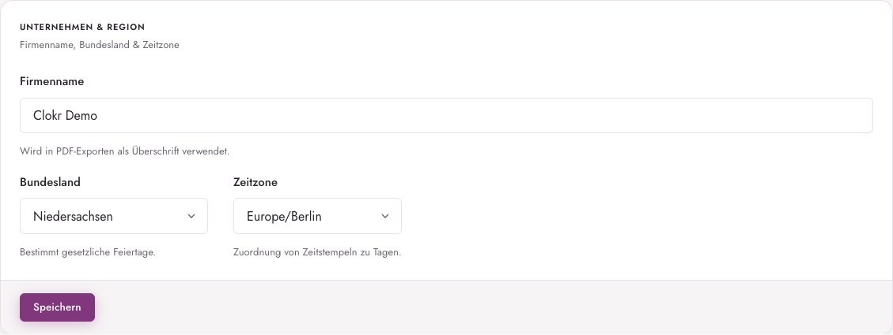
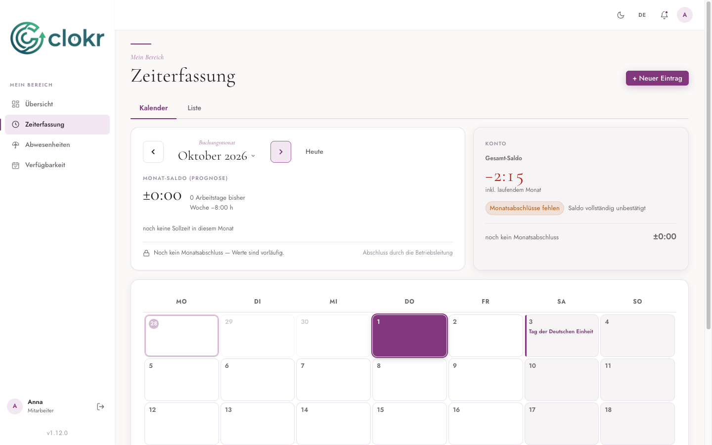

# Salons & Feiertage

Clokr berechnet gesetzliche Feiertage automatisch – Sie müssen sie nicht einzeln eintragen. Maßgeblich ist das **Bundesland des Salons**, in dem an diesem Tag gearbeitet wird (Arbeitsort nach § 2 EFZG). Diese Seite erklärt, woher dieses Bundesland kommt und was Sie in der Weboberfläche dazu einstellen können.

## Bundesland und gesetzliche Feiertage

Jeder Salon hat ein eigenes Bundesland. Für einen Tag gilt der Feiertagskalender

1. des Salons, dem der Zeiteintrag dieses Tages zugeordnet ist,
2. sonst des Salons, dem die Person an diesem Tag zugeordnet ist,
3. sonst des Standard-Salons Ihres Betriebs.

Gesetzliche Feiertage erscheinen automatisch in den Kalendern von Zeiterfassung, Team-Zeiten und Abwesenheiten und verringern das Soll.

### Das Feld „Bundesland" unter Allgemein

Unter **Allgemein** (`/admin/system`) im Abschnitt **Unternehmen & Region** gibt es ein Feld **Bundesland**. Wichtig: Dieses Feld ist nur der **Vorgabewert für neu angelegte Salons**. Es ändert **nicht** das Bundesland eines bestehenden Salons und damit auch nicht die Feiertage, die Clokr heute berechnet – auch wenn der Hinweistext neben dem Feld „Bestimmt gesetzliche Feiertage." lautet.

Das Bundesland eines bestehenden Salons lässt sich nur ändern, solange noch keine Zeiteinträge und keine Mitarbeiter-Zuordnungen auf diesen Salon verweisen. Ein Umzug in ein anderes Bundesland ist fachlich ein neuer Salon.

> **Hinweis:** Eine Oberfläche zum Verwalten von Salons (anlegen, deaktivieren, Bundesland ändern) gibt es in der aktuellen Version noch nicht. Stimmt das Bundesland Ihres Salons nicht, wenden Sie sich an Ihre IT bzw. den Clokr-Support.

<!-- SCREENSHOT file=images/salons-und-feiertage-01-bundesland.png role=admin url=/admin/system show="Abschnitt 'Unternehmen & Region' auf der Seite Allgemein mit dem Feld Bundesland (Vorgabe für neue Salons)" -->

<!-- SCREENSHOT file=images/salons-und-feiertage-02-kalender.png role=mitarbeiter url=/time-entries show="Zeiterfassungs-Kalender mit einem als Feiertag markierten Tag (farblich hervorgehobene Zelle mit Feiertagsnamen, z. B. Tag der Deutschen Einheit)" -->

## Heiligabend und Silvester

Ob der 24.12. und der 31.12. als normaler Arbeitstag, halber freier Tag oder ganzer freier Tag gelten, konfigurieren Sie nicht hier, sondern unter **Urlaubsverwaltung → Anträge & Krankheit** – Details dazu: **[[Urlaubsverwaltung]]**.

## Salons

Clokr kann mehrere Salons (Filialen) eines Betriebs abbilden. Jeder Betrieb hat mindestens einen aktiven Standard-Salon. Jeder Zeiteintrag gehört zu genau einem Salon. In der Weboberfläche ordnet Clokr ihn automatisch zu – aus der Salon-Zuordnung der Person an diesem Tag, sonst dem Standard-Salon.

Eigene, zusätzliche Feiertage (z. B. ein örtlicher Feiertag) werden je Salon hinterlegt.

> **Hinweis:** Salons, Salon-Zuordnungen von Mitarbeitenden und eigene Feiertage lassen sich in der aktuellen Version nur über die Programmierschnittstelle (API) verwalten, nicht in der Weboberfläche. Wenden Sie sich dafür an Ihre IT bzw. den Clokr-Support.

## Siehe auch

- **[[Urlaubsverwaltung]]** – Heiligabend-/Silvester-Regel konfigurieren
- **[[Systemeinstellungen]]** – weitere Firmen- und Compliance-Einstellungen unter Allgemein
- **[[Mitarbeiter verwalten|Mitarbeiter-verwalten]]** – Stammsalon bei mehreren aktiven Salons
- **[[Compliance & Revisionssicherheit|Compliance-und-Revisionssicherheit]]** – rechtlicher Hintergrund zu Feiertagsregelungen
