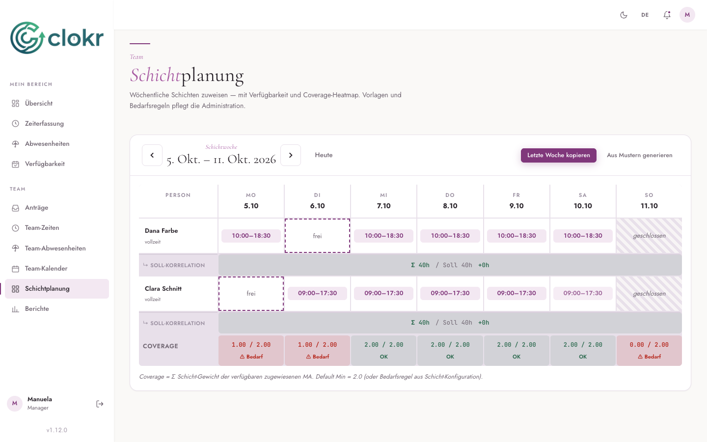
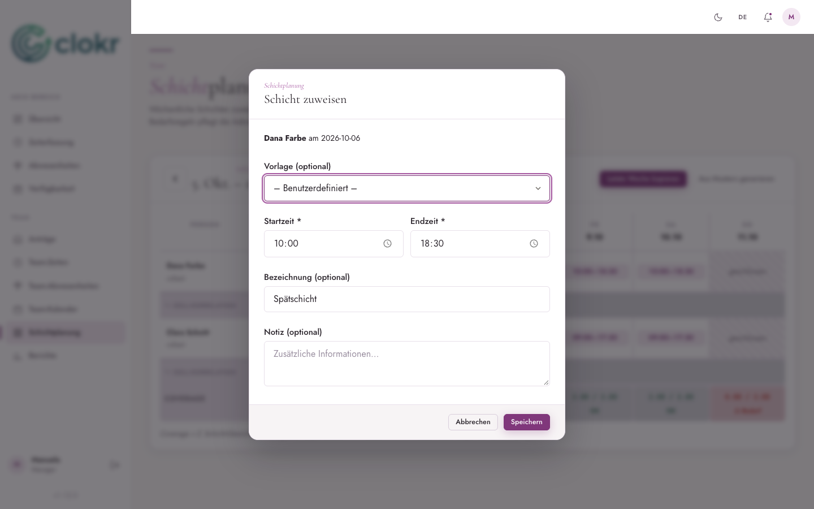
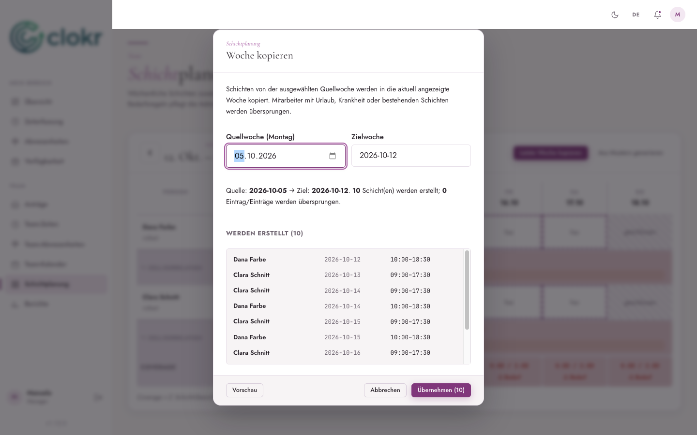
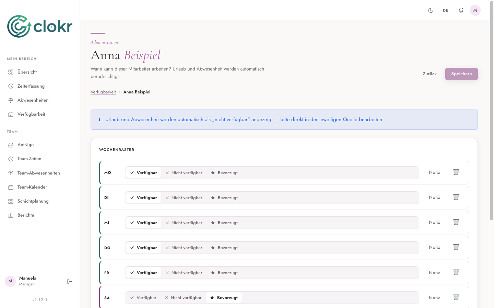

# Schichtplanung

Unter **Schichtplanung** planen Sie die Wochenschichten Ihres Teams: Schichten zuweisen, verschieben und löschen, aus Vorlagen oder der Vorwoche übernehmen und die Besetzung (Coverage) je Tag im Blick behalten. Die Seite zeigt nur Mitarbeitende mit dem Arbeitszeitmodell **SHIFT_BASED** – für andere Modelle gibt es keinen Schichtplan.

## Aufbau der Seite

Die Ansicht ist ein **Wochenraster**: eine Zeile pro Mitarbeiter, eine Spalte pro Wochentag (Mo–So), darunter eine **Coverage**-Zeile je Tag. Es gibt keine Tages- oder Monatsansicht – nur die Woche. Über **Vorherige Woche** / **Nächste Woche** / **Heute** navigieren Sie durch die Wochen.

Vorlagen und Bedarfsregeln (Mindestbesetzung) werden nicht hier, sondern unter **Admin → Schichtplan** gepflegt – dort ist der Zugriff Admin-exklusiv (siehe unten).

<!-- SCREENSHOT file=images/schichtplanung-01-wochenraster.png role=manager url=/shifts show="Schichtplanung-Seite für die Woche 05.–11.10.2026 mit den zugewiesenen Schichten von Clara Schnitt und Dana Farbe sowie der Coverage-Zeile je Tag" -->

## Schicht anlegen

**Per Klick:** Klicken Sie eine freie („frei") Zelle an – der Dialog **Schicht zuweisen** öffnet sich mit den Feldern **Vorlage (optional)**, **Startzeit**, **Endzeit**, **Bezeichnung (optional)** und **Notiz (optional)**. Mit **Speichern** übernehmen.

**Per Drag & Drop (Schnellzuweisung):** Ziehen Sie eine Vorlagen-Kachel aus der Vorlagen-Leiste oberhalb des Rasters direkt auf eine freie Zelle – die Schicht wird sofort mit den Zeiten der Vorlage angelegt, ohne Dialog.

> Es gibt **keinen** Veröffentlichen-Schritt: Eine angelegte Schicht ist sofort aktiv und für den Mitarbeiter sichtbar. Es gibt keinen Entwurfsstatus.

## Schicht verschieben oder bearbeiten

- **Verschieben:** Ziehen Sie eine bestehende Schicht (Pille) per Drag & Drop auf eine andere freie Zelle.
- **Bearbeiten:** Klicken Sie eine bestehende Schicht an – derselbe Dialog öffnet sich (Titel **Schicht bearbeiten**) mit den aktuellen Werten.

## Schicht löschen

Im Bearbeiten-Dialog **Löschen** klicken. Der Bestätigungsdialog **Schicht löschen?** warnt, dass die Schicht dauerhaft entfernt wird; sind für den Zeitraum Kundentermine (Phorest) gebucht, wird das vorab angezeigt. Mit **Löschen** bestätigen.

> Hinweis: Der Dialog **„Schicht zuweisen"** öffnet sich nur durch Klick auf eine freie Rasterzelle.

<!-- SCREENSHOT file=images/schichtplanung-02-schicht-dialog.png role=manager url=/shifts show="Dialog 'Schicht zuweisen' für eine freie Zelle von Dana Farbe mit ausgefüllter Start- und Endzeit sowie Bezeichnung" -->

## Konflikte und Überschreiben

Kollidiert eine geplante Schicht mit Urlaub, Abwesenheit, fehlender Verfügbarkeit, der ArbZG-Mindestruhezeit (§ 5) oder den Öffnungszeiten, meldet Clokr das beim Speichern über den Dialog-Weg. Mit **Trotzdem zuweisen** können Sie die Schicht bewusst dennoch anlegen (wird protokolliert). Beim Drag & Drop wird nie automatisch überschrieben – Sie erhalten stattdessen einen Hinweis, die Schicht über den Klick-Dialog anzulegen.

> Die tägliche ArbZG-Höchstarbeitszeit von 10 Stunden (§ 3) ist eine **harte Grenze ohne Override** – eine Schicht, die diese überschreitet, lässt sich nicht anlegen.

## Woche aus Vorlagen generieren

Über **Aus Mustern generieren** erzeugen Sie die Woche automatisch nach den in **Admin → Schichtplan → Muster** hinterlegten Wochenrhythmen. Eine Vorschau zeigt **Zu erstellen (N)** und **Übersprungen (N)** mit Gründen (z. B. Urlaub, Abwesenheit, Schicht existiert bereits, kein Muster hinterlegt). Erst mit **N Schicht(en) erstellen** werden die Schichten tatsächlich angelegt.

## Letzte Woche kopieren

Über **Letzte Woche kopieren** übernehmen Sie den Plan einer Vorwoche in die aktuelle Woche. Quellwoche ist änderbar (Standard: 7 Tage zurück), die Zielwoche ist die aktuell angezeigte Woche. Eine Vorschau zeigt, was übernommen und was übersprungen wird (z. B. wegen Urlaub, Krankheit oder bereits bestehender Schicht). Mit **Übernehmen (N)** bestätigen.

<!-- SCREENSHOT file=images/schichtplanung-03-woche-kopieren.png role=manager url=/shifts show="Dialog „Woche kopieren" mit Quellwoche 05.10.2026 und Zielwoche 12.10.2026; die Zusammenfassung zeigt 10 zu erstellende Schichten mit Vorschauliste (Clara Schnitt, Dana Farbe)" -->

## Besetzung (Coverage)

Die Coverage-Zeile am unteren Rand zeigt je Tag das Verhältnis aus geplantem Schicht-Gewicht zur Mindestbesetzung (Standard 2,0, sofern keine abweichende Bedarfsregel hinterlegt ist), farblich markiert (in Ordnung / **⚠ Bedarf** bei Unterbesetzung / **⚠ Aufsicht** bei fehlender Aufsichtsperson). Darüber zeigt jede Mitarbeiterzeile den Vergleich aus geplanten Stunden zum vertraglichen Soll, inklusive einer Warnung **Unterdeckung**, wenn zu wenig geplant wurde.

## Verfügbarkeiten der Mitarbeiter einsehen

Unter **Admin → Verfügbarkeit** sehen und bearbeiten Sie, wann ein Mitarbeiter grundsätzlich arbeiten kann:

1. Wählen Sie in der Liste den Mitarbeiter aus.
2. Im **Wochenraster** sehen Sie das wiederkehrende Verfügbarkeitsmuster, unter **Einmaltermine** einzelne abweichende Tage.
3. Urlaub und Abwesenheit werden automatisch als „nicht verfügbar" angezeigt – diese lassen sich nicht hier, sondern direkt in **[[Genehmigungen]]** bzw. **[[Abwesenheiten]]** bearbeiten.
4. Änderungen mit **Speichern** übernehmen.

Diese Verfügbarkeiten fließen als Markierungen direkt ins Wochenraster ein (z. B. **✕ Nicht verfügbar**, **★ Bevorzugt**, **🏖 Urlaub**, **🤒 Krank**, **🔒 Berufsschule**).

<!-- SCREENSHOT file=images/schichtplanung-04-verfuegbarkeit.png role=manager url=/admin/availability show="Verfügbarkeits-Detailseite eines Mitarbeiters mit Wochenraster und Einmaltermine-Liste" -->

## Admin-Einstellungen zur Schichtplanung

Unter **Admin → Schichtplan** – **nur für Admins zugänglich**, Manager werden bei Aufruf automatisch zu **Schichtplanung** zurückgeleitet – werden die Bausteine gepflegt, die Sie auf dieser Seite nur nutzen:

- **Vorlagen & Bedarf**: Schichtvorlagen anlegen/bearbeiten/löschen sowie Bedarfsregeln (Mindestbesetzung, Aufsichtspflicht) je Vorlage und Wochentag.
- **Muster**: der wiederkehrende Wochenrhythmus je Mitarbeiter, aus dem **Aus Mustern generieren** die Woche befüllt.

## Konflikte (/shifts/conflicts)

Unter **Schicht-Konflikte** finden Sie zwei Listen:

- **Automatisch entfernte Schichten** – Schichten, die beim Anlegen neuer Berufsschultage automatisch entfernt wurden.
- **Markierte Schichten** – Schichten, die mit Urlaub oder einem neuen Berufsschultag kollidieren.

Über **Wiederherstellen** je Zeile holen Sie eine Schicht zurück bzw. entfernen die Konflikt-Markierung. Ein Datumsfilter (**Von**/**Bis**) mit **Aktualisieren** grenzt den Zeitraum ein (Standard: 30 Tage zurück bis 60 Tage voraus).

## Schichten, Soll und Urlaubstage

Bei **SHIFT_BASED**-Mitarbeitenden bestimmt der tatsächliche Schichtplan – nicht ein festes Wochenraster – wie viel Soll-Zeit für einen Tag gilt. **Wie viele Urlaubstage ein Antrag verbraucht, richtet sich dagegen nach dem Vertrag** (vertragliche Arbeitstage pro Woche) und nicht nach dem Schichtplan: Ein Urlaubstag kostet einen Tag, auch wenn er in Phorest bewusst nicht geplant oder die Schicht gelöscht wurde, damit die Person nicht buchbar ist. Die Reihenfolge von Urlaubsantrag und Planung spielt dabei keine Rolle. Wurde für einen Zeitraum zu wenig geplant, entsteht dem Mitarbeiter daraus **kein** Minus-Saldo (§ 615 BGB, Annahmeverzug) – das Planungsrisiko liegt beim Betrieb. Details zur Saldo-Berechnung: **[[Arbeitszeitmodelle]]**.

## Phorest-Hinweis

Ein manueller Sync-Button erscheint auf dieser Seite **nicht** – Phorest-Schichten werden automatisch importiert und erscheinen als reguläre Schichten im Raster; beim Löschen einer Schicht mit gebuchten Kundenterminen warnt Clokr vorab. Konfiguration und manueller Sync laufen ausschließlich über **[[Phorest-Integration]]** (Admin-only).

## Urlaub und Schichtplanung – empfohlener Ablauf

Urlaub wird im Salon meist lange im Voraus genehmigt (z. B. im Oktober/November für das ganze Folgejahr), der Schichtplan steht dagegen nur einige Wochen bis Monate im Voraus. Deshalb gilt:

1. **Zuerst in Clokr prüfen**, welcher Urlaub in der zu planenden Woche genehmigt ist (**Team → Team-Kalender** oder **Team-Anträge**).
2. **Dann in Phorest um den Urlaub herum planen.** An genehmigten Urlaubstagen wird die Person nicht eingeplant.
3. **Urlaub verringert die Arbeitstage der Woche:** Bei einem Vertrag mit 5 Arbeitstagen pro Woche und 2 Urlaubstagen sind in dieser Woche nur noch **3 Arbeitstage** einzuplanen. Auf welche Wochentage diese fallen (Mo–Sa), entscheidet die Planung.

Genehmigter Urlaub ist verbindlich; er wird nicht durch die spätere Planung verschoben oder „aufgebraucht“. Wie viele Urlaubstage ein Antrag kostet, richtet sich nach dem Vertrag, nicht nach dem Plan (siehe **[[Abwesenheiten]]**).

## Siehe auch

- **[[Verfuegbarkeit-und-Schichten]]** – Grundlagen zu Schichten und Verfügbarkeit aus Mitarbeitersicht
- **[[Genehmigungen]]** – Abwesenheitsanträge, die die Schichtplanung beeinflussen
- **[[Arbeitszeitmodelle]]** – wie `SHIFT_BASED` Soll und Saldo berechnet
- **[[Phorest-Integration]]** – automatischer Schichtimport aus Phorest
