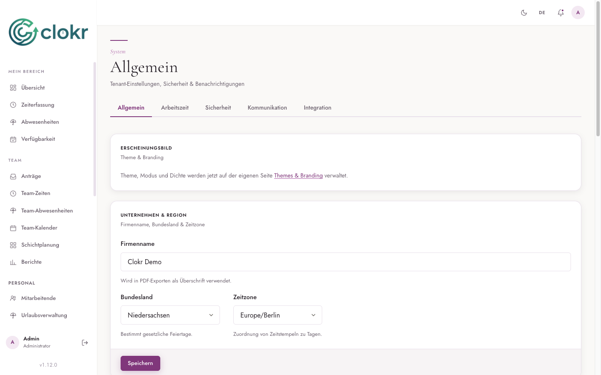
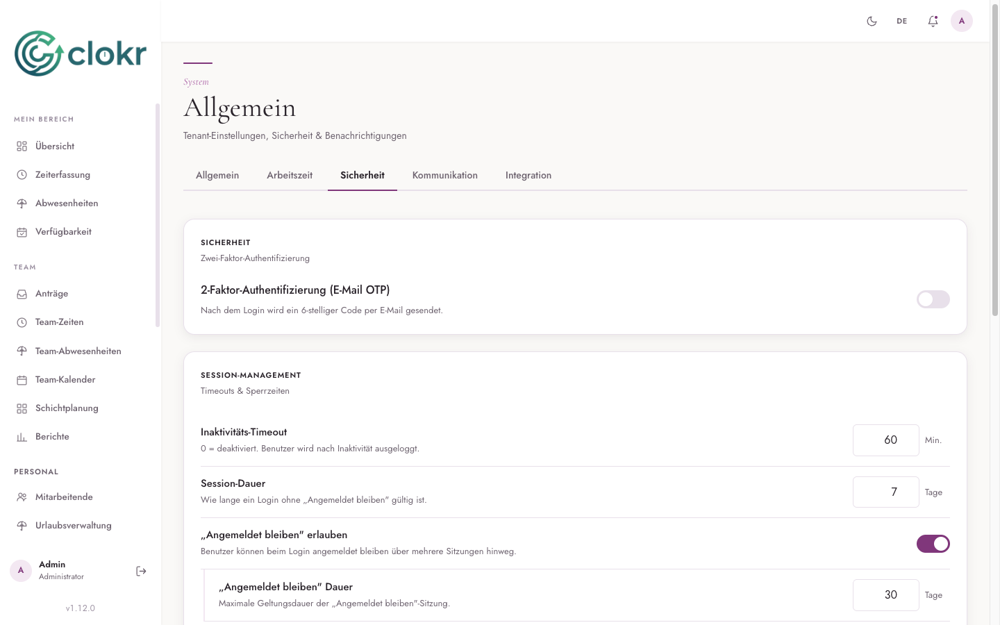
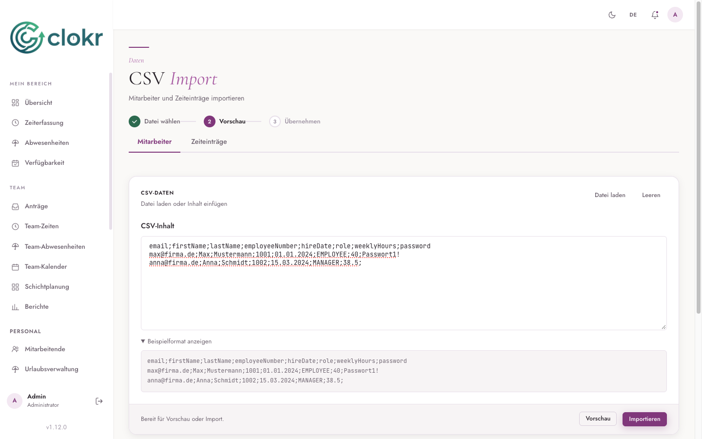
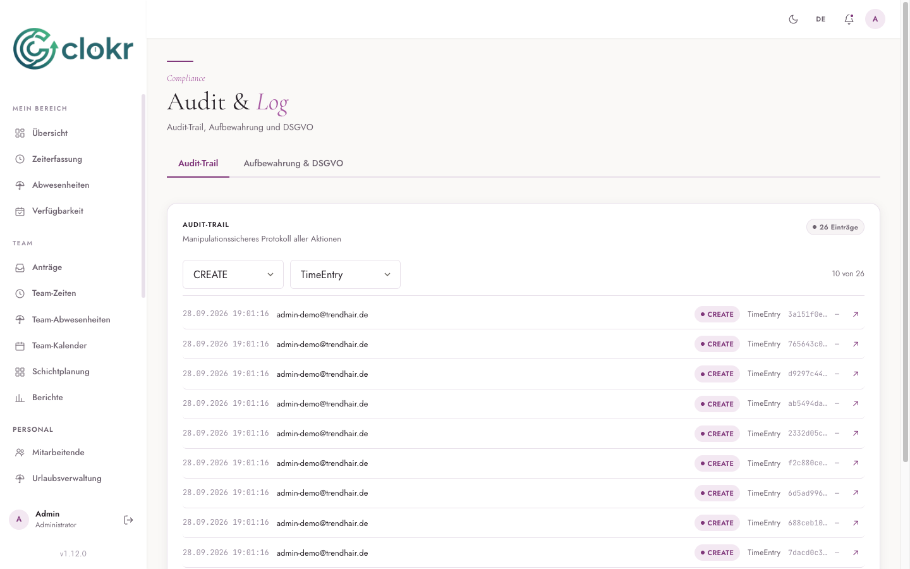

# Systemeinstellungen

Diese Seite gibt einen Überblick über den Admin-Bereich von Clokr und beschreibt die mandantenweiten Einstellungen, Branding, Integrationen, CSV-Import und das Audit-Log.

## Überblick über den Admin-Bereich

Die Seitenleiste gliedert den Admin-Bereich in fünf Gruppen:

| Gruppe | Einträge |
| --- | --- |
| **PERSONAL** | Mitarbeitende, Urlaubsverwaltung, Betriebsurlaub |
| **PLANUNG** | Schichtplan, Verfügbarkeit |
| **COMPLIANCE** | Monatsabschluss, Audit & Log |
| **DATEN** | CSV Import, DATEV Export |
| **SYSTEM** | Allgemein, Branding & Themes, Integrationen, Phorest |

Die Gruppenüberschriften selbst sind nicht klickbar; sie ordnen nur die darunterliegenden Seiten. Rufen Sie `/admin` direkt auf, landen Sie automatisch auf **Mitarbeitende**.

<!-- SCREENSHOT file=images/systemeinstellungen-01-sidebar.png role=admin url=/admin/system show="Linke Seitenleiste im Admin-Bereich mit allen fünf Gruppen (PERSONAL, PLANUNG, COMPLIANCE, DATEN, SYSTEM) und ihren Einträgen, aktiver Eintrag 'Allgemein' hervorgehoben" -->

## Allgemein

Unter **Allgemein** (`/admin/system`) sind die mandantenweiten Einstellungen in Reiter gegliedert: **Allgemein**, **Arbeitszeit**, **Sicherheit**, **Kommunikation**, **Integration**.

### Reiter Allgemein

- **Erscheinungsbild** – Theme und Branding (siehe auch **Branding & Themes** unten)
- **Firmenname, Bundesland & Zeitzone** – u. a. das Bundesland als Vorgabe für neu angelegte Salons – die Feiertage richten sich nach dem Bundesland des jeweiligen Salons (siehe **[[Salons & Feiertage|Salons-und-Feiertage]]**)
- **Features** – mandantenweite Feature-Schalter

### Reiter Arbeitszeit

- **Rückwirkende Einträge** – Feld **Selbstbearbeitungsfenster (Tage)**: legt fest, wie viele Tage rückwirkend Mitarbeiter ihre eigenen Zeiteinträge noch selbst bearbeiten dürfen (Standard 10 Tage). Ältere Einträge müssen als Zeitnachtrag beantragt werden.
- Abschnitt **Berufsschule — Zeitgutschrift** für die Zeitgutschrift bei Berufsschultagen

### Reiter Sicherheit

- **Zwei-Faktor-Authentifizierung** – mandantenweiter Schalter für die E-Mail-basierte 2FA
- **Session-Management** – Timeouts und Sperrzeiten
- **Passwort-Richtlinie** – BSI-konforme Komplexitätsregeln

### Reiter Kommunikation

- **E-Mail-Benachrichtigungen**: Hauptschalter **E-Mail-Benachrichtigungen aktivieren** (zusätzlich zur In-App-Benachrichtigung, benötigt konfiguriertes SMTP) sowie einzelne Schalter je Ereignistyp (z. B. Zeitnachtrag)
- **E-Mail / SMTP** – Postausgangsserver konfigurieren, inkl. Testmail-Versand

### Reiter Integration

- **NFC-Terminals** – API-Schlüssel für stationäre NFC-Geräte anlegen und widerrufen
- **API Keys** – Schlüssel für externe Integrationen anlegen und verwalten

<!-- SCREENSHOT file=images/systemeinstellungen-02-sicherheit.png role=admin url=/admin/system show="Reiter Sicherheit auf der Seite Allgemein mit den Abschnitten Zwei-Faktor-Authentifizierung, Session-Management (Timeouts & Sperrzeiten) und Passwort-Richtlinie" -->

## Branding & Themes

Unter **Branding & Themes** (`/admin/themes`) wählen Sie die Markenfarbe und den Charakter der Oberfläche:

- Drei Editorial-Themes: **Pflaume** (Standard), **Nacht**, **Wald**
- Alternativ mehrere „Modern"-Preset-Kombinationen aus Skin, Modus und Theme
- **Modus** – Hell oder Dunkel, unabhängig vom gewählten Theme
- **Dichte** – Padding und Zeilenhöhe der Oberfläche
- **Sprache** – aktuell nur Deutsch verfügbar

## Integrationen (WiFi-Präsenz)

Unter **Integrationen** (`/admin/integrations`) verwalten Sie die WiFi-basierte Anwesenheitserkennung: API-Schlüssel für WLAN-Adapter (**Presence-Quellen**), die Liste verbundener Geräte (**WiFi-Geräteliste**) und eine **Opt-In-Übersicht**, welche Mitarbeiter die WiFi-Präsenzerkennung aktiviert haben.

## CSV Import

Unter **CSV Import** (`/admin/import`) importieren Sie Daten aus einer CSV-Datei. Zur Wahl stehen zwei Import-Arten:

- **Mitarbeiter** – Spalten u. a. E-Mail, Vorname, Nachname, Mitarbeiter-Nr., Eintrittsdatum, Rolle, Wochenstunden, optional Passwort
- **Zeiteinträge** – Spalten u. a. Mitarbeiter-Nr., Datum, Beginn, Ende, Pausenminuten, Notiz

**So geht's:**

1. Import-Art wählen
2. CSV-Datei laden oder Inhalt direkt einfügen
3. **Vorschau** prüfen
4. Auf **Importieren** klicken

Das Ergebnis wird zeilenweise als **Import-Ergebnis** ausgewertet, inklusive Fehlermeldungen zu einzelnen Zeilen.

<!-- SCREENSHOT file=images/systemeinstellungen-03-import.png role=admin url=/admin/import show="Seite CSV Import mit ausgewählter Import-Art Mitarbeiter, eingefügtem Beispieltext im Textfeld und sichtbarer Vorschau-Tabelle" -->

## Audit-Log lesen

Unter **Audit & Log** (`/admin/audit`) sehen Sie das manipulationssichere Protokoll aller Aktionen im System (Abschnitt **Audit-Trail**), filterbar nach **Aktion** und **Entität**.

Auf dem zweiten Reiter finden Sie zusätzlich:

- **Aufbewahrung** – die Aufbewahrungsfrist des Mandanten als Auswahlfeld mit vier festen Optionen: **10 Jahre (GoBD)** (Standard, § 147 AO), **6 Jahre (§ 41 EStG Lohnkonten)**, **3 Jahre** und **2 Jahre (Minimum § 16 ArbZG)**; nach Ablauf werden Daten automatisch anonymisiert, aggregierte Salden bleiben erhalten
- **DSGVO-Werkzeuge** – Schnellzugriff für Datenexport pro Mitarbeiter und Anonymisierung (führt zu **Mitarbeitende**, siehe **[[Mitarbeiter verwalten|Mitarbeiter-verwalten]]**)

<!-- SCREENSHOT file=images/systemeinstellungen-04-audit.png role=admin url=/admin/audit show="Reiter Audit-Trail mit gefilterter Log-Liste (Filter nach Aktion und Entität) sowie im Hintergrund erkennbarem zweiten Reiter mit Aufbewahrungsfrist-Einstellung" -->

## Phorest-Integration

Die Anbindung an die Salon-Software Phorest (Schichten-Import) hat eine eigene Seite: **[[Phorest-Integration]]**.

## Siehe auch

- **[[Mitarbeiter verwalten|Mitarbeiter-verwalten]]** – DSGVO-Anonymisierung und -Löschung
- **[[Salons & Feiertage|Salons-und-Feiertage]]** – Bundesland und Feiertage
- **[[Compliance & Revisionssicherheit|Compliance-und-Revisionssicherheit]]** – Aufbewahrungsfristen und Audit-Trail im Detail
- **[[Phorest-Integration]]** – Schichten aus Phorest importieren
