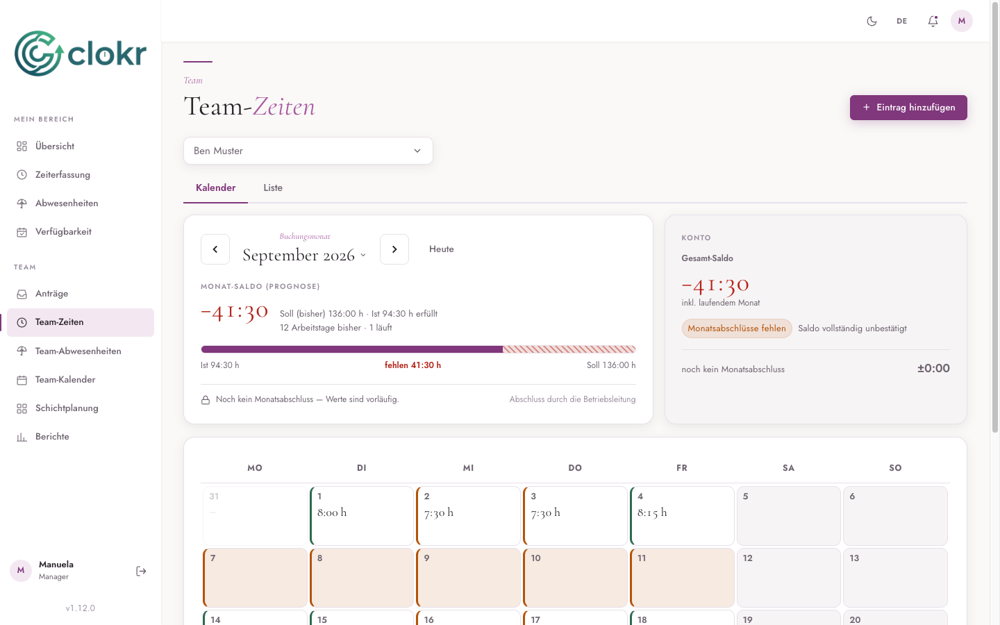
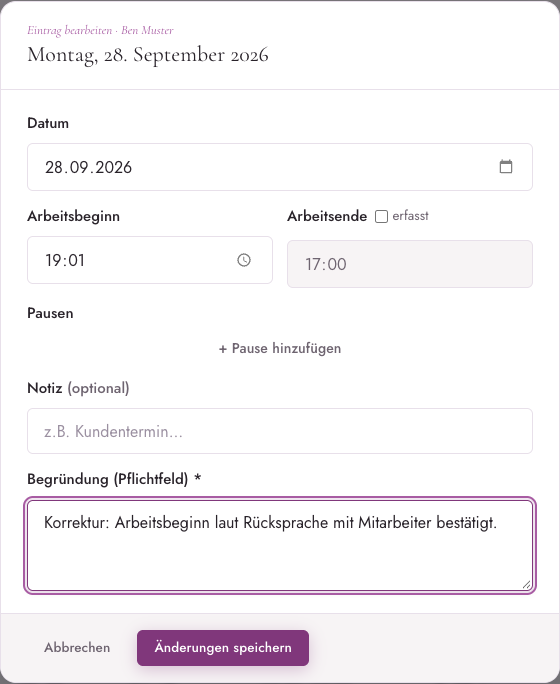
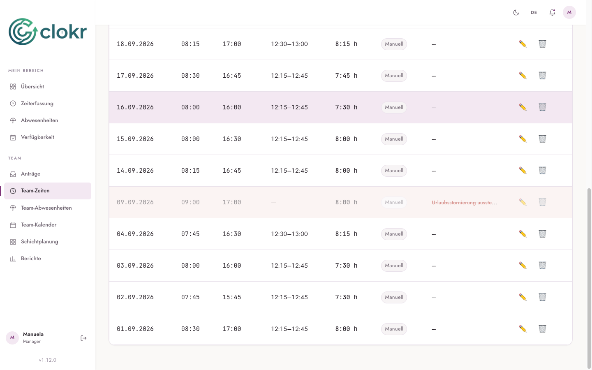

# Team-Zeiten

Unter **Team-Zeiten** sehen Sie die Zeiterfassung Ihres Teams tagesgenau, können fehlerhafte Einträge korrigieren und für Mitarbeitende nachträglich Einträge anlegen. Die Seite zeigt immer nur Mitarbeitende in Ihrem zugewiesenen Bereich (Stammsalon bzw. zugewiesene Mitarbeiterliste).

## So geht's: einen Mitarbeiter auswählen

1. Öffnen Sie **Team-Zeiten**.
2. Wählen Sie über das Suchfeld **Mitarbeiter auswählen…** die gewünschte Person aus. Ohne Auswahl zeigt die Seite nur den Hinweis „Mitarbeiter auswählen, um Zeiteinträge anzuzeigen."
3. Navigieren Sie über die Monatsleiste (Vor/Zurück/Heute) zum gewünschten Monat.
4. Wechseln Sie zwischen **Kalender**- und **Liste**-Ansicht.

Oben zeigt eine Kennzahlenzeile den Monats-Saldo (Soll/Ist/Saldo) sowie den laufenden Gesamt-Saldo (Überstundenkonto) der ausgewählten Person.

<!-- SCREENSHOT file=images/team-zeiten-01-uebersicht.png role=manager url=/team/time-entries show="Team-Zeiten-Seite mit ausgewähltem Mitarbeiter Ben Muster, September 2026, Kalenderansicht mit Soll/Ist/Saldo-Kennzahlen oben" -->

## Zeiten eines Mitarbeiters korrigieren

### So geht's

1. Wählen Sie den Mitarbeiter, dann in der Kalender- oder Listenansicht den betroffenen Tag anklicken (in der Liste über das Stift-Symbol, Titel „Bearbeiten").
2. Passen Sie Arbeitsbeginn, Arbeitsende, Pausen oder die Notiz an.
3. Tragen Sie eine **Begründung** ein (Pflichtfeld).
4. **Speichern**.

> **Begründung nur bei fremden Einträgen Pflicht:** Bearbeiten Sie den Eintrag eines **anderen** Mitarbeiters, verlangt Clokr eine Begründung („Begründung ist erforderlich (revisionssicherheitspflichtig)."). Bearbeiten Sie dagegen Ihren **eigenen** Eintrag über diese Seite, ist keine Begründung nötig und keine zweite Person erforderlich – für Zeiteinträge gilt anders als bei Abwesenheits- und Zeitnachtrag-Genehmigungen **kein** Vier-Augen-Zwang (siehe **[[Genehmigungen]]**).

### Gesperrte Monate

Ist der Monat bereits per Monatsabschluss gesperrt, zeigt die Liste für diese Einträge keine Bearbeiten-/Löschen-Symbole mehr – sie sind schreibgeschützt. Ein dennoch versuchter Speicher- oder Löschvorgang scheitert mit „Monat ist gesperrt". Mehr dazu: **[[Monatsabschluss]]**.

## Einträge für Mitarbeiter nachtragen

Über **+ Eintrag hinzufügen** (nur sichtbar, wenn ein Mitarbeiter ausgewählt ist) legen Sie für diese Person einen neuen Tageseintrag an – Datum, Arbeitszeiten, Pausen und optional eine Notiz. Anders als bei der Korrektur eines bestehenden fremden Eintrags ist hier **keine Begründung** erforderlich; ein neu angelegter Eintrag für einen Mitarbeiter ist keine Korrektur eines vorhandenen Werts.

<!-- SCREENSHOT file=images/team-zeiten-02-eintrag-korrigieren.png role=manager url=/team/time-entries show="Bearbeiten-Dialog für einen bestehenden Zeiteintrag von Ben Muster mit ausgefülltem Pflichtfeld Begründung" -->

## Eintrag löschen

Über das Löschen-Symbol öffnet sich ein Dialog **Eintrag löschen?**, der in jedem Fall eine Begründung verlangt – unabhängig davon, ob es der eigene oder ein fremder Eintrag ist.

## „Fehlt" – fehlender Eintrag

Tage ohne (vollständigen) Eintrag zeigen in der Kalenderansicht eine rote Minusstunden-Markierung (z. B. „−8:00 h") statt eines grünen Hakens; die Legende bezeichnet diesen Status als **Fehlt**. So erkennen Sie auf einen Blick, an welchen Tagen ein Eintrag oder ein Ausstempeln noch aussteht.

## ArbZG-Hinweise in der Teamansicht

Clokr prüft jeden Tag automatisch und markiert Verstöße mit einem Warnsymbol (⚠︎ im Kalender, ⛔/⚠️ in der Liste) mit Tooltip. Mögliche Meldungen:

- „Tägliche Höchstarbeitszeit von 10h überschritten (Xh)"
- „Bei über 9h Arbeitszeit mind. 45 Min. Pause erforderlich (N Min. erfasst)"
- „Bei über 6h Arbeitszeit mind. 30 Min. Pause erforderlich (N Min. erfasst)"

Das Speichern wird dadurch nicht blockiert – die Hinweise dienen der Kontrolle, nicht der Sperre. Details zu den gesetzlichen Grundlagen: **[[Compliance und Revisionssicherheit|Compliance-und-Revisionssicherheit]]**.

## Ungültige Einträge

Einträge, die durch eine ausstehende Urlaubsstornierung oder einen abgelehnten Zeitnachtrag als **ungültig** markiert sind, werden in der Liste hervorgehoben und zeigen anstelle der Notiz den Invalidierungsgrund. Sie zählen nicht in Soll/Ist/Saldo, bis sie wieder gültig gesetzt werden (automatisch bei genehmigter Stornierung, siehe **[[Genehmigungen]]**).

<!-- SCREENSHOT file=images/team-zeiten-03-arbzg-und-ungueltig.png role=manager url=/team/time-entries show="Listenansicht von Ben Muster mit einem ungültigen, hervorgehobenen Eintrag (09.09.2026, durchgestrichen) und sichtbarem Invalidierungsgrund 'Urlaubsstornierung ausstehend'; kein Tag im aktuellen Demo-Datensatz zeigt zusätzlich ein ArbZG-Warnsymbol – alle regulären Einträge haben ausreichende Pausen, und der ungültige Eintrag selbst löst trotz fehlender Pause keine sichtbare ArbZG-Warnung aus" -->

## Hinweis zur Mitarbeiterliste

Es gibt keine separate Team-Listenansicht außerhalb dieser Seite – ein direkter Aufruf der Mitarbeiterliste leitet zur Mitarbeiterverwaltung unter **Admin** weiter. Für die tägliche Teamarbeit nutzen Sie **Team-Zeiten** (diese Seite), für Stammdaten **[[Mitarbeiter-verwalten]]**.

## Siehe auch

- **[[Genehmigungen]]** – Zeitnachträge und Stornierungen entscheiden
- **[[Zeiterfassung]]** – wie Mitarbeitende selbst Zeiten erfassen
- **[[Monatsabschluss]]** – gesperrte Monate und ihre Auswirkung auf Korrekturen
- **[[Arbeitszeitmodelle]]** – Soll-Berechnung je Arbeitszeitmodell
