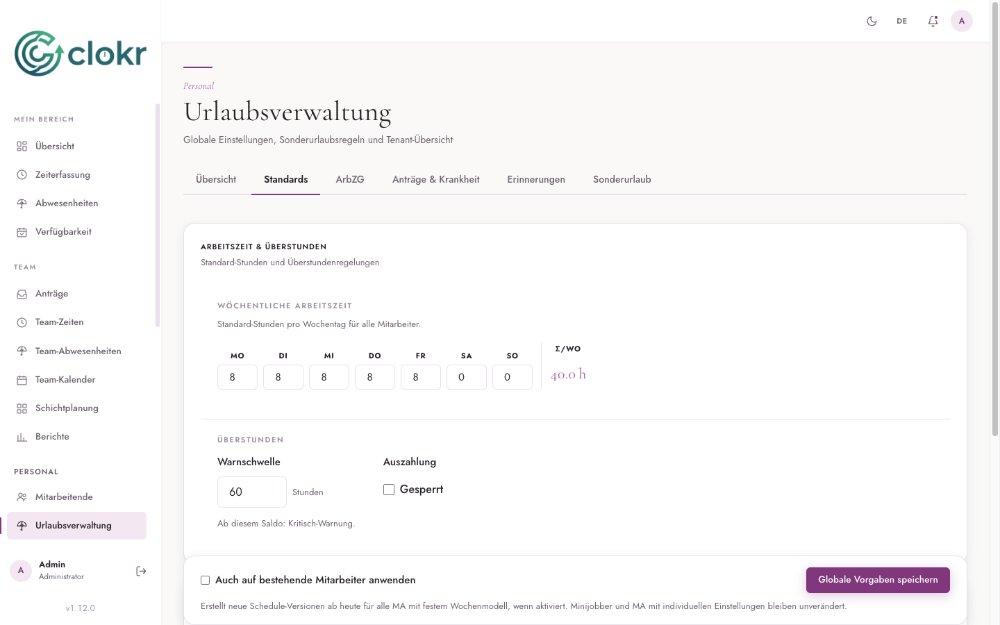
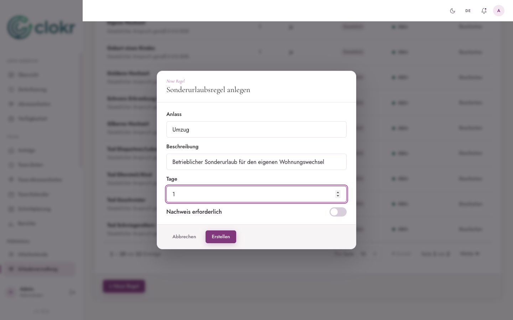
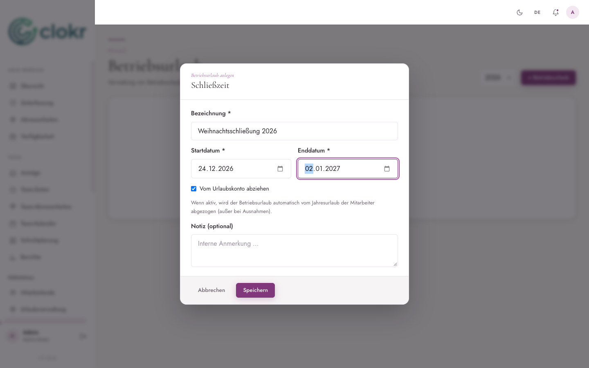

# Urlaubsverwaltung

Diese Seite beschreibt die betriebsweiten Urlaubsvorgaben (Jahresurlaub, Übertrag und Verfall nach BUrlG/EuGH), Sonderurlaubsregeln und Betriebsurlaub. Zuständig ist der Bereich **Urlaubsverwaltung** in der Seitenleiste (`/admin/vacation`, mehrere Reiter) sowie **Betriebsurlaub** (`/admin/shutdowns`).

> Der frühere eigenständige Bereich „Sonderurlaubs-Typen" (`/admin/special-leave`) wurde in den Reiter **Sonderurlaub** von Urlaubsverwaltung übernommen; alte Lesezeichen leiten automatisch dorthin um.

## Jahresurlaub, anteilig, Übertrag und Verfall

Auf dem Reiter **Standards** legen Sie im Abschnitt **Urlaubsanspruch** die betriebsweiten Grundwerte fest:

- **Jahresurlaub (Basis 5-Tage-Woche)** – die Anzahl Urlaubstage bei Vollzeit auf Basis einer 5-Tage-Woche. Ein Hinweistext zeigt live die anteilige Umrechnung für eine 4-Tage-Woche.
- **Resturlaub verfällt am** – Tag und Monat des Folgejahres, zu dem nicht genommener Resturlaub verfällt

Die **anteilige Berechnung** bei unterjährigem Ein- oder Austritt erfolgt automatisch: Ist bei einem Mitarbeiter ein **Austrittsdatum** gesetzt, wird der Jahresurlaub nach § 5 Abs. 2 BUrlG anteilig berechnet (siehe **[[Mitarbeiter verwalten|Mitarbeiter-verwalten]]**). Für Teilzeitkräfte sorgt auf dem Reiter **Anträge & Krankheit** der Abschnitt **Teilzeit-Urlaub** für eine automatische Pro-Rata-Berechnung nach BUrlG, wenn die Checkbox **Automatische Pro-Rata-Berechnung (BUrlG)** aktiv ist – dazu legen Sie fest, ob eine Vollzeitstelle **5 Tage (Mo–Fr)** oder **6 Tage (Mo–Sa)** umfasst.

Im Abschnitt **Urlaubsübertrag & Mindesturlaub (§ 7 BUrlG)** auf dem Reiter **Anträge & Krankheit** konfigurieren Sie:

- **Gesetzlichen Mindesturlaub durchsetzen (Warnung wenn nicht genommen)**
- **Übertrag ins Folgejahr erfordert Begründung (Krankheit, betriebliche Gründe)**
- **Verfall-Erinnerung ab Monat** (August bis Dezember wählbar) – ab diesem Monat werden Mitarbeiter über verfallenden Urlaub informiert (Hinweispflicht nach EuGH C-684/16)
- **Hinweispflicht – Verfall-Warnungen**: automatischer täglicher Versand (06:00 Uhr) mit frei konfigurierbaren **Schwellwerten (Tage vor Verfall)**, z. B. `60, 30, 14, 7`

<!-- SCREENSHOT file=images/urlaubsverwaltung-01-standards.png role=admin url=/admin/vacation show="Reiter 'Standards' von Urlaubsverwaltung mit den Abschnitten 'Arbeitszeit & Überstunden' und darunter 'Urlaubsanspruch' (Jahresurlaub, Resturlaub verfällt am); der Abschnitt 'Urlaubsübertrag & Mindesturlaub' liegt auf dem Reiter 'Anträge & Krankheit', nicht hier" -->

## Urlaubstage pro Mitarbeiter und gesetzlicher Mindesturlaub

Zusätzlich zum betriebsweiten Standard (**Jahresurlaub (Basis 5-Tage-Woche)**, siehe oben) lässt sich für jede Person ein eigener Basiswert hinterlegen – **„Urlaubstage pro Jahr (5-Tage-Woche)"** auf dem Reiter **Stammdaten** der Mitarbeiter-Detailansicht bzw. beim Anlegen (siehe **[[Mitarbeiter verwalten|Mitarbeiter-verwalten]]**). Bleibt das Feld leer, gilt der aktuelle Mandanten-Standard; ein eingetragener Wert gilt unabhängig von späteren Änderungen des Mandanten-Standards weiter.

Dieser Basiswert bezieht sich immer auf eine **5-Tage-Woche** und wird für Personen mit abweichender Vertragstage-Zahl automatisch umgerechnet, z. B. ergeben 20 Tage Basis bei einer 4-Tage-Woche 16 Urlaubstage.

### "Urlaubstage Azubis" – Mandantenwert für Auszubildende

Auf dem Reiter **Standards** von Urlaubsverwaltung steht neben „Jahresurlaub (Basis 5-Tage-Woche)" der Wert **„Urlaubstage Azubis (Basis 5-Tage-Woche)"**. Er muss mindestens 20 Tage betragen (§ 3 BUrlG bei einer 5-Tage-Woche) und dient ausschließlich als **Vorschlag**: Beim Anlegen einer/eines Auszubildenden wird er in das Feld „Urlaubstage pro Jahr" übernommen, lässt sich dort aber jederzeit überschreiben. Für bereits angelegte Auszubildende ändert eine spätere Anpassung dieses Mandantenwerts nichts automatisch – die Prüfung und ggf. Korrektur bestehender Urlaubsansprüche ist Gegenstand eines Folge-Tickets.

### Gesetzlicher Mindesturlaub (§ 19 JArbSchG / § 3 BUrlG)

Unabhängig vom Basiswert unterschreitet der tatsächliche Urlaubsanspruch nie den gesetzlichen Mindesturlaub. Für Jugendliche gilt der gestaffelte Mindesturlaub nach § 19 JArbSchG, für Erwachsene der Mindesturlaub von 24 Werktagen nach § 3 BUrlG. Maßgeblich ist das Alter **am 1. Januar** des jeweiligen Jahres (wer am 1.1. Geburtstag hat, zählt an diesem Tag bereits als ein Jahr älter; wer am 2.1. Geburtstag hat, noch nicht) – das Alter wird dadurch jedes Jahr neu bewertet.

| Alter am 1.1. | Werktage (6-Tage-Woche) | 5-Tage-Woche | 4-Tage-Woche |
| --- | --- | --- | --- |
| noch nicht 16 | 30 | 25 | 20 |
| noch nicht 17 | 27 | 22,5 | 18 |
| noch nicht 18 | 25 | 20,83 | 16,67 |
| ab 18 | 24 | 20 | 16 |

Ist bei einer/einem Auszubildenden kein Geburtsdatum hinterlegt, kann dieser gestaffelte Mindesturlaub nicht geprüft werden – Clokr geht in diesem Fall vom Erwachsenen-Mindesturlaub (24 Werktage) aus und zeigt zusätzlich den Hinweis „Geburtsdatum fehlt – Mindesturlaub nach JArbSchG kann nicht geprüft werden" (siehe **[[Mitarbeiter verwalten|Mitarbeiter-verwalten]]**).

Der Urlaubsanspruch ergibt sich also immer als das **Maximum** aus dem (ggf. auf die Vertragstage umgerechneten) persönlichen Basiswert und dem gesetzlichen Mindesturlaub des jeweiligen Jahres.

### Wartezeit im Eintrittsjahr (§ 4 / § 5 Abs. 1 a BUrlG)

Im Eintrittsjahr hängt die anteilige Berechnung vom Eintrittsdatum ab:

- Eintritt **bis einschließlich 01.07.**: die sechsmonatige Wartezeit nach § 4 BUrlG endet noch innerhalb desselben Jahres – es gilt der **volle** Jahresanspruch, ohne Kürzung.
- Eintritt **ab dem 02.07.**: die Wartezeit endet erst im Folgejahr – der Jahresanspruch wird anteilig nach den im Eintrittsjahr verbleibenden Monaten gekürzt. Beispiel: 20 Tage Jahresanspruch, Eintritt am 01.10. → 5 Tage im Eintrittsjahr.

### Anzeige auf dem Reiter "Urlaub"

Der Reiter **Urlaub** in der Mitarbeiter-Detailansicht zeigt bei der Pflege des Urlaubskontos sowohl den vom Server berechneten **regulären Anspruch** als auch den **gesetzlichen Mindestanspruch** des jeweiligen Jahres zur Orientierung an. Ein eingetragener Wert unterhalb des gesetzlichen Mindestanspruchs wird beim Speichern abgelehnt – es sei denn, der Wert bleibt gegenüber dem bisher gespeicherten unverändert (damit lassen sich auch ältere Datensätze, die unterhalb des heutigen Mindestanspruchs liegen, weiterhin bearbeiten, etwa um nur den Übertrag anzupassen).

> **Hinweis:** Bereits bestehende Urlaubsansprüche werden durch diese Regeln nicht automatisch neu berechnet oder korrigiert – das betrifft ausschließlich neu angelegte bzw. künftige Urlaubsjahre. Eine Prüfung und ggf. Korrektur des Bestands ist Gegenstand eines Folge-Tickets.

## Urlaubsanträge: Vorlaufzeit und Halbtage

Auf dem Reiter **Anträge & Krankheit** im Abschnitt **Urlaubsanträge**:

- **Vorlaufzeit (Tage)** – wie viele Tage im Voraus ein Urlaubsantrag mindestens gestellt werden muss (0 = keine Vorlaufzeit; gilt nicht für Krankmeldungen)
- **Max. Vorausbuchung (Monate)** – wie weit im Voraus Urlaub gebucht werden darf (0 = unbegrenzt)
- Checkbox **Halbe Tage erlauben**

Im Abschnitt **Krankmeldungen** legen Sie fest, ob Mitarbeiter Krankmeldungen selbst eintragen dürfen und nach wie vielen Kalendertagen ein Attest (AU) Pflicht wird (§ 5 Abs. 1 EFZG, Standard 3 Tage).

Im Abschnitt **Heiligabend & Silvester** desselben Reiters bestimmen Sie außerdem, ob der 24.12. bzw. 31.12. als **Normaler Arbeitstag**, **Halber Tag frei** oder **Ganzer Tag frei** gilt, sowie ab welchem Jahr (**Gültig ab Jahr**) diese Regel gilt.

## Abwesenheitsarten: beantragt vs. angeordnet

Clokr unterscheidet zwei Arten von Abwesenheit:

- **Beantragter Urlaub** (Urlaub, Krankheit, Sonderurlaub) durchläuft einen Genehmigungsprozess mit Status und Anspruchsprüfung. Details zum Genehmigen: **[[Genehmigungen]]**.
- **Angeordnete Abwesenheit** (z. B. Berufsschule, Mutterschutz, Elternzeit) wird nicht beantragt, sondern tritt ein und wird entsprechend erfasst.

## Genehmigte Anträge korrigieren

Ist ein bereits genehmigter Urlaubs- oder Sonderurlaubsantrag fehlerhaft, kann eine Managerin oder ein Manager ihn nachträglich korrigieren, ohne ihn zu stornieren. Diese Funktion finden Sie nicht in den Admin-Einstellungen, sondern im Bereich **Team → Anträge** bei einem genehmigten Antrag über die Schaltfläche **Korrigieren**.

**So geht's:**

1. Im Dialog **„Antrag korrigieren"** Art, Zeitraum (**Von**/**Bis**), **Halber Tag** und optional eine **Notiz** anpassen
2. Im Pflichtfeld **Begründung (Pflichtfeld)** angeben, warum korrigiert wird
3. Mit **Bestätigen** speichern

Der Saldo der betroffenen Person wird nach der Korrektur automatisch neu berechnet. Details zum Genehmigungs-Workflow: **[[Genehmigungen]]**.

## Sonderurlaub-Regeln

Auf dem Reiter **Sonderurlaub** verwalten Sie die im Betrieb verfügbaren Sonderurlaubsanlässe als Tabelle mit Anlass, Anzahl Tage, ob ein Nachweis erforderlich ist, ob es sich um eine gesetzliche oder betriebliche Regel handelt, sowie dem Aktiv-Status.

**So geht's – neue Regel anlegen:**

1. Auf **Neue Regel** klicken – Dialog **„Sonderurlaubsregel anlegen"** öffnet sich
2. **Anlass** und optional eine **Beschreibung** eintragen
3. **Tage** festlegen, die bei diesem Anlass gewährt werden
4. Bei Bedarf **Nachweis erforderlich** aktivieren
5. Speichern

Eine bestehende Regel öffnen Sie über **Bearbeiten** in der jeweiligen Zeile; dort lässt sie sich zusätzlich über den Schalter **Aktiv** deaktivieren, ohne sie zu löschen.

<!-- SCREENSHOT file=images/urlaubsverwaltung-02-sonderurlaub.png role=admin url=/admin/vacation show="Reiter 'Sonderurlaub' mit Tabelle mehrerer Sonderurlaubsregeln (Anlass, Tage, Nachweis, Gesetzlich/Betrieblich-Badge, Aktiv-Status) sowie geöffnetem Dialog 'Sonderurlaubsregel anlegen'" -->

## Betriebsurlaub (Schließzeiten)

Über **Betriebsurlaub** in der Seitenleiste (`/admin/shutdowns`) legen Sie unternehmensweite Schließzeiten an, z. B. eine Weihnachtsschließung.

**So geht's:**

1. Auf **+ Betriebsurlaub** klicken – Dialog **„Schließzeit"** öffnet sich
2. **Bezeichnung**, **Startdatum** und **Enddatum** eintragen
3. Checkbox **Vom Urlaubskonto abziehen** setzen, falls die Schließzeit den Jahresurlaub der Mitarbeiter belasten soll
4. Optional eine interne **Notiz** hinterlegen
5. Speichern

**Ausnahmen:** Über die Aktion **Ausnahmen** bei einer Schließzeit können Sie einzelne Mitarbeiter als von ihr ausgenommen kennzeichnen (z. B. wegen Notdienst). Wählen Sie dazu den **Mitarbeiter** aus und tragen optional einen **Grund** ein.

> **Hinweis:** Die Anzeige „Zieht vom Urlaubskonto ab" auf dieser Seite ist zum Zeitpunkt dieser Dokumentation ein reines Datenfeld – ein tatsächlicher automatischer Abzug vom Urlaubskonto der Mitarbeitenden findet dafür (noch) nicht statt. Betriebsurlaub wirkt sich derzeit als Information/Planungszeitraum aus, nicht als automatische Verbuchung. Prüfen Sie den Urlaubsverbrauch betroffener Mitarbeiter im Zweifel manuell.

<!-- SCREENSHOT file=images/urlaubsverwaltung-03-betriebsurlaub.png role=admin url=/admin/shutdowns show="Leerer Zustand 'Keine Betriebsurlaube' (im Demo-Mandanten ist noch keine Schließzeit angelegt) mit geöffnetem Dialog 'Schließzeit' und ausgefüllten Feldern Bezeichnung/Startdatum/Enddatum sowie aktivierter Checkbox 'Vom Urlaubskonto abziehen'" -->

## Siehe auch

- **[[Abwesenheiten]]** – Urlaub aus Sicht der Mitarbeitenden beantragen
- **[[Genehmigungen]]** – Anträge prüfen, genehmigen und korrigieren
- **[[Mitarbeiter verwalten|Mitarbeiter-verwalten]]** – Austrittsdatum und Personalstruktur pro Person
- **[[Compliance & Revisionssicherheit|Compliance-und-Revisionssicherheit]]** – BUrlG- und EFZG-Hintergrund der Regeln
