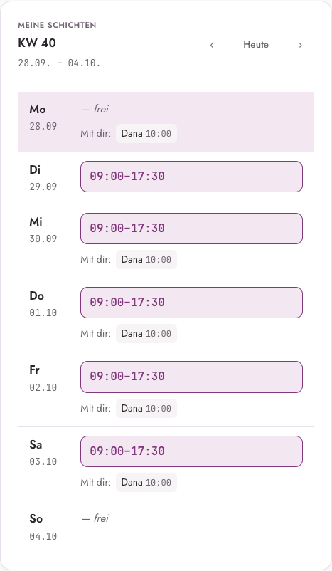
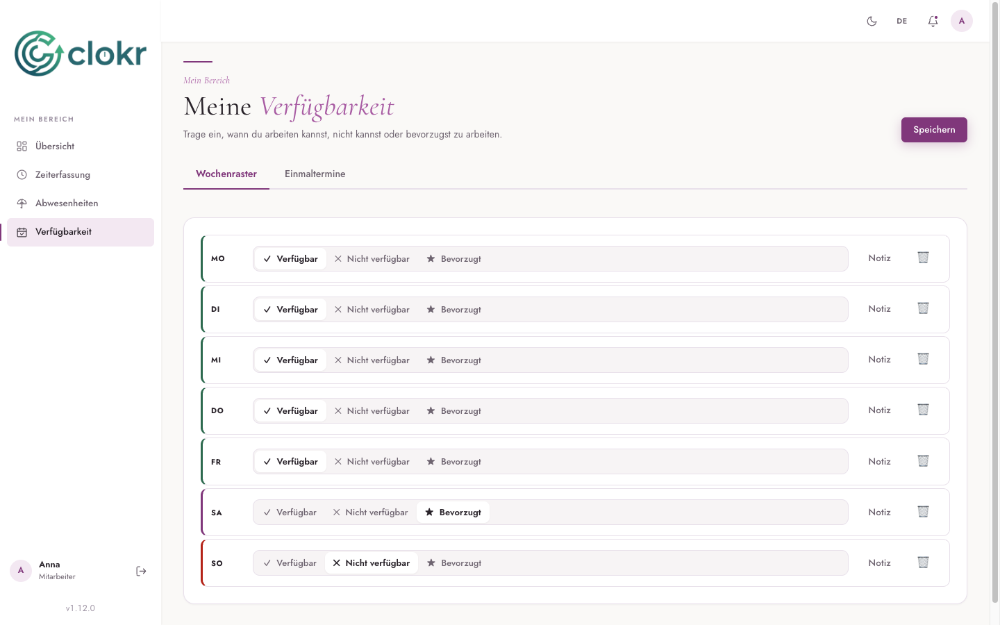
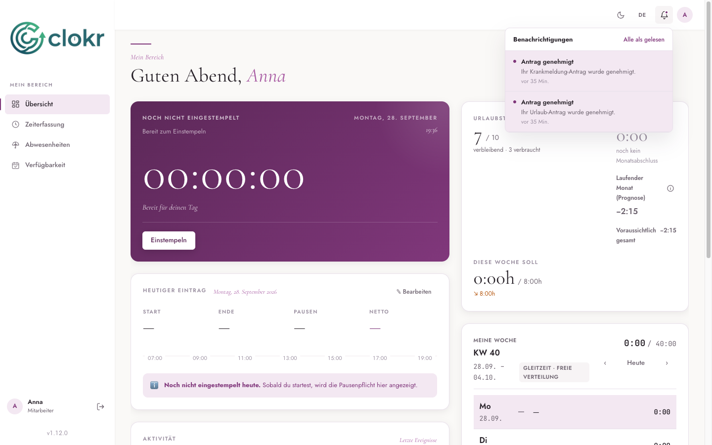

# Verfügbarkeit & Schichten

Diese Seite beschreibt, wie Sie als Mitarbeiter Ihre eigene Verfügbarkeit hinterlegen, Ihre eingeteilten Schichten einsehen und über neue Anträge und Entscheidungen benachrichtigt werden. Die eigentliche Schichtplanung erstellen Managerinnen und Manager – siehe **[[Schichtplanung]]**.

## Eigene Schichten

Arbeiten Sie in einem schichtbasierten Arbeitszeitmodell, zeigt Ihnen das Dashboard die Kachel **„Meine Schichten"** mit einer Wochenansicht:

- pro Tag Ihre eingeteilte(n) Schicht(en) mit Uhrzeit und Vorlagenname
- unter **„Mit dir:"** die Kolleginnen und Kollegen, die zeitgleich eingeteilt sind
- Navigation über **‹**, **Heute** und **›** zur vorherigen/nächsten Woche

Ein Tag ohne Eintrag wird als **„— frei"** angezeigt. Eine eigene Übersichtsseite für Schichten gibt es für Mitarbeitende nicht – die vollständige Wochenplanung mit Zuweisung ist Managerinnen und Managern vorbehalten.

> Wird eine Schicht neu zugewiesen oder geändert, erhalten Sie dafür **keine gesonderte Benachrichtigung** – prüfen Sie regelmäßig die Kachel auf dem Dashboard. Eine Ausnahme: Wirkt sich eine Schichtänderung auf bereits verbrauchte, vorläufig geschätzte Urlaubstage aus, informiert Sie Clokr per Benachrichtigung „Urlaubsverbrauch angepasst" (siehe unten).

> Hinweis: Die Kachel **„Meine Schichten"** erscheint nur bei einem schichtbasierten Arbeitszeitmodell (SHIFT_BASED). Bei anderen Arbeitszeitmodellen zeigt das Dashboard stattdessen die Kachel **„Meine Woche"**.

<!-- SCREENSHOT file=images/verfuegbarkeit-und-schichten-01-meine-schichten.png role=mitarbeiter url=/dashboard show="Dashboard-Kachel 'Meine Schichten' für die aktuelle Woche mit den Schichten von Clara Schnitt sowie den 'Mit dir:'-Kolleginnen-Chips (Dana Farbe)" -->

## Verfügbarkeit angeben

Unter **Verfügbarkeit** (nur sichtbar, wenn Ihr Unternehmen diese Funktion nutzt) hinterlegen Sie, wann Sie grundsätzlich arbeiten können. Diese Angaben fließen in die Schichtplanung Ihrer Führungskraft ein – Sie tragen also nur Ihre eigenen Präferenzen ein, die Zuteilung selbst nehmen Sie nicht vor.

Die Seite **„Meine Verfügbarkeit"** bietet zwei Ansichten:

### Wochenraster

Ein wiederkehrendes Muster pro Wochentag (Mo–So) mit drei möglichen Zuständen:

- **Verfügbar** (✓)
- **Nicht verfügbar** (✕)
- **Bevorzugt** (★)

**So geht's:**

1. Wochentag anklicken – der Dialog **„Wochentag bearbeiten"** öffnet sich
2. **Status** wählen (Verfügbar / Nicht verfügbar / Bevorzugt)
3. Optional **Gültig ab** / **Gültig bis** setzen, um das Muster zeitlich zu begrenzen
4. Optional eine **Notiz** (max. 200 Zeichen) ergänzen
5. Mit **Speichern** übernehmen

### Einmaltermine

Für einzelne, vom Wochenmuster abweichende Tage (z. B. ein einmaliger freier Nachmittag) fügen Sie über **+ Einmaltermin hinzufügen** einen datumsbezogenen Eintrag mit denselben drei Status-Optionen hinzu. Ohne Einträge zeigt die Liste „Keine Einmaltermine vorhanden."

Änderungen speichern Sie über den Button **Speichern** oben auf der Seite.

<!-- SCREENSHOT file=images/verfuegbarkeit-und-schichten-02-wochenraster.png role=mitarbeiter url=/availability show="Seite 'Meine Verfügbarkeit', Reiter 'Wochenraster' mit unterschiedlichen Status-Pillen (Verfügbar, Nicht verfügbar, Bevorzugt) für die Wochentage Mo–So" -->

## Benachrichtigungen

Eine eigene Posteingangs-Seite gibt es für Mitarbeitende nicht – Genehmigungsanfragen laufen ausschließlich bei Managerinnen und Managern auf. Ihr Kanal für Benachrichtigungen ist das **Glocken-Symbol** oben rechts in der Kopfzeile:

- Ein Punkt am Symbol zeigt ungelesene Benachrichtigungen an
- Ein Klick öffnet das Dropdown **„Benachrichtigungen"** mit den letzten Einträgen (Titel, Nachricht, relative Uhrzeit wie „vor 5 Min.")
- **Alle als gelesen** markiert alle Einträge auf einmal
- Ein Klick auf eine Benachrichtigung markiert sie als gelesen und führt Sie direkt zur betroffenen Stelle (z. B. zum Zeiteintrag oder Antrag)
- Ohne offene Benachrichtigungen zeigt das Dropdown „Keine neuen Benachrichtigungen"

Für Sie als Mitarbeiter relevante Benachrichtigungen sind unter anderem:

- **Antrag genehmigt** / **Antrag abgelehnt** – Entscheidung zu Ihrem Abwesenheitsantrag
- **Urlaubsverbrauch angepasst** – der tatsächliche Verbrauch eines Urlaubsantrags wurde nachträglich korrigiert, sobald der Schichtplan feststeht
- **Offene Stempelung** – Sie sind noch eingestempelt und sollten die Arbeitszeit prüfen
- **Fehlende Zeiteinträge** – seit mehreren Tagen fehlen Einträge
- **Fehlende Zeiteinträge vor Monatsabschluss** – letzte Erinnerung vor dem Abschluss des Monats
- **Zeiteintrag invalidiert** – ein Eintrag wurde automatisch als ungültig markiert, weil das Ausstempeln fehlte
- **Pause bestätigen** – eine automatisch eingetragene Pflichtpause wartet auf Ihre Bestätigung
- **Bevorstehende Abwesenheit** – Erinnerung an einen nahenden genehmigten Urlaub
- **Resturlaub verfällt bald** / **Resturlaub verfällt am …** – Hinweis auf drohenden Verfall von Urlaubstagen
- **Zeitnachtrag genehmigt** / **Zeitnachtrag abgelehnt** – Entscheidung zu einem nachträglich erfassten Zeiteintrag

<!-- SCREENSHOT file=images/verfuegbarkeit-und-schichten-03-benachrichtigungen.png role=mitarbeiter url=/dashboard show="Geöffnetes Benachrichtigungs-Dropdown über das Glocken-Symbol in der Kopfzeile mit mehreren gelesenen/ungelesenen Einträgen und Button 'Alle als gelesen'" -->

## Siehe auch

- **[[Schichtplanung]]** – wie Managerinnen und Manager Schichten planen und zuweisen
- **[[Zeiterfassung]]** – eigene Zeiteinträge, Pausen, Saldo
- **[[Erste Schritte|Erste-Schritte]]** – Navigation und persönliche Einstellungen
- **[[FAQ]]** – häufige Fragen
