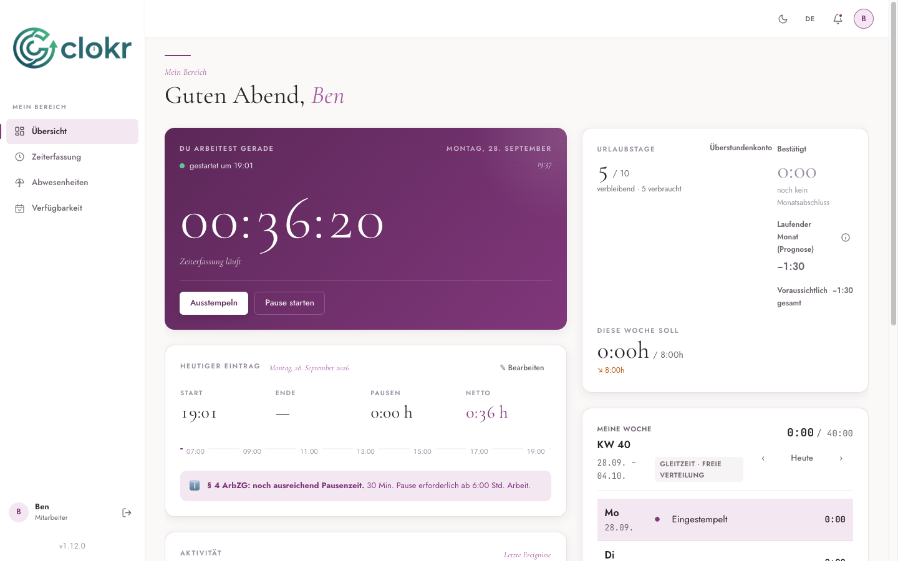
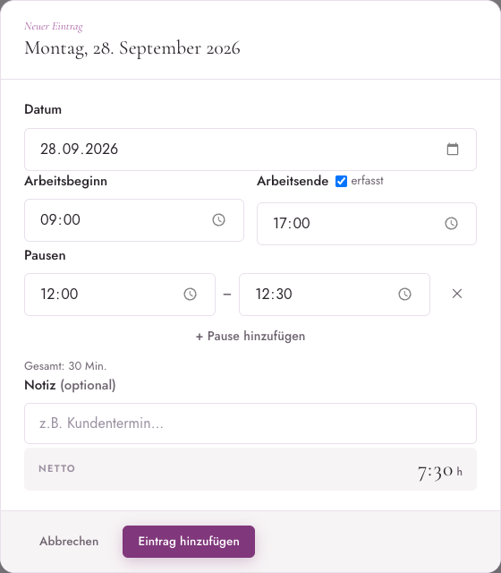

# Zeiterfassung

Diese Seite beschreibt die tägliche Zeiterfassung für Mitarbeitende: Ein-/Ausstempeln, Pausen, eigene Zeiteinträge, nachträgliche Korrekturen sowie die gesetzlichen Hinweise nach dem Arbeitszeitgesetz (ArbZG). Genehmigungen und die Schichtplanung selbst übernehmen Managerinnen und Manager – siehe **[[Schichtplanung]]**.

## Dashboard

Auf der **Übersicht** (Dashboard) sehen Sie alles Zeitrelevante auf einen Blick:

- **Timer-Karte** – zeigt je nach Status **„Noch nicht eingestempelt"**, **„Du arbeitest gerade"** (mit laufender Uhrzeit) oder **„Tag abgeschlossen"**. Bei einem festen Arbeitszeitmodell zusätzlich ein Fortschrittsbalken bis zum Tagesziel.
- **Heutiger Eintrag** – Start, Ende, Pausen und Netto-Arbeitszeit des Tages sowie ein Link **✎ Bearbeiten** direkt zum Eintrag.
- **Aktivität** – die letzten Ereignisse (Stempelungen, Genehmigungen etc.).
- **Urlaubstage** und **Überstundenkonto** – Kurzübersicht Ihres Saldos, Details siehe unten.
- **Meine Woche** – Wochenübersicht mit Status pro Tag (eingestempelt, Urlaub, krank, Feiertag, fehlt …), bei Schichtdienst stattdessen **Meine Schichten**.
- **Offene Vorgänge** – fehlende Zeiteinträge, unbestätigte Pausen, laufende Anträge; leer zeigt „Keine offenen Vorgänge".

> Ist für Sie das ArbZG-Ausnahme-Flag (z. B. leitende Position) gesetzt, blendet Clokr die Stempel-Funktionen komplett aus – das ist beabsichtigt und keine Störung.

<!-- SCREENSHOT file=images/zeiterfassung-01-dashboard.png role=mitarbeiter url=/dashboard show="Dashboard von Ben Muster (aktuell eingestempelt): Timer-Karte 'Du arbeitest gerade', Karte 'Heutiger Eintrag' und Kachel 'Überstundenkonto'" -->

## Ein- und Ausstempeln

Sie haben drei Wege, Ihre Arbeitszeit zu erfassen:

1. **Dashboard-Button** – **Einstempeln** bzw. **Ausstempeln** auf der Übersicht. Während der Arbeitszeit steht Ihnen zusätzlich **Pause starten** / **Pause beenden** zur Verfügung.
2. **NFC-Terminal** – sofern Ihr Unternehmen ein Terminal einsetzt, stempeln Sie mit Ihrer NFC-Karte direkt am Gerät. Die Karte wird von der Administration einmalig Ihrem Profil zugeordnet; Sie müssen nichts weiter einrichten.
3. **WLAN-Präsenz** (optional) – unter **Mein Profil → Meine Geräte** können Sie die **WLAN-Präsenzerkennung aktivieren** und Ihr Diensthandy/-tablet per MAC-Adresse hinterlegen. Danach stempelt Clokr automatisch, sobald sich das Gerät mit dem Firmen-WLAN verbindet bzw. die Verbindung trennt – ohne weiteres Zutun. Details zur Datenspeicherung siehe **[[Erste Schritte|Erste-Schritte]]**.

Ist ein Tag bereits abgeschlossen, können Sie ihn über **Erneut einstempeln** wieder öffnen (sofern der Monat nicht gesperrt ist). Ein Bestätigungsdialog weist darauf hin, dass die Zeit bis zum erneuten Einstempeln als Pause gewertet und die Netto-Arbeitszeit dadurch neu berechnet wird.

## Pausen erfassen und bestätigen

Sofern Ihr Unternehmen die Pausenpflicht-Kontrolle aktiviert hat, trägt Clokr eine gesetzlich vorgeschriebene Pause automatisch ein, wenn Sie länger als 6 bzw. 9 Stunden ohne erfasste Pause arbeiten (§ 4 ArbZG). Ein solcher Eintrag ist zunächst **unbestätigt** und muss von Ihnen geklärt werden:

- **Pause bestätigt** (grün) – die automatisch eingetragene Pause war korrekt
- **Durchgearbeitet** (grau) – Sie haben tatsächlich keine Pause gemacht
- **Pause unbestätigt** (gelb) – noch offen, Handlung nötig

**So geht's, wenn eine Pause unbestätigt ist:**

1. Hinweis „Pause bestätigen" auf dem Dashboard oder Zeiteintrag öffnen
2. **Bestätigen** klicken, wenn die Pause korrekt war, oder **Anpassen**, um die Zeiten zu korrigieren
3. Haben Sie tatsächlich ohne Pause durchgearbeitet: **Durchgearbeitet** klicken, im folgenden Dialog optional einen Grund angeben und mit **Durchgearbeitet bestätigen** abschließen – Ihre Führungskraft wird darüber informiert

> Eine unbestätigte Pause bleibt in Ihren **Offenen Vorgängen** sichtbar und muss vor einem Monatsabschluss geklärt sein.

> Hinweis: Der Hinweis **„Pause unbestätigt"** erscheint nur, wenn Clokr selbst eine Pause eingetragen hat – z. B. nach einer Stempelung per NFC oder WLAN mit mehr als 6 Stunden ohne erfasste Pause.

## Eigene Zeiteinträge

Unter **Zeiterfassung** verwalten Sie Ihre Einträge in zwei Ansichten:

- **Kalender** – Monatsübersicht, jeder Tag farblich nach Soll-Status markiert (erfüllt / teilweise / fehlt / Urlaub / Feiertag …)
- **Liste** – tabellarisch mit den Spalten Datum, Von, Bis, Pause, Netto, Quelle, Notiz (bei Schichtmodellen zusätzlich Saldo)

**Neuen Eintrag erfassen:**

1. **+ Neuer Eintrag** klicken (bzw. einen Tag im Kalender anklicken)
2. Datum, Arbeitsbeginn und Arbeitsende eintragen; bei Bedarf über **+ Pause hinzufügen** eine oder mehrere Pausen erfassen
3. Optional eine Notiz hinterlegen
4. Mit **Eintrag hinzufügen** speichern

> Pro Tag ist genau **ein** Zeiteintrag vorgesehen – beliebig viele Pausen darin sind kein Problem. Existiert für den gewählten Tag bereits ein Eintrag, öffnet Clokr automatisch den vorhandenen zur Bearbeitung statt eines neuen Formulars.

Zum Löschen eines Eintrags ist eine kurze Begründung erforderlich (Dialog **„Eintrag löschen?"**).

<!-- SCREENSHOT file=images/zeiterfassung-03-neuer-eintrag.png role=mitarbeiter url=/time-entries show="Dialog 'Neuer Eintrag' geöffnet mit ausgefülltem Arbeitsbeginn/-ende, einer erfassten Pause und sichtbarer Netto-Anzeige" -->

## Zeiten nachpflegen (Zeitnachtrag)

Liegt ein Tag außerhalb des regulären Bearbeitungsfensters (typischerweise die letzten 10 Tage, Ihr Unternehmen kann das abweichend einstellen), lässt sich der Eintrag nicht mehr direkt speichern. Clokr bietet dafür zwei Varianten an, je nachdem, ob für den Tag bereits ein Eintrag existiert:

- **Neuer Tag ohne bestehenden Eintrag**: Der Eintrag wird sofort angelegt, aber als **„Nachtrag – Genehmigung ausstehend"** markiert; Sie sehen die Meldung „Eintrag gespeichert – wartet auf Genehmigung."
- **Bestehenden Eintrag ändern oder löschen**: Ihre Änderung wird als Antrag eingereicht („Antrag wurde eingereicht. Ein Manager wird deinen Antrag prüfen."); der ursprüngliche Eintrag bleibt bis zur Entscheidung unverändert in Ihrem Saldo wirksam.

In beiden Fällen müssen Sie eine **Begründung** angeben (Pflichtfeld) – ohne sie erscheint „Bitte gib eine Begründung an." bzw. bei fehlenden Zeiten „Bitte gib Von- und Bis-Uhrzeit an."

Einen noch offenen Nachtrags-Antrag können Sie selbst über das Zurückziehen-Symbol in der Liste wieder zurückziehen. Über die Entscheidung Ihrer Führungskraft werden Sie per Benachrichtigung informiert („Zeitnachtrag genehmigt" bzw. „Zeitnachtrag abgelehnt" – eine Ablehnung enthält stets eine Begründung).

## ArbZG-Hinweise

Beim Erfassen eines Eintrags prüft Clokr automatisch die Pausenregeln und weist direkt im Formular darauf hin, wenn:

- bei mehr als **6 Stunden** Arbeitszeit weniger als **30 Minuten** Pause erfasst sind (§ 4 ArbZG)
- bei mehr als **9 Stunden** Arbeitszeit weniger als **45 Minuten** Pause erfasst sind (§ 4 ArbZG)
- die **tägliche Höchstarbeitszeit von 10 Stunden** überschritten ist (§ 3 ArbZG)

Diese Hinweise blockieren das Speichern nicht – Sie können den Eintrag trotzdem sichern und ihn danach korrigieren. Im Hintergrund prüft Clokr außerdem die Mindestruhezeit (§ 5, 11 Stunden zwischen zwei Arbeitstagen) und die wöchentliche Höchstarbeitszeit (§ 3, 48 Stunden).

> **Wichtig:** Die häufig genannte „8-Stunden-Regel" ist gesetzlich ein **Durchschnittswert über 24 Wochen**, keine tägliche Obergrenze. Ein einzelner Tag zwischen 8 und 10 Stunden ist normal und löst keinen Warnhinweis aus – erst wenn Ihr Durchschnitt über einen längeren Zeitraum 8 Stunden pro Werktag übersteigt, reagiert das System. Auf dem Dashboard zeigt die Karte „Heutiger Eintrag" zusätzlich einen laufenden Status zur Pausenerfüllung nach § 4.

Ausführlicher zum rechtlichen Rahmen: **[[Compliance und Revisionssicherheit|Compliance-und-Revisionssicherheit]]**.

## Saldo und Überstunden

Ihren Überstundensaldo sehen Sie an zwei Stellen:

- **Dashboard**, Kachel **Überstundenkonto** – zeigt **Bestätigt** (Ihr fest verbuchter Saldo aus abgeschlossenen Monaten, ändert sich nur beim Monatsabschluss) mit einer Unterzeile wie **Guthaben**, **offen**, **ausgeglichen** oder **noch kein Monatsabschluss**, sowie eine Prognose für den laufenden, noch offenen Monat.
- **Zeiterfassung**, oberhalb des Kalenders/der Liste: **Gesamt-Saldo** (Ihr Lebenszeit-Saldo) und **Monat-Saldo** für den aktuell angezeigten Monat, jeweils mit dem Zusatz **„(Bestätigt)"** bei abgeschlossenen bzw. **„(Prognose)"** bei laufenden Monaten.

Ein positiver Saldo wird mit **+**, ein negativer mit **−** angezeigt. Urlaub, Feiertage und genehmigte Abwesenheiten reduzieren dabei automatisch Ihre Sollstunden.

## Gesperrte Monate

Ist ein Monat abgeschlossen (Monatsabschluss durch die Betriebsleitung), sind Ihre Einträge für diesen Zeitraum **nicht mehr veränderbar** – das gilt auch für Admins, es dient der Revisionssicherheit. In der Liste erkennen Sie das am Badge **🔒 Gesperrt**; die Bearbeiten- und Löschen-Symbole sind deaktiviert. Ein Speicher- oder Löschversuch zeigt die Meldung „Dieser Monat ist gesperrt. Bitte verwende ‚Monat öffnen', um Korrekturen vorzunehmen." – das Öffnen eines abgeschlossenen Monats kann nur Ihre Führungskraft bzw. Administration vornehmen. Wenden Sie sich bei Korrekturbedarf an sie. Mehr zum Ablauf: **[[Monatsabschluss]]**.

## Siehe auch

- **[[Erste Schritte|Erste-Schritte]]** – Anmeldung, Oberfläche, persönliche Einstellungen
- **[[Abwesenheiten]]** – Urlaub, Krankmeldung und deren Wirkung auf Zeiteinträge
- **[[Monatsabschluss]]** – wie und wann Monate abgeschlossen werden
- **[[Arbeitszeitmodelle]]** – Unterschiede zwischen den Arbeitszeitmodellen
- **[[Compliance und Revisionssicherheit|Compliance-und-Revisionssicherheit]]** – rechtlicher Hintergrund
- **[[FAQ]]** – häufige Fragen
