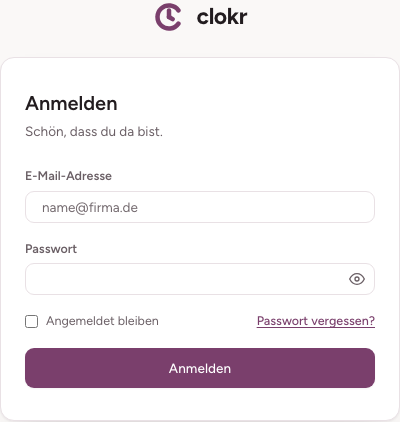
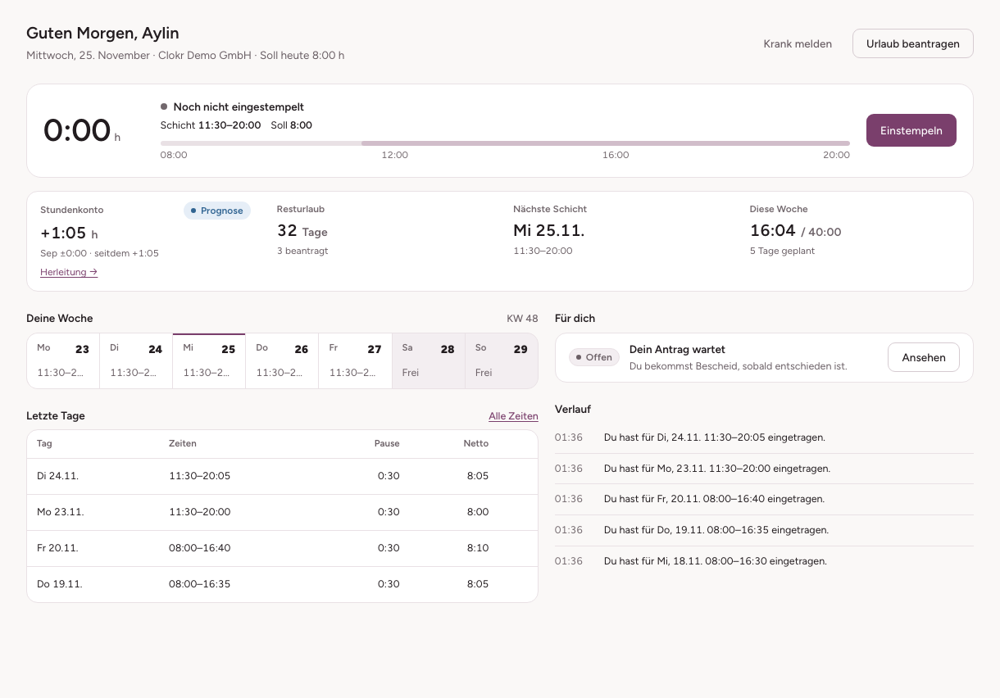
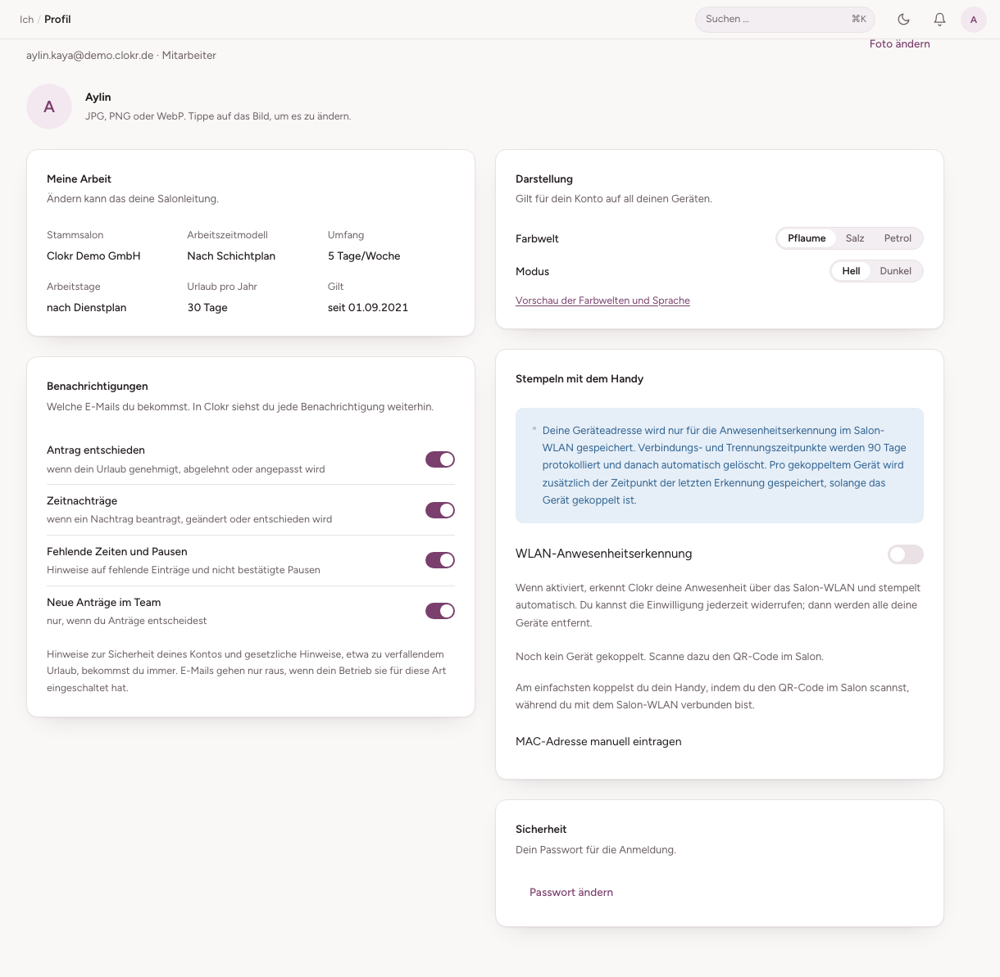

# Erste Schritte

Diese Seite führt dich durch Anmeldung, Einladung, Passwort und die Oberfläche von Clokr. Die Seite gilt für alle, egal ob du Mitarbeiterin, Teamleitung oder in der Verwaltung bist.

## Anmelden

Öffne die Clokr-Adresse deines Unternehmens. Du landest auf der Seite „Anmelden“.

1. Gib deine **E-Mail-Adresse** und dein **Passwort** ein.
2. Aktiviere bei Bedarf **Angemeldet bleiben**, damit du beim nächsten Besuch nicht erneut anmelden musst.
3. Klicke auf **Anmelden**.

Mit dem Auge-Symbol im Passwortfeld machst du deine Eingabe sichtbar. Stimmen die Zugangsdaten nicht, erscheint eine Fehlermeldung über dem Formular.

<!-- SCREENSHOT file=bilder/erste-schritte-01.png role=emp url=/login show="Die Anmeldeseite mit den Feldern E-Mail-Adresse und Passwort, dem Kästchen Angemeldet bleiben, dem Link Passwort vergessen und dem Button Anmelden" -->

## Einladung annehmen

Legt die Verwaltung dich neu in Clokr an, bekommst du eine E-Mail mit einem Einladungslink.

1. Öffne den Link aus der E-Mail. Du landest auf der Seite „Konto aktivieren“.
2. Vergib ein **Passwort**. Die Liste unter dem Feld zeigt dir sofort, welche Regeln noch fehlen.
3. Wiederhole das Passwort im Feld **Passwort bestätigen**.
4. Klicke auf **Konto aktivieren** und danach auf **Zur Anmeldung**.

::: tip Hinweis
Ist der Link abgelaufen oder schon benutzt, zeigt die Seite „Link abgelaufen“ oder „Schon aktiviert“. Wende dich in diesem Fall an deine Verwaltung. Dort bekommst du eine neue Einladung.
:::

## Passwort vergessen

1. Klicke auf der Anmeldeseite auf **Passwort vergessen?**.
2. Gib deine E-Mail-Adresse ein und lass dir den Link schicken.
3. Aus Sicherheitsgründen erscheint immer dieselbe Meldung, egal ob es ein Konto mit dieser Adresse gibt.
4. Öffne den Link aus der E-Mail, lege ein neues Passwort fest und melde dich damit an.

Dein Passwort änderst du auch jederzeit selbst unter **Ich › Profil**, im Abschnitt „Sicherheit“.

## Zusätzlicher Code beim Anmelden

Hat dein Unternehmen die Anmeldung mit Code eingeschaltet, schickt Clokr dir nach dem Passwort einen 6-stelligen Code per E-Mail. Du gibst ihn auf der Seite „Code eingeben“ ein und bestätigst. Kommt keine Mail an, fordere sie mit **Code noch einmal senden** neu an. Ist der Code abgelaufen, meldest du dich noch einmal an. Ob diese Funktion aktiv ist, entscheidet die Verwaltung für das ganze Unternehmen.

## Die Oberfläche

Clokr hat drei Bereiche. Du siehst nur die, für die du Rechte hast:

| Bereich       | Wofür                                                                                                   |
| ------------- | ------------------------------------------------------------------------------------------------------- |
| **Ich**       | Dein Tag, deine Zeiten, Abwesenheiten, dein Dienstplan, dein Konto und dein Profil                      |
| **Team**      | Das Team im Salon: wer heute da ist, Aufgaben, Zeiten, Abwesenheiten, Dienstplan, Berichte und Personen |
| **Verwalten** | Personen, Salons, Regeln, Monatsabschluss, Daten und System                                             |

Am Computer findest du die Bereiche und ihre Seiten links in der Navigation. Oben läuft eine Pfadzeile mit dem Namen der aktuellen Seite.

Auf dem Handy ersetzt eine **Tab-Leiste am unteren Rand** die Navigation. Die wichtigsten Seiten haben dort einen eigenen Tab. Alle weiteren Seiten findest du hinter **Mehr**.

### Oben rechts

- **Suchen** (oder die Tastenkombination Cmd+K am Mac, Strg+K unter Windows): ein Schnellzugriff, mit dem du eine Seite per Namen öffnest.
- **Hell- und Dunkelmodus**: ein Klick wechselt den Modus.
- **Glocke**: deine Benachrichtigungen. Mit **Alle als gelesen** hakst du alle ungelesenen Einträge ab. Ein Klick auf eine Benachrichtigung bringt dich direkt zur passenden Stelle.
- **Dein Bild oder deine Initialen**: das persönliche Menü mit **Profil** und **Abmelden**.

<!-- SCREENSHOT file=bilder/erste-schritte-02.png role=emp url=/ich/tag show="Mein Tag mit Begrüßung, Stempeluhr und Button Einstempeln, den Kennzahlen Stundenkonto, Resturlaub, Nächste Schicht und Diese Woche sowie den Abschnitten Deine Woche, Für dich, Letzte Tage und Verlauf" -->

## Dein Profil

Unter **Ich › Profil** findest du alles, was nur dich betrifft.

- **Foto ändern**: Du lädst ein Bild als JPG, PNG oder WebP hoch.
- **Meine Arbeit**: dein Stammsalon, dein Arbeitszeitmodell, dein Umfang, deine Arbeitstage und dein Urlaubsanspruch für das laufende Jahr. Ändern kann das deine Salonleitung.
- **Wer sieht meine Zeiten?**: welche Rollen deine Zeiteinträge lesen können, wie weit sie reichen und wofür – ohne Namen. Darunter öffnest du „Warum stempeln?“ jederzeit wieder.
- **Benachrichtigungen**: Hier schaltest du ein, zu welchen Anlässen du E-Mails bekommst. Hinweise zur Sicherheit deines Kontos und gesetzliche Hinweise bekommst du immer.
- **Push-Benachrichtigungen** und **Erinnerungen**: siehe [Dienstplan](ich/dienstplan.md).
- **Darstellung**: Farbwelt und Modus. Mehr dazu unten.
- **Stempeln mit dem Handy**: die WLAN-Anwesenheitserkennung, siehe [Mein Tag und Zeiten](ich/mein-tag-und-zeiten.md).
- **Sicherheit**: mit **Passwort ändern** setzt du ein neues Passwort. Du brauchst dafür dein aktuelles.

<!-- SCREENSHOT file=bilder/erste-schritte-03.png role=emp url=/ich/profil show="Die Profilseite mit dem Foto, den Abschnitten Meine Arbeit, Benachrichtigungen, Darstellung, Stempeln mit dem Handy und Sicherheit" -->

### Erscheinungsbild

Unter **Ich › Profil › Erscheinungsbild** wählst du die Farbwelt und den Modus (hell oder dunkel). Die Einstellung gehört zu deinem Konto und gilt auf all deinen Geräten.

### Handy koppeln

Die Seite **Ich › Profil › Handy koppeln** öffnet sich, wenn du im Salon den QR-Code für die WLAN-Anwesenheit scannst. Dort siehst du dein Gerät und gibst deine Einwilligung. Mit **Das ist mein Handy – koppeln** schließt du die Kopplung ab. Mehr dazu auf der Seite [Mein Tag und Zeiten](ich/mein-tag-und-zeiten.md).

## Automatische Abmeldung

Aus Sicherheitsgründen meldet Clokr dich nach einer Zeit ohne Aktivität automatisch ab. Wie lange das dauert, legt dein Unternehmen fest. Wurdest du unerwartet auf die Anmeldeseite geleitet, ist das meist die Ursache. Melde dich einfach noch einmal an.

## Wie es weitergeht

- [Ich](ich/index.md): alles für deinen Alltag als Mitarbeiterin oder Mitarbeiter
- [Mein Tag und Zeiten](ich/mein-tag-und-zeiten.md): ein- und ausstempeln, Pausen, Zeiten nachtragen
- [Abwesenheiten](ich/abwesenheiten.md): Urlaub beantragen, krankmelden
