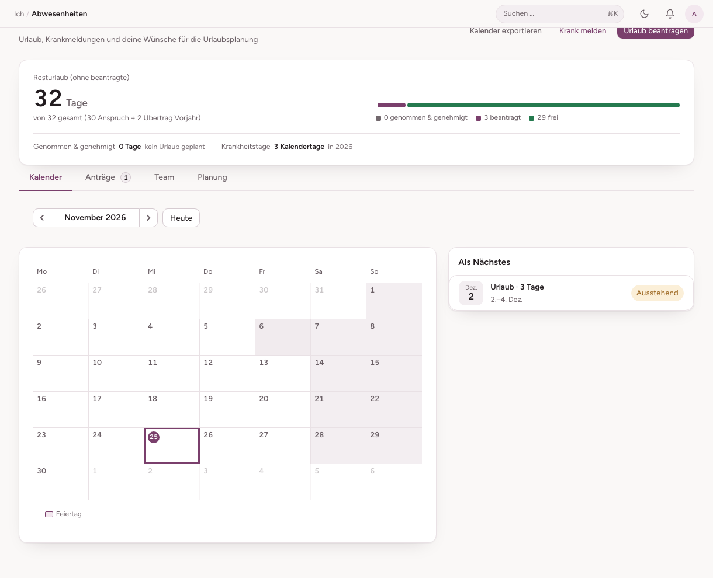
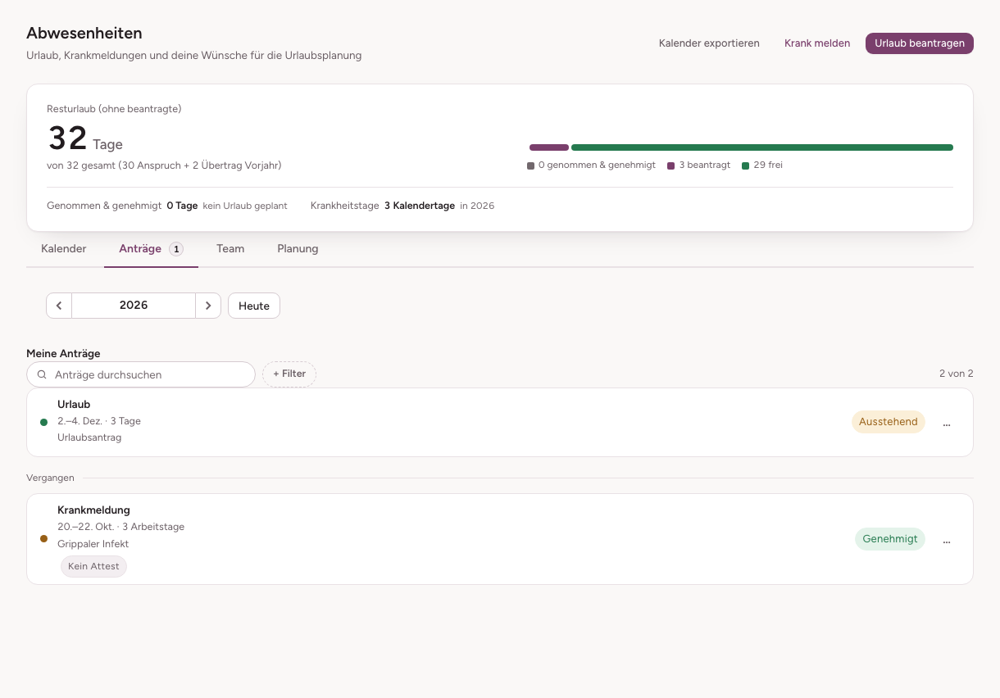

# Abwesenheiten

Hier beantragst du Urlaub, meldest dich krank und siehst, wer im Team wann fehlt. Die Seite dazu ist **Ich › Abwesenheiten**. Genehmigt wird dein Antrag von deiner Führungskraft.

## Die Seite im Überblick

Oben stehen deine Zahlen: dein **Resturlaub** mit einem Balken, der zeigt, wie viele Tage genommen und genehmigt, beantragt und noch frei sind. Darunter wechselst du zwischen vier Reitern:

- **Kalender**: dein Monat mit eigenen und, je nach deinen Rechten, den Abwesenheiten der Kolleginnen und Kollegen. Je nach Rechten siehst du die Art oder nur „abwesend“.
- **Anträge**: deine eigenen Anträge als Liste. Eine Zahl am Reiter zeigt, wie viele noch auf eine Entscheidung warten.
- **Team**: wer im Team wann abwesend ist, in einer Zeitleiste.
- **Planung**: deine Urlaubswünsche, siehe unten.

Mit **Kalender exportieren** lädst du deine Abwesenheiten oder die des Teams als Datei für Outlook, Google Kalender oder Apple Kalender.

<!-- SCREENSHOT file=bilder/abwesenheiten-01.png role=emp url=/ich/abwesenheiten show="Abwesenheiten mit Resturlaub-Karte, den Reitern Kalender, Anträge, Team und Planung und dem Monatskalender" -->

## Urlaub beantragen

1. Klicke auf **Urlaub beantragen** (oder auf einen Tag im Kalender, oder ziehe über mehrere Tage).
2. Wähle die **Art der Abwesenheit**, hier „Urlaub“.
3. Trage den Zeitraum ein. Bei einem einzelnen Tag kannst du **Halber Tag** aktivieren (nicht bei einer Krankmeldung).
4. Schreibe optional eine **Anmerkung**, zum Beispiel „Hochzeit“.
5. Klicke auf **Antrag einreichen**.

Das Formular zeigt dir sofort, wie viele Tage der Antrag verbraucht, was von deinem Resturlaub bleibt und wer im selben Zeitraum noch fehlt. Reicht dein Resturlaub nicht, warnt es dich: „Nicht genug Resturlaub vorhanden“.

Übertragene Urlaubstage aus dem Vorjahr können verfallen. Steht beim Übertrag ein Datum, plane diese Tage vorrangig.

### Welche Arten es gibt

| Art                       | Bezahlt | Genehmigung       |
| ------------------------- | ------- | ----------------- |
| Urlaub                    | ja      | ja                |
| Überstundenausgleich      | ja      | ja                |
| Sonderurlaub (mit Anlass) | ja      | ja                |
| Bildungsurlaub            | ja      | ja                |
| Krankmeldung              | ja      | nein, gilt sofort |
| Kinderkrank               | ja      | nein, gilt sofort |
| Unbezahlter Urlaub        | nein    | ja                |
| Mutterschutz              | ja      | Meldung           |
| Elternzeit                | nein    | Meldung           |

Welche Arten du siehst, hängt von deinen Rechten und den Einstellungen deines Unternehmens ab.

- **Sonderurlaub**: Du wählst zusätzlich einen **Anlass** aus einer Liste, die die Verwaltung pflegt.
- **Überstundenausgleich**: Das Formular zeigt dir dein Guthaben und warnt, wenn der Antrag es übersteigt.

## Krankmeldung

Klicke auf **Krank melden** (auf **Ich › Mein Tag** oder hier). Der Dialog heißt „Krank melden“. Wähle „Krankmeldung“ oder „Kinderkrank“, trage den Zeitraum ein und klicke auf **Krankmeldung senden**. Eine Krankmeldung braucht keine Genehmigung und gilt sofort. Halbe Kranktage gibt es nicht, deshalb fehlt die Option für diese Arten.

Ein ärztliches Attest trägt deine Führungskraft oder die Verwaltung ein. Ob eines hinterlegt ist, siehst du am Hinweis **Attest** oder **Kein Attest** an deinem Antrag.

## Status deiner Anträge

Auf dem Reiter **Anträge** zeigt jeder Antrag seinen Status:

| Status                | Bedeutung                                                                    |
| --------------------- | ---------------------------------------------------------------------------- |
| Ausstehend            | wartet auf Genehmigung                                                       |
| Genehmigt             | bestätigt, im Kalender sichtbar, zählt für dein Konto                        |
| Abgelehnt             | nicht genehmigt, mit Begründung                                              |
| Stornierung beantragt | du willst einen genehmigten Antrag zurücknehmen, eine Entscheidung steht aus |
| Zurückgezogen         | von dir zurückgenommen oder nach einer genehmigten Stornierung beendet       |

Hinweise wie „Vorläufig“ oder „Angepasst“ erscheinen bei älteren Anträgen mit Schichtplan. Neue Anträge bekommen sie nicht mehr.

<!-- SCREENSHOT file=bilder/abwesenheiten-02.png role=emp url=/ich/abwesenheiten?tab=antraege show="Die Liste der eigenen Anträge mit Statusanzeigen" -->

### Antrag bearbeiten, zurückziehen, stornieren

Am Ende jeder Zeile öffnet ein Menü die Aktionen, die für den Status möglich sind:

- **Noch ausstehender Antrag**: Du kannst ihn bearbeiten oder mit **Zurückziehen** zurücknehmen. Dabei nennst du kurz einen Grund.
- **Genehmigter Antrag**: Mit **Stornieren** beantragst du die Stornierung und nennst einen Grund. Der Urlaub bleibt bis zur Entscheidung aktiv, im Kalender sichtbar und zählt weiter. Aus Revisionsgründen bestätigt eine **andere** Führungskraft als die, die ihn genehmigt hat. Du kannst deine eigene Stornierung nicht genehmigen.

::: tip Hinweis
Solange die Stornierung aussteht, darfst du für diesen Zeitraum schon Zeiten erfassen. Diese Zeiten werden zunächst als ungültig markiert und zählen erst, wenn die Stornierung genehmigt ist. Lehnt deine Führungskraft ab, bleibt der Urlaub genehmigt und die Zeiten bleiben ungültig.
:::

## Urlaub und Zeiterfassung

Für einen Tag mit **genehmigtem** Urlaub kannst du dich nicht einstempeln und keine Zeit eintragen. Clokr meldet: „§ 8 BUrlG: Heute ist Urlaub genehmigt. Bitte zuerst stornieren.“ Willst du an dem Tag doch arbeiten, beantragst du zuerst die Stornierung. Das gilt auch für Mutterschutz und Elternzeit.

## Urlaub bei Schichtplan

Arbeitest du nach Schichtplan, steht der Plan oft erst fest, wenn der Urlaub längst beantragt ist. Deshalb:

- Beantrage alle Tage, die frei sein sollen, auch einen Samstag, wenn du ein langes Wochenende willst.
- Eine ganze Woche Urlaub kostet höchstens so viele Tage, wie dein Vertrag Arbeitstage pro Woche hat. Sonntage und gesetzliche Feiertage kosten keinen Urlaubstag.
- Mehrere Anträge in derselben Kalenderwoche werden zusammen gerechnet, nicht einzeln. Die Vorschau im Formular zeigt dir schon beim Eintragen, was ein Antrag kostet.
- Bereits genehmigte Anträge ändern sich nicht von allein.
- Wirst du im Urlaub krank, reichst du die Arbeitsunfähigkeitsbescheinigung ein. Deine Führungskraft schreibt die Krankheitstage dann gut (§ 9 BUrlG).

## Urlaubswünsche für die Planung

Eröffnet deine Führungskraft eine Urlaubsplanung, trägst du auf dem Reiter **Planung** deine Wünsche ein:

1. Klicke auf **Wunsch hinzufügen**.
2. Gib **Von** und **Bis** an, bei einem einzelnen Tag optional **Halber Tag**.
3. Speichere den Wunsch. Unter „Meine Wünsche“ siehst du alle und kannst sie bearbeiten oder entfernen.

Ein Wunsch ist noch kein Urlaub. Deine Führungskraft kann ihn in die Planung übernehmen. Ein übernommener Wunsch lässt sich nicht mehr ändern. Überschneidet sich ein Wunsch mit einem Antrag, weist dich Clokr darauf hin. Die Kolleginnen und Kollegen siehst du in der Planung nur neutral als „abwesend“.
