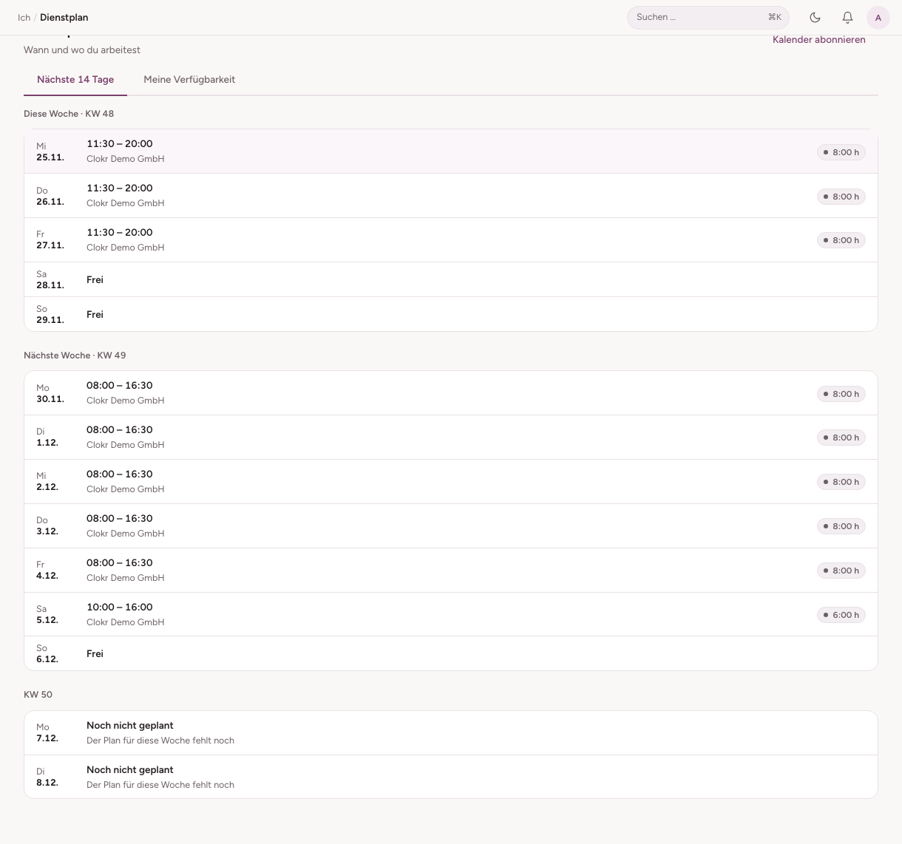

# Dienstplan

Hier siehst du, wann und wo du arbeitest, sagst deiner Salonleitung, wann du arbeiten kannst, und bleibst über Benachrichtigungen, Erinnerungen und deinen Handy-Kalender auf dem Laufenden. Die Seite dazu ist **Ich › Dienstplan**. Den Dienstplan selbst planen Führungskräfte unter **Team › Dienstplan**.

## Deine Schichten

Auf dem Reiter **Nächste 14 Tage** stehen deine Tage der nächsten zwei Wochen, nach Wochen gruppiert. Zu jedem Tag siehst du:

- deine Schicht mit Uhrzeit und, wenn es einen gibt, dem Namen der Vorlage
- eine Markierung **anderer Salon**, wenn du an dem Tag woanders eingeteilt bist
- die Arbeitszeit der Schicht in Stunden
- **Feiertag** oder **Abwesend**, wenn der Tag ein Feiertag ist oder du Urlaub oder eine Abwesenheit hast

Ein heutiger Tag ist hervorgehoben. Hast du noch keine Schichten, steht dort „Noch keine Schichten geplant“. Sobald deine Salonleitung dich einplant, siehst du hier, wann und wo du arbeitest.

<!-- SCREENSHOT file=bilder/dienstplan-01.png role=emp url=/ich/dienstplan show="Der Reiter Nächste 14 Tage mit den Schichten der kommenden Wochen" -->

## Verfügbarkeit angeben

Der Reiter **Meine Verfügbarkeit** erscheint nur, wenn dein Unternehmen die Verfügbarkeit nutzt. Dort sagst du deiner Salonleitung, wann du arbeiten kannst, wann nicht und wann du lieber arbeitest. Du trägst nur deine Wünsche ein. Eingeteilt wirst du von der Salonleitung.

Du schaltest zwischen zwei Ansichten um:

- **Jede Woche**: ein wiederkehrendes Muster pro Wochentag, Montag bis Sonntag. Pro Tag wählst du **Verfügbar**, **Nicht verfügbar** oder **Bevorzugt**.
- **Einzelne Tage**: Ausnahmen vom Wochenmuster, zum Beispiel ein freier Nachmittag. Mit **+ Einmaltermin hinzufügen** legst du einen Tag mit demselben Status an. Ohne Einträge steht dort „Keine Einmaltermine vorhanden.“

Beim Bearbeiten kannst du zusätzlich festlegen, ab und bis wann ein Eintrag gilt, und eine Notiz ergänzen. Mit **Verfügbarkeit speichern** übernimmst du deine Änderungen, über die Leiste verwirfst du sie wieder. Beim Entfernen eines Eintrags bleiben bereits geplante Schichten bestehen.

## Kalender abonnieren

Mit **Kalender abonnieren** oben auf der Seite bekommst du einen Link für deine Kalender-App (Google Kalender, Apple Kalender, Outlook). Der Button erscheint nur, wenn du ihn nutzen darfst. Deine Schichten, dein Urlaub und die Feiertage stehen dann in deinem Kalender und bleiben dort aktuell. Krankheit steht dort nur als „Abwesend“.

1. Klicke auf **Kalender abonnieren** und dann auf **Link erstellen**.
2. Klicke auf **Link kopieren** und füge ihn in deiner Kalender-App als Abo ein, oder öffne ihn mit **In Kalender-App öffnen**.

::: warning Achtung
Der Link ist nur im Moment des Erstellens sichtbar. Wer ihn hat, sieht deinen Dienstplan. Gib ihn nicht weiter. Hast du ihn aus Versehen geteilt, erstellst du einen **neuen Link**, dann hört der bisherige sofort auf zu funktionieren. Mit **Abo beenden** trennst du den Kalender ganz.
:::

## Benachrichtigungen

Dein Kanal für Benachrichtigungen ist die **Glocke** oben rechts. Ein Punkt zeigt Ungelesenes an. Ein Klick öffnet die letzten Einträge, **Alle als gelesen** hakt sie ab, und ein Klick auf einen Eintrag führt dich zur betroffenen Stelle. Ohne Neues steht dort „Keine neuen Benachrichtigungen“.

Das meldet dir Clokr unter anderem:

- die Entscheidung zu einem Abwesenheitsantrag
- „Urlaubsverbrauch angepasst“, wenn sich der Verbrauch eines Urlaubsantrags nach der Planung ändert
- „Offene Stempelung“, wenn du noch eingestempelt bist
- „Fehlende Zeiteinträge“, auch kurz vor dem Monatsabschluss
- „Pause bestätigen“ für eine automatisch eingetragene Pause
- „Zeitnachtrag genehmigt“ oder „Zeitnachtrag abgelehnt“
- „Bevorstehende Abwesenheit“ als Erinnerung an genehmigten Urlaub
- eine Warnung, wenn Resturlaub bald verfällt

Welche dieser Meldungen du zusätzlich per E-Mail bekommst, stellst du unter **Ich › Profil** im Abschnitt „Benachrichtigungen“ ein.

## Push auf dem Handy

Hat dein Unternehmen Push-Benachrichtigungen eingerichtet, siehst du unter **Ich › Profil** den Abschnitt „Push-Benachrichtigungen“. Du schaltest Push **pro Gerät** ein:

1. Öffne **Ich › Profil** auf dem Gerät, das Push bekommen soll.
2. Klicke auf **Push aktivieren** und erlaube die Benachrichtigungen im Browser.
3. Mit **Test senden** prüfst du, ob es ankommt. In der Geräteliste entfernst du Geräte wieder.

Auf dem Sperrbildschirm erscheint nur ein neutraler Hinweis, keine Namen und keine Zeiten. Hast du Push im Browser blockiert, erlaubst du Clokr die Benachrichtigungen in den Browser-Einstellungen.

## Erinnerungen an Schicht und Zeit

Hat dein Unternehmen Erinnerungen eingeschaltet, erinnert Clokr dich per Push, wenn du eine geplante Schicht hast:

- **Bei Schichtbeginn erinnern**, wenn du dich nicht eingestempelt hast
- **Bei Schichtende erinnern**, wenn du noch eingestempelt bist
- **Abends erinnern, wenn deine Zeit fehlt**, wenn du an einem Schichttag nichts erfasst hast

Unter **Ich › Profil** im Abschnitt „Erinnerungen“ schaltest du jede davon für dich aus. Der Text dort nennt auch die Minuten und die Uhrzeit, die dein Unternehmen eingestellt hat. Gestempelt wird nie automatisch. Du bestätigst es in der App. Ohne geplante Schicht bekommst du keine Erinnerung.
