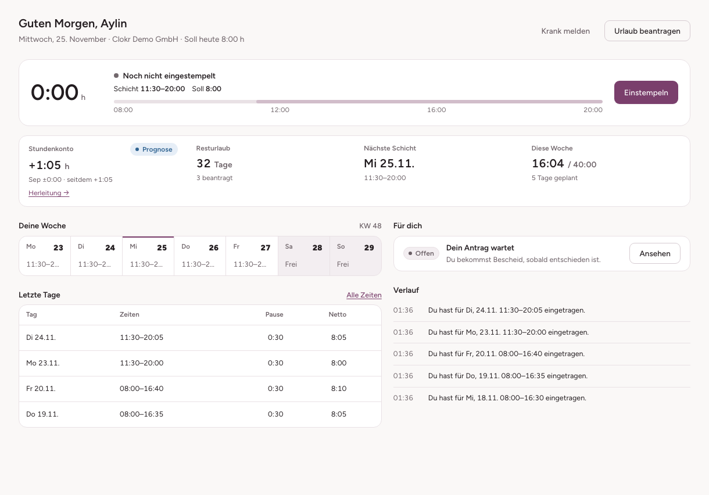
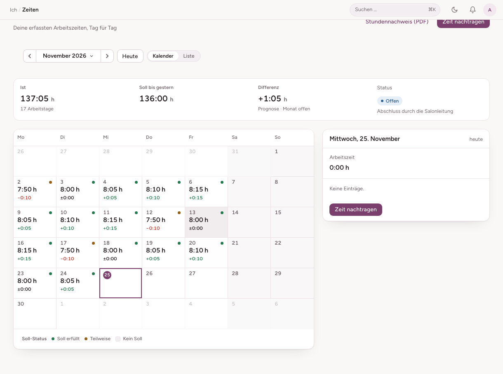
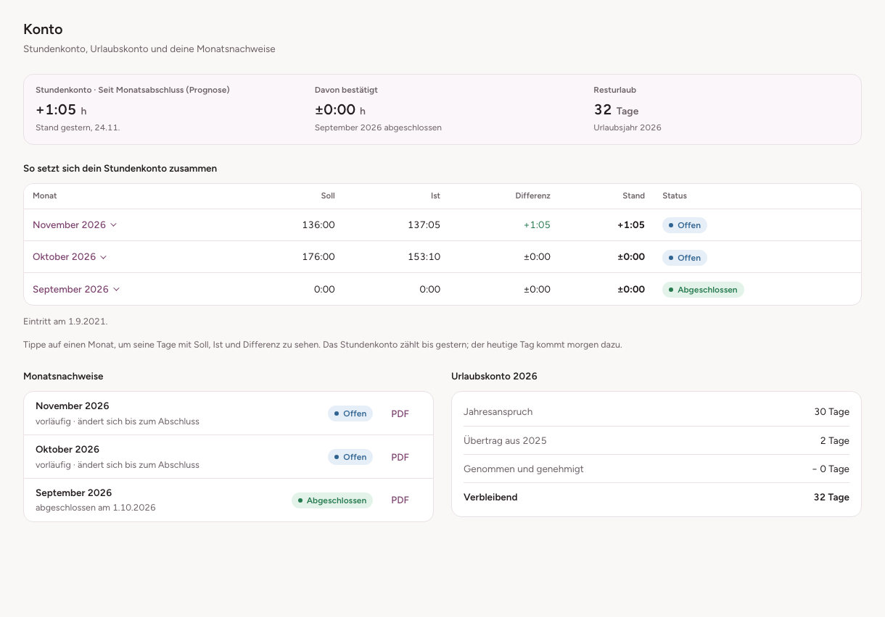

# Mein Tag und Zeiten

Hier erfährst du, wie du deine Arbeitszeit erfasst: ein- und ausstempeln, Pausen, Zeiten ansehen und nachtragen, dein Stundenkonto verstehen. Die Seiten dazu sind **Ich › Mein Tag**, **Ich › Zeiten** und **Ich › Konto**.

## Mein Tag

**Ich › Mein Tag** ist deine Startseite für den Arbeitstag. Oben steht die Uhr mit deinem Status:

- „Noch nicht eingestempelt“
- „Du arbeitest“ mit der laufenden Arbeitszeit
- „Pause“, solange eine Pause läuft
- „Ausgestempelt um …“, wenn dein Tag abgeschlossen ist

Neben dem Status stehen die Buttons für das, was gerade möglich ist.

### Ein- und ausstempeln

1. Klicke auf **Einstempeln**, wenn du anfängst.
2. Für eine Pause klickst du auf **Pause**. Die Zeit wird später von deinem Eintrag abgezogen. Mit **Weiterarbeiten** beendest du die Pause.
3. Klicke zum Feierabend auf **Ausstempeln**.

Arbeitest du in mehreren Salons, wählst du vor dem Einstempeln den Salon aus. Hast du den Tag schon abgeschlossen und arbeitest doch weiter, öffnest du ihn mit **Wieder einstempeln**. Clokr fragt vorher nach. Die Zeit zwischen Ausstempeln und erneutem Einstempeln zählt dann als Pause.

Ist der Monat schon abgeschlossen, steht dort „Monat abgeschlossen“ und der Eintrag lässt sich nicht mehr ändern. Eine Korrektur dafür beschreibt der Abschnitt [Gesperrte Monate](#gesperrte-monate).

Du kannst auch ohne Knopfdruck stempeln:

- **NFC-Karte am Terminal**, wenn dein Unternehmen ein Terminal einsetzt. Die Karte ordnet dir die Verwaltung einmalig zu.
- **Handy im Salon-WLAN**, wenn du es gekoppelt hast. Siehe [Stempeln mit dem Handy im WLAN](#stempeln-mit-dem-handy-im-wlan).

Gilt für dich keine Pflicht zur Zeiterfassung (§ 18 ArbZG), zeigt Clokr dir die Stempel-Buttons gar nicht an. Das ist beabsichtigt.

<!-- SCREENSHOT file=bilder/mein-tag-und-zeiten-01.png role=emp url=/ich/tag show="Mein Tag mit der Stempeluhr (noch nicht eingestempelt) und dem Button Einstempeln, darunter die Kennzahlen zu Stundenkonto, Resturlaub und Diese Woche" -->

### Was sonst auf Mein Tag steht

- **Kennzahlen**: „Stundenkonto“ (mit dem Zusatz „Prognose“, solange der Monat läuft), „Resturlaub“, „Nächste Schicht“ oder „Nächster Arbeitstag“ und „Diese Woche“.
- **Deine Woche**: ein Streifen mit deinen Tagen der Woche und dem Stand jedes Tages.
- **Letzte Tage**: deine Zeiten der letzten zwei Wochen mit Pause, Arbeitszeit und Saldo des Tages. Fehlt die Pause, steht dort „Pause fehlt“. **Alle Zeiten** führt zu **Ich › Zeiten**.
- **Für dich**: was gerade offen ist, zum Beispiel eine Pause zum Bestätigen, ein fehlender Eintrag oder ein Antrag, der noch wartet. Steht dort „Nichts offen. Alles erledigt.“, ist alles geklärt.
- **Verlauf**: deine letzten Ereignisse, etwa Stempelungen und Entscheidungen.
- **Krank melden** und **Urlaub beantragen** oben rechts führen direkt in den Antrag, siehe [Abwesenheiten](abwesenheiten.md).

### „Warum stempeln?“ beim ersten Mal

Bei deiner ersten Anmeldung steht unter den Kennzahlen eine Karte „Warum stempeln?“. Die Karte nennt drei Gründe: Das Gesetz verlangt die Erfassung deiner Arbeitszeit, sie schützt dich vor unbezahlter Arbeit, und jede gestempelte Minute zählt für dein Stundenkonto. Mit **Verstanden** oder **Überspringen** blendest du die Karte aus; die Karte kommt auf keinem deiner Geräte wieder. Den Text findest du jederzeit unter **Ich › Profil**: Dort öffnet **„Warum stempeln?“ ansehen** dieselben drei Gründe noch einmal.

## Pausen bestätigen

Arbeitest du länger als 6 Stunden ohne erfasste Pause, trägt Clokr die gesetzlich vorgeschriebene Pause nach § 4 ArbZG automatisch ein. Das gilt, wenn dein Unternehmen die Pausenprüfung eingeschaltet hat. Ein solcher Eintrag ist zuerst **unbestätigt**. Du findest ihn unter „Für dich“ auf **Ich › Mein Tag** und als Hinweis „Pause bestätigen“ auf **Ich › Zeiten**.

So klärst du ihn:

1. Öffne den Tag über den Hinweis.
2. Klicke auf **Bestätigen**, wenn die Pause so stimmt.
3. Klicke auf **Anpassen**, wenn du die Zeiten ändern willst.
4. Klicke auf **Durchgearbeitet**, wenn du wirklich keine Pause gemacht hast. Optional nennst du einen Grund. Deine Führungskraft wird informiert.

::: warning Achtung
Eine unbestätigte Pause bleibt als offener Punkt stehen und sollte vor dem Monatsabschluss geklärt sein.
:::

## Zeiten

Unter **Ich › Zeiten** siehst du deine erfassten Arbeitszeiten, Tag für Tag. Oben wählst du den Monat. Du schaltest zwischen zwei Ansichten um:

- **Kalender**: jeder Tag ist nach seinem Stand eingefärbt, zum Beispiel „Soll erfüllt“, „Teilweise“ oder „Fehlt“. Urlaub, Feiertage und Berufsschule haben eigene Markierungen. Eine Legende erklärt die Farben.
- **Liste**: alle Einträge des Monats mit Datum, Zeit, Pause und Arbeitszeit.

Über dem Kalender steht **Dein Monat in Zahlen**, zum Beispiel Gearbeitet, Monatssaldo, Gesamtsaldo, Pausen, Ist, Soll und Differenz. Solange der Monat läuft, zählt der Monat bis gestern. Hat dein Vertrag kein Soll, erfasst du trotzdem Zeiten, nur ohne Vergleich.

Klickst du einen Tag an, öffnet sich das Tagesfenster mit allen Einträgen des Tages, mit **Bearbeiten** und **Löschen**. Pro Tag kannst du **mehrere Einträge** haben, solange sie sich nicht überschneiden. Jeder Eintrag gehört zu einem Salon. Mit **Weiteren Eintrag an diesem Tag** legst du einen weiteren an. Pro Eintrag sind mehrere Pausen möglich.

Mit **Stundennachweis (PDF)** oben erstellst du deinen Stundennachweis für den gewählten Monat.

<!-- SCREENSHOT file=bilder/mein-tag-und-zeiten-02.png role=emp url=/ich/zeiten show="Zeiten im Kalender mit den Kennzahlen Ist, Soll bis gestern, Differenz und Status, den Tageswerten der einzelnen Tage und der Legende zum Soll-Status" -->

### Zeit nachtragen

1. Klicke auf **Zeit nachtragen** (oder auf einen Tag im Kalender).
2. Prüfe das **Datum** und trage **Arbeitsbeginn** und **Arbeitsende** ein. Für einen laufenden Eintrag lässt du das Ende offen.
3. Füge bei Bedarf eine oder mehrere **Pausen** hinzu.
4. Wähle den **Salon**, wenn du in mehreren arbeitest. Sonst trägt Clokr ihn laut Plan ein.
5. Schreibe optional eine **Notiz** und speichere.

Die Arbeitszeit rechnet Clokr dir beim Eintragen vor. Wirst du zwischen zwei Salons eingesetzt, kannst du die **Fahrzeit zwischen Salons** als eigenen Eintrag erfassen. Der Weg von und nach Hause ist keine Arbeitszeit.

Zum Löschen eines Eintrags nennst du einen kurzen Grund („Eintrag löschen?“).

### Weit zurückliegende Tage

Für die letzten Tage, üblicherweise 10, kannst du Einträge direkt ändern. Dein Unternehmen kann dieses Fenster anders einstellen. Der Dialog zeigt dir das Datum, ab dem es gilt. Für frühere Tage stellst du einen **Antrag auf rückwirkende Bearbeitung**:

1. Trage die gewünschten Zeiten ein.
2. Schreibe eine **Begründung**. Das Feld ist ein Pflichtfeld.
3. Klicke auf **Antrag stellen**.

Bis zur Entscheidung gilt der bisherige Stand. Deine Führungskraft entscheidet unter **Team › Aufgaben**. Du bekommst eine Benachrichtigung („Zeitnachtrag genehmigt“ oder „Zeitnachtrag abgelehnt“). Eine Ablehnung hat immer eine Begründung. Einen noch offenen Antrag kannst du selbst zurückziehen.

### Hinweise zum Arbeitszeitgesetz

Beim Erfassen prüft Clokr deine Zeiten und markiert den Tag, wenn etwas auffällt:

- Mehr als 6 Stunden Arbeitszeit brauchen mindestens 30 Minuten Pause, mehr als 9 Stunden mindestens 45 Minuten (§ 4 ArbZG). Eine Pause zählt erst ab 15 Minuten, und nach spätestens 6 Stunden am Stück muss eine Pause liegen.
- Als Höchstarbeitszeit gelten 10 Stunden am Tag (§ 3 ArbZG).
- Zwischen zwei Arbeitstagen müssen mindestens 11 Stunden Ruhezeit liegen (§ 5 ArbZG).
- Unter 18 Jahren gelten die strengeren Pausenregeln des Jugendarbeitsschutzgesetzes (§ 11 JArbSchG).

Die Hinweise verhindern das Speichern nicht. Du kannst den Eintrag sichern und danach korrigieren. Den rechtlichen Hintergrund findest du unter [Compliance und Revisionssicherheit](../hintergrund/compliance.md).

::: tip Hinweis
Die „8-Stunden-Regel“ ist gesetzlich ein Durchschnitt über 24 Wochen, keine Grenze pro Tag. Ein einzelner Tag zwischen 8 und 10 Stunden ist erlaubt und löst keinen Hinweis aus.
:::

### Gesperrte Monate

Hat die Verwaltung einen Monat abgeschlossen, kannst du seine Einträge nicht mehr ändern. Das gilt für alle, auch für die Verwaltung selbst. Stimmt in einem abgeschlossenen Monat etwas nicht, fragst du eine **Korrektur** an: Öffne den Tag und wähle die Korrektur. Im Dialog „Korrektur anfragen“ gibst du Beginn, Ende und Pause an und beschreibst, was nicht stimmt (mindestens 10 Zeichen). Mit **Anfrage senden** schickst du sie ab. Die Anfrage verändert den abgeschlossenen Monat nicht. Wird sie genehmigt, bucht Clokr die Korrektur in den laufenden Monat. Das entscheidet eine andere Person als du.

## Konto

**Ich › Konto** zeigt dir, wie dein Stundenkonto entsteht, und dein Urlaubskonto.

- **Stundenkonto**: dein Saldo, also Guthaben oder Minus. Er zählt bis gestern, der heutige Tag kommt morgen dazu. **Davon bestätigt** ist der Teil aus abgeschlossenen Monaten. Er ändert sich nur durch einen Monatsabschluss. Der Rest ist eine Prognose für den laufenden Zeitraum und kann sich bewegen. Hast du noch keinen Monatsabschluss, steht dort, dass noch kein Monat bestätigt ist.
- **So setzt sich dein Stundenkonto zusammen**: eine Tabelle pro Monat mit Soll, Ist, Differenz und Stand. Ein Klick auf einen Monat zeigt seine Tage.
- **Monatsnachweise**: Für jeden Monat lädst du den Stundennachweis als PDF herunter. Ein abgeschlossener Monat zeigt sein Datum, ein offener ist „vorläufig“.
- **Urlaubskonto**: Jahresanspruch, Übertrag aus dem Vorjahr, genommen und genehmigt, verbleibend. Verfällt ein Übertrag, steht das Datum dabei.

Ein Plus zeigt Clokr mit **+**, ein Minus mit **−**. Urlaub, Feiertage und genehmigte Abwesenheiten senken dein Soll automatisch.

<!-- SCREENSHOT file=bilder/mein-tag-und-zeiten-03.png role=emp url=/ich/konto show="Konto mit den Kennzahlen zu Stundenkonto und Resturlaub, der Tabelle So setzt sich dein Stundenkonto zusammen, den Monatsnachweisen und dem Urlaubskonto" -->

## Hinweis auf vermutlich nicht erfasste Zeit

Wenn dein Unternehmen es eingerichtet hat, gleicht Clokr die Termine aus dem Terminkalender deines Salons mit deiner erfassten Zeit ab. Einen Hinweis siehst du in **Für dich** auf **Ich › Mein Tag** und als gelben Kasten auf **Ich › Zeiten**, wenn für einen vergangenen Tag eines davon zutrifft:

- Dein letzter Termin endete mehr als 15 Minuten nach deinem Ausstempeln.
- Du hattest Termine, aber an dem Tag keine Zeit erfasst.

Der Hinweis nennt den Tag, das Ende deines letzten Termins und, falls du ausgestempelt hast, die Zeit. Du hast zwei Möglichkeiten:

- **Nachtragen** öffnet den Tag. Du trägst deine Zeit selbst ein, Clokr füllt nichts vor.
- **Stimmt so** blendet den Hinweis für diesen Tag dauerhaft aus, zum Beispiel weil du nach dem letzten Termin wirklich Feierabend hattest. Das wird mit Datum und Uhrzeit festgehalten. Auch deine Führungskraft sieht den Hinweis dann nicht mehr.

Clokr trägt nie selbst Zeit ein und ändert dein Stundenkonto nicht. Hinweise gibt es nur für die Tage, die du noch selbst bearbeiten darfst, nicht für heute, nicht für Tage mit Urlaub oder Krankheit und nicht für abgeschlossene Monate. Unter **Ich › Profil** steht im Abschnitt „Abgleich mit deinen Terminen“, dass abgeglichen wird, solange dein Unternehmen den Abgleich eingeschaltet hat.

## Stempeln mit dem Handy im WLAN

Wenn dein Unternehmen es eingerichtet hat, erkennt Clokr dich über das Salon-WLAN und stempelt für dich ein und aus. Dafür koppelst du dein Handy einmal:

1. Verbinde dein Handy mit dem Salon-WLAN.
2. Scanne den QR-Code im Salon.
3. Prüfe auf der Seite **Ich › Profil › Handy koppeln** dein Gerät und klicke auf **Das ist mein Handy – koppeln**.

Alternativ trägst du unter **Ich › Profil** im Abschnitt „Stempeln mit dem Handy“ die Adresse deines Geräts per Hand ein (**MAC-Adresse manuell eintragen**). Im selben Abschnitt schaltest du die **WLAN-Anwesenheitserkennung** ein oder aus und entfernst Geräte. Schaltest du sie aus oder widerrufst du die Einwilligung, entfernt Clokr alle deine Geräte.

::: tip Hinweis zum Datenschutz
Clokr speichert die Geräteadresse nur für die Anwesenheitserkennung im Salon-WLAN. Verbindungs- und Trennungszeiten werden 90 Tage protokolliert und danach automatisch gelöscht.
:::
