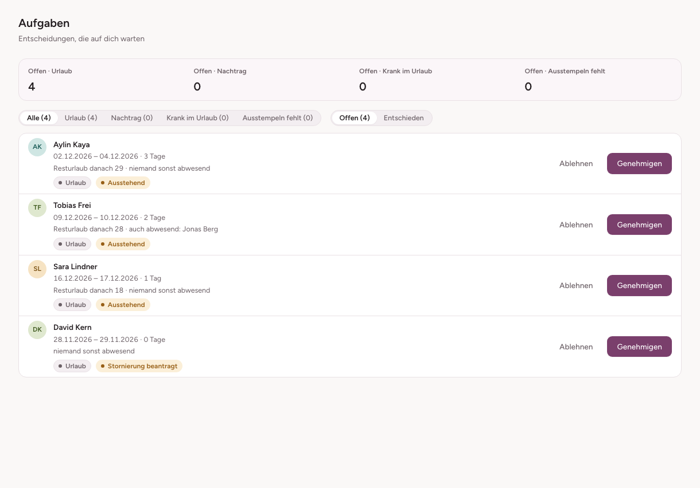

# Aufgaben

Auf **Team › Aufgaben** entscheidest du alles, was auf dich wartet: Urlaubs- und andere Abwesenheitsanträge, Stornierungen, Zeitnachträge und weitere offene Vorgänge deines Teams. Du siehst nur Anträge von Personen, für die du zuständig bist, in der Regel die Mitarbeitenden deiner Salons.

## Die Seite im Überblick

Oben zählen Kennzahlen die offenen Aufgaben je Art. Darunter steht die Liste:

- **Art der Aufgabe** (nur sichtbar, wenn es mehrere Arten gibt): schränkt die Liste auf eine Art ein.
- **Offen** und **Entschieden**: Du wechselst zwischen dem, was noch wartet, und dem, was schon entschieden ist.

Die Arten sind:

| Art               | Was ist zu tun                                                                                    |
| ----------------- | ------------------------------------------------------------------------------------------------- |
| Urlaub            | einen Abwesenheitsantrag genehmigen oder ablehnen, auch eine beantragte Stornierung               |
| Nachtrag          | einen Zeitnachtrag prüfen, also Zeiten, die jemand nach Ablauf des Bearbeitungsfensters nachträgt |
| Krank im Urlaub   | eine Krankheit während eines genehmigten Urlaubs klären (§ 9 BUrlG)                               |
| Pausenbefund      | einen offenen Pausenbefund klären                                                                 |
| Ausstempeln fehlt | einen Eintrag ohne Ende klären                                                                    |
| Zeit prüfen       | einen Hinweis auf vermutlich nicht erfasste Zeit ansehen (siehe unten)                            |
| Zeitkorrektur     | eine Korrektur für einen abgeschlossenen Monat entscheiden                                        |

Ein neuer Antrag löst eine Benachrichtigung aus. Die Benachrichtigung erscheint an der Glocke oben rechts und führt dich direkt zum Antrag.

<!-- SCREENSHOT file=bilder/aufgaben-01.png role=manager url=/team/aufgaben show="Aufgaben mit den Kennzahlen, den Reitern Offen und Entschieden und mehreren offenen Anträgen mit den Buttons Ablehnen und Genehmigen" -->

## Abwesenheitsanträge entscheiden

1. Öffne **Team › Aufgaben**.
2. Genehmige oder lehne den Antrag direkt in der Zeile ab. **Ablehnen** fragt nach einem Grund, den du angeben musst. **Genehmigen** zeigt dir vorher die Fakten der Entscheidung und fragt nach.
3. Möchtest du erst alles sehen, klicke auf den Titel der Zeile. Im Dialog „Antrag prüfen“ stehen Person, Art, Zeitraum, Umfang und die Anmerkung. Unter „Im gleichen Zeitraum abwesend“ siehst du, wer sonst abwesend ist. Das hilft bei Engpässen.
4. Entscheide dort mit **Genehmigen** oder **Ablehnen**. Bei einer Ablehnung gibst du eine Begründung an („Pflicht beim Ablehnen“).

Einige Hinweise können dabei erscheinen:

- Bei einem Urlaubsantrag erinnert ein Hinweis an § 7 BUrlG: Der Antrag muss zeitnah entschieden werden. Urlaub muss im laufenden Jahr gewährt werden, sonst kann er nach § 7 Abs. 3 BUrlG am 31. März des Folgejahres verfallen.
- Sind im Zeitraum Kundentermine gebucht, fragt Clokr vor der Genehmigung nach („Kundentermine im Zeitraum gebucht“). Mit **Trotzdem fortfahren** genehmigst du trotzdem.
- Überschreitet die Genehmigung eine Urlaubsgrenze, bittest Clokr dich um eine **Begründung der Ausnahme**. Mit **Trotzdem genehmigen** bestätigst du sie.
- Bei einer Krankmeldung kannst du vermerken, ob ein **Attest** vorliegt, mit Gültigkeitszeitraum.

Anträge, die schon genehmigt sind, korrigierst du unter **Team › Abwesenheiten** auf dem Reiter „Anträge“ über **Korrigieren**. Dafür ist eine Begründung Pflicht. Liegt der Monat schon im Monatsabschluss, lehnt Clokr die Korrektur ab.

### Stornierungen

Ein genehmigter Antrag wird nie direkt storniert:

1. Die Person oder eine Führungskraft beantragt die **Stornierung**. Der Status wechselt zu „Stornierung beantragt“. Der Urlaub bleibt bis zur Entscheidung aktiv, steht weiter im Kalender und sperrt die reguläre Zeiterfassung.
2. Eine **andere** Führungskraft entscheidet im Dialog „Stornierungsantrag prüfen“ mit **Stornierung genehmigen** oder **Stornierung ablehnen**.

Während die Stornierung aussteht, dürfen für den Zeitraum Zeiten erfasst werden. Diese Zeiten gelten zunächst als ungültig und zählen nicht für Saldo und Soll. Genehmigst du die Stornierung, werden sie automatisch wieder gültig. Lehnst du sie ab, bleiben sie ungültig und müssen von Hand geklärt werden.

### Krank im Urlaub (§ 9 BUrlG)

Überschneidet sich eine spätere Krankmeldung mit genehmigtem Urlaub, legt Clokr einen eigenen Vorgang „Krank im Urlaub“ an. Mit **AU liegt vor** bestätigst du die ärztliche Bescheinigung. Du gibst an, von wann bis wann sie gilt und ob sie elektronisch vorliegt oder auf Papier, und kannst die Papier-AU hochladen. Die betroffenen Urlaubstage werden danach gutgeschrieben. Mit **Ablehnen** weist du den Vorgang zurück, mit **Wieder eröffnen** nimmst du ihn später wieder auf.

## Zeitnachträge entscheiden

Hat jemand einen Tag außerhalb des Bearbeitungsfensters nachgetragen, steht der Antrag als Aufgabe „Nachtrag“ in der Liste.

1. Öffne den Antrag über den Titel. Du siehst die Person, den Tag, das Alter des Antrags im Vergleich zum erlaubten Fenster, die vorgeschlagenen Zeiten (Von, Bis, Pause) und die Begründung der Person.
2. Bei Bedarf änderst du die vorgeschlagenen Zeiten **vor der Genehmigung**. Deine Werte gelten dann, und Clokr protokolliert die Korrektur.
3. Schreibe optional einen Kommentar, bei einer Ablehnung ist er Pflicht.
4. Klicke auf **Genehmigen** oder **Ablehnen**.

Genehmigst du, wird der Eintrag gültig und zählt. Lehnst du ab, wird er entfernt. Liegt der Tag in einem abgeschlossenen Monat, lässt sich der Antrag nicht mehr entscheiden.

## Vier-Augen-Regel

Clokr setzt das Vier-Augen-Prinzip durch, unabhängig von deiner Rolle:

- **Keine Selbstgenehmigung**: Eigene Anträge und eigene Zeitnachträge kannst du nicht entscheiden. Statt der Buttons steht dort „Eigene Anträge können nicht selbst genehmigt werden.“
- **Stornierung braucht eine zweite Person**: Weder die Person, die die Stornierung beantragt hat, noch die, die den Urlaub genehmigt hat, darf sie freigeben.
- **Zeitkorrekturen für abgeschlossene Monate** entscheidet weder die Person, die sie gestellt hat, noch die Person, um deren Zeiten es geht.
- Die direkte Korrektur eines Zeiteintrags auf [Team › Zeiten](zeiten.md) ist davon ausgenommen. Dort darfst du auch deinen eigenen Eintrag bearbeiten.

## Zeit prüfen

Die Art „Zeit prüfen“ gibt es nur, wenn dein Unternehmen den Abgleich mit Terminen eingeschaltet hat. Eine Zeile bedeutet: Bei einer Person endete der letzte Termin eines vergangenen Tages mehr als 15 Minuten nach dem Ausstempeln, oder sie hatte Termine, aber an dem Tag keine Zeit erfasst. Du siehst nur Personen, deren Zeiten du sehen darfst. **Prüfen** öffnet den Tag der Person auf [Team › Zeiten](zeiten.md). Dort korrigierst du bei Bedarf den Eintrag mit den bekannten Dialogen.

Clokr trägt nie selbst Zeit ein. Die Person selbst beantwortet den Hinweis mit **Stimmt so**, wenn ihre erfasste Zeit vollständig ist. Danach verschwindet die Zeile bei dir. Korrigierst du den Eintrag, verschwindet sie von allein.

## Pausenbefunde und fehlende Stempelungen

Zeilen der Arten „Pausenbefund“ und „Ausstempeln fehlt“ haben keinen eigenen Entscheidungsweg. Der Button an der Zeile (zum Beispiel **Klären** oder **Korrigieren**) öffnet die passende Seite, auf der du die Sache mit den bekannten Dialogen klärst.
