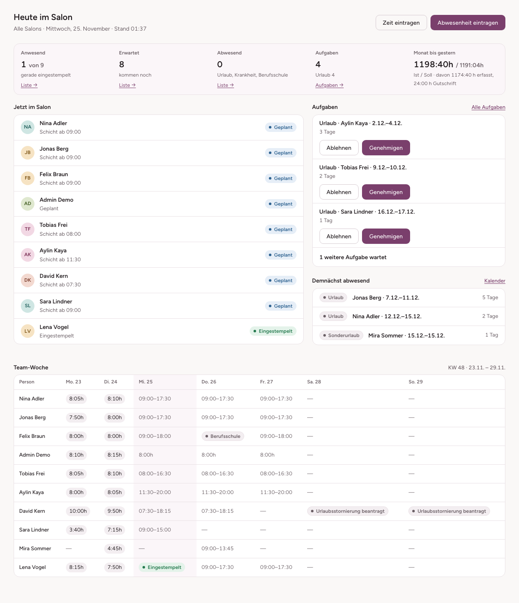

# Team

Der Bereich **Team** ist für Teamleitungen und alle, die Verantwortung für andere tragen: wer heute im Salon ist, Anträge entscheiden, Zeiten prüfen, den Dienstplan planen und Berichte erstellen. Du siehst nur die Personen, für die du zuständig bist, in der Regel die Mitarbeitenden deiner Salons. Welche Seiten du bekommst, hängt von deinen Rechten ab, siehe [Rollen und Rechte](../verwalten/rollen-und-rechte.md).

## Ich möchte …

| Ich möchte …                                              | Seite in Clokr            | Handbuch                    |
| --------------------------------------------------------- | ------------------------- | --------------------------- |
| sehen, wer heute im Salon ist und was fehlt               | **Team › Heute im Salon** | [unten](#heute-im-salon)    |
| Urlaub, Stornierungen und Zeitnachträge entscheiden       | **Team › Aufgaben**       | [Aufgaben](aufgaben.md)     |
| Zeiten meines Teams prüfen, korrigieren oder nachtragen   | **Team › Zeiten**         | [Zeiten](zeiten.md)         |
| sehen, wer wann abwesend ist, und Abwesenheiten eintragen | **Team › Abwesenheiten**  | [unten](#abwesenheiten)     |
| Schichten planen                                          | **Team › Dienstplan**     | [Dienstplan](dienstplan.md) |
| Auswertungen und Exporte ansehen                          | **Team › Berichte**       | [Berichte](berichte.md)     |
| die Personen meines Teams nachschlagen                    | **Team › Personen**       | [unten](#personen)          |

## Heute im Salon

**Team › Heute im Salon** ist deine Übersicht für den Tag. Oben stehen die Kennzahlen **Heute im Salon in Zahlen**. Darunter findest du:

- **Jetzt im Salon**: wer heute da ist, wer fehlt oder abwesend ist. Jede Zeile zeigt den Status der Person als Hinweis, zum Beispiel eingestempelt, fehlt, Feiertag oder abwesend. Ein Klick öffnet die Zeiten der Person, wenn du diese Seite nutzen darfst. Mit dem Filter schränkst du die Liste auf einen Status ein, **Alle zeigen** hebt ihn wieder auf.
- **Fehlende Zeiten**: Personen mit Tagen ohne Eintrag in diesem Monat. Ein Klick führt zum ersten betroffenen Tag.
- **Aufgaben**: die ersten offenen Anträge, direkt zu entscheiden. **Alle Aufgaben** öffnet [Team › Aufgaben](aufgaben.md).
- **Demnächst abwesend**: wer in den nächsten Wochen fehlt. **Kalender** öffnet **Team › Abwesenheiten**.

Oben rechts findest du die Abkürzungen **Zeit eintragen** und **Abwesenheit eintragen**, wenn du die Rechte dafür hast.

<!-- SCREENSHOT file=bilder/team-01.png role=manager url=/team/heute show="Heute im Salon mit den Kennzahlen, der Liste Jetzt im Salon und den Abschnitten Fehlende Zeiten, Aufgaben und Demnächst abwesend" -->

## Abwesenheiten

**Team › Abwesenheiten** zeigt die Urlaube, Krankmeldungen und anderen Abwesenheiten deines Teams. Oben wählst du den Zeitraum (Jahr, Quartal oder Monat) und blätterst vor und zurück. Es gibt drei Reiter:

- **Übersicht**: eine Zeitleiste mit allen Personen. Standardmäßig siehst du deinen eigenen Personenkreis. Der Filter **Personenkreis** mit der Auswahl **Alle Salons** nimmt die übrigen Salons dazu. Mit „Person suchen“ findest du jemanden direkt. Unter der Leiste erklärt eine Legende die Farben.
- **Anträge**: alle Anträge des Teams als Liste, filterbar nach Status, Art und Person. Je nach Status und Rechten stehen pro Zeile Aktionen zur Verfügung, zum Beispiel **Korrigieren** oder **Attest erfassen**.
- **Planung**: die Urlaubsplanung mit den Wünschen deines Teams. Mit **Planung verwalten** richtest du sie ein und übernimmst Wünsche.

**Abwesenheit eintragen** legt eine Abwesenheit für eine Person an, zum Beispiel eine Krankmeldung. Mit **Kalender abonnieren** holst du die Abwesenheiten in deine Kalender-App. Neue Anträge entscheidest du nicht hier, sie warten auf [Team › Aufgaben](aufgaben.md).

## Personen

**Team › Personen** ist die Nachschlageliste der Personen in deinem Bereich: Name mit Personalnummer, Stammsalon, Vertrag, Wochenstunden, Rollen und Status. Du suchst, sortierst und filterst nach Salon, Status und Vertrag. Über die Zeile gelangst du zu den Zeiten der Person, wenn du diese Seite nutzen darfst.

Hier bearbeitest du nichts. Daten einer Person ändert die Verwaltung unter **Verwalten › Personen**.
