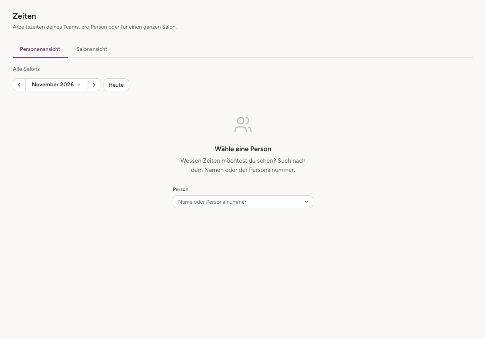

# Zeiten

Auf **Team › Zeiten** prüfst du die Zeiterfassung deines Teams, korrigierst fehlerhafte Einträge und trägst für Personen Zeiten nach. Du siehst nur Personen, für die du zuständig bist, in der Regel die Mitarbeitenden deiner Salons.

## Zwei Ansichten

Oben wechselst du zwischen zwei Reitern:

- **Personenansicht**: die Zeiten einer einzelnen Person.
- **Salonansicht**: alle Einträge eines Salons im gewählten Monat, nach Tag und Person geordnet. Die Ansicht zeigt jeden Eintrag einzeln und bildet keine Summen.

Den Monat wählst du über die Monatsleiste.

## Zeiten einer Person ansehen

1. Wähle in der Personenansicht eine Person. Solange keine Person gewählt ist, steht dort „Wähle eine Person“. Du suchst nach dem Namen oder der Personalnummer.
2. Wähle den Monat und schalte zwischen **Kalender** und **Liste** um.
3. Die Kennzahlen **Monat in Zahlen** zeigen Gearbeitet, Soll, Differenz, Monatssaldo, Gesamtsaldo und Pausen der Person, so wie sie die Person selbst auf **Ich › Zeiten** sieht. Der Status sagt, ob der Monat läuft oder abgeschlossen ist.

Im Kalender ist jeder Tag nach seinem Stand eingefärbt. Fehlt an einem Tag der Eintrag, steht dort **Fehlt** oder die fehlende Zeit in Stunden. Eine Legende erklärt die Farben. Ein Klick auf einen Tag öffnet das Tagesfenster mit allen Einträgen des Tages. Unter dem Kalender fasst eine Zeile die Auffälligkeiten des Monats zusammen: Tage mit Hinweisen zur Pause oder zur Arbeitszeit.

<!-- SCREENSHOT file=bilder/team-zeiten-01.png role=manager url=/team/zeiten show="Zeiten in der Personenansicht mit dem Hinweis Wähle eine Person und dem Auswahlfeld für Name oder Personalnummer" -->

## Hinweise zum Arbeitszeitgesetz

Clokr prüft jeden Tag und markiert Auffälligkeiten am Tag, mit „ArbZG-Hinweis“ oder „prüfen“. Im Tagesfenster stehen die Einzelheiten, zum Beispiel:

- Die Tagessumme liegt über der Höchstarbeitszeit von 10 Stunden (§ 3 ArbZG).
- Zu den Pausen des Tages liegt ein Befund nach § 4 ArbZG vor, bei Jugendlichen nach § 11 JArbSchG.

Die Hinweise sind eine Kontrolle und blockieren das Speichern nicht. Im Tagesfenster kannst du Pausen eintragen oder löschen und einen Pausenverstoß mit Begründung quittieren, sofern du das darfst. Die Quittung ersetzt keine Pause, sie hält fest, dass der Befund geprüft und begründet wurde, und der Verstoß bleibt dokumentiert. Die rechtlichen Grundlagen stehen unter [Compliance und Revisionssicherheit](../hintergrund/compliance.md).

## Zeit eintragen und korrigieren

**Zeit eintragen** (oben rechts, sobald eine Person gewählt ist) legt für die Person einen Eintrag an: Datum, Arbeitsbeginn, Arbeitsende, Pausen und optional eine Notiz. Für einen neuen Eintrag brauchst du keine Begründung. Pro Tag kann eine Person mehrere Einträge haben, solange sie sich nicht überschneiden. **Weiteren Eintrag an diesem Tag** legt einen weiteren an.

So korrigierst du einen vorhandenen Eintrag:

1. Öffne den Tag und wähle **Bearbeiten** am Eintrag.
2. Ändere Beginn, Ende, Pausen oder Notiz.
3. Trage eine **Begründung** ein. Das Feld ist ein Pflichtfeld, wenn du den Eintrag einer **anderen** Person änderst („Begründung ist erforderlich (revisionssicherheitspflichtig).“). Bei deinem eigenen Eintrag brauchst du keine.
4. Speichere.

Beim **Löschen** eines Eintrags verlangt Clokr immer eine Begründung („Eintrag löschen?“). Der Eintrag wird dabei nicht endgültig gelöscht, sondern bleibt nachvollziehbar protokolliert.

## Ungültige Einträge

Einträge, die durch eine ausstehende Urlaubsstornierung oder einen abgelehnten Zeitnachtrag ungültig sind, hebt Clokr hervor. Diese Einträge zählen nicht für Soll, Ist und Saldo, bis sie wieder gültig sind. Das geschieht automatisch, wenn eine Stornierung genehmigt wird (siehe [Aufgaben](aufgaben.md)).

## Gesperrte Monate

Hat die Verwaltung einen Monat abgeschlossen, sind seine Einträge schreibgeschützt, auch für dich und die Verwaltung. Ein Versuch zu speichern oder zu löschen scheitert, weil der Monat gesperrt ist. Eine nötige Korrektur läuft als Anfrage, die ein anderer Mensch genehmigt und die Clokr im laufenden Monat bucht. Wie du sie entscheidest, steht unter [Aufgaben](aufgaben.md), wie sie angefragt wird, auf der Seite [Mein Tag und Zeiten](../ich/mein-tag-und-zeiten.md).
