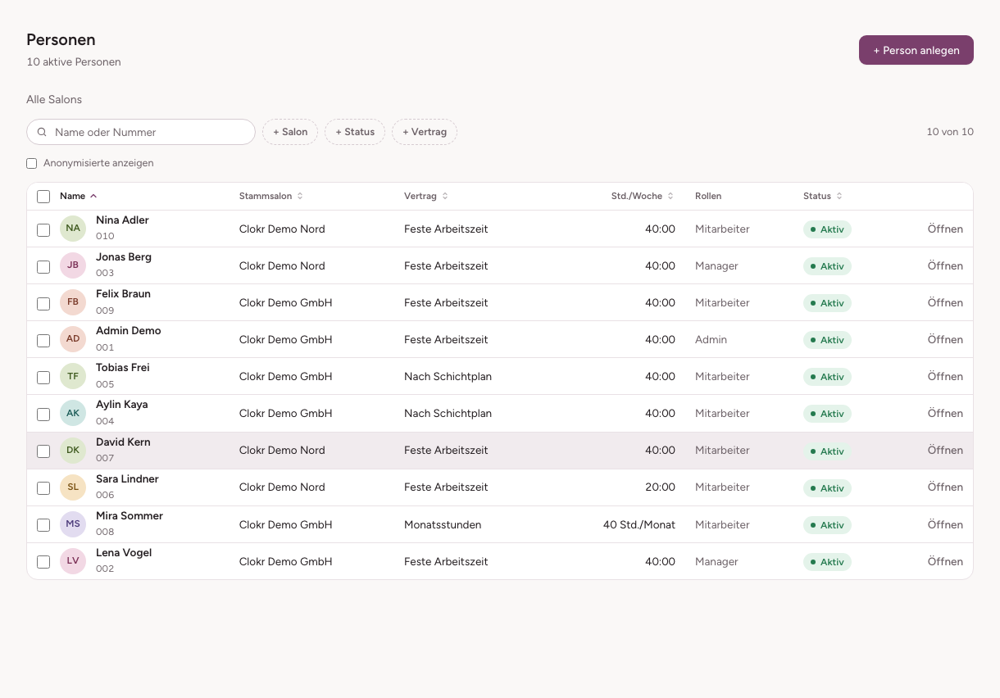

# Arbeitszeitmodelle

Das Arbeitszeitmodell legt fest, wie Clokr das Soll einer Person berechnet. Es gibt vier Modelle. Du stellst sie pro Person im Vertrag ein und legst Vorgaben für das ganze Unternehmen unter **Verwalten › Regeln › Arbeitszeit & Verträge** fest.

## Wo du das Modell einstellst

Öffne **Verwalten › Personen**, wähle die Person und öffne den Reiter **Vertrag**. Im Abschnitt **Arbeitszeitmodell** wählst du eines der vier Modelle und trägst die passenden Werte ein. Beim Anlegen einer Person tust du dasselbe im Schritt „Vertrag“, siehe [Personen](personen.md#person-anlegen).

<!-- SCREENSHOT file=bilder/arbeitszeitmodelle-01.png role=admin url=/verwalten/personen show="Die Personenliste mit den Spalten Vertrag und Std./Woche, in denen das Arbeitszeitmodell jeder Person steht" -->

## Die vier Modelle

### Feste Arbeitszeit

Du hinterlegst für jeden Wochentag eine feste Stundenzahl, zum Beispiel Montag bis Freitag je 8 Stunden unter **Wochenstunden je Tag**. Die Wochenstunden und die Arbeitstage ergeben sich daraus. Das Soll eines Tages ist genau der hinterlegte Wert.

### Gleitzeit

Du hinterlegst ein **Wochenstunden-Soll**. Wie sich die Stunden auf die Tage verteilen, ist frei. Die **Arbeitstage** legst du über die Wochentage fest. Diese Tage sind die Grundlage für den Urlaubsverbrauch und den anteiligen Urlaubsanspruch. Optional gibst du eine Kernzeit an: **Kernzeitbeginn**, **Kernzeitende** und **Kerntage**. Die Kernzeit ist nur zur Information und wirkt weder auf das Soll noch auf den Urlaub. Lässt du sie leer, ist es reine Gleitzeit.

### Monatsstunden

Für flexible Beschäftigte wie Minijobberinnen und Minijobber trägst du **Stunden pro Monat** ein. Es gibt keine Tagesziele. Das Monatssoll ist geschuldet: Urlaub, Krankheit, angeordnete Abwesenheiten und Feiertage an vertraglichen Arbeitstagen mindern es anteilig. Lässt du das Feld leer oder trägst 0 ein, werden die Zeiten nur erfasst, ohne Soll und ohne Saldo.

### Nach Schichtplan

Der Schichtplan ist führend. Du erfasst das **Wochenstunden-Soll** als Gesamtstunden und die vertragliche Zahl der **Arbeitstage pro Woche**. Welche Wochentage das sind, bestimmt der Schichtplan. Das Soll eines Tages ergibt sich aus den tatsächlich geplanten Schichten.

Außerdem trägst du die **Üblichen Arbeitstage** ein, also die Wochentage, an denen die Person normalerweise arbeitet. Das ist bei diesem Modell Pflicht, und es müssen mindestens so viele Tage sein wie Arbeitstage pro Woche. Die Angabe wirkt nur auf eine **angebrochene** Urlaubswoche: Eine volle Urlaubswoche kostet immer die vertraglichen Arbeitstage. Bei einem 4-Tage-Vertrag mit üblichen Arbeitstagen Dienstag bis Freitag kostet ein Urlaubsantrag für Montag bis Mittwoch zum Beispiel nur 2 Tage. Wie viele Urlaubstage ein Antrag kostet, richtet sich auch bei diesem Modell nach den vertraglichen Arbeitstagen, nicht nach dem Plan.

Bei älteren Verträgen kann die Angabe fehlen. Dann zählt in einer angebrochenen Urlaubswoche jeder beantragte Tag von Montag bis Samstag. Clokr zeigt dir diese Verträge im Abschnitt „Übliche Arbeitstage nachtragen“ an. Die Angabe landet im bestehenden Vertrag, es entsteht kein neuer. Bereits genehmigte Anträge werden dadurch nicht neu berechnet.

## Weitere Einstellungen im Vertrag

- **Überstunden-Warnschwelle**: Stunden, ab denen das Überstundenkonto eine Warnung zeigt.
- **Überstunden-Auszahlung erlaubt**: Ist der Schalter aus, lassen sich Überstunden nur als Freizeit ausgleichen.
- **Gültig ab**: Ab wann der Vertrag gilt.
- **Vertragsverlauf**: Alle Verträge der Person mit „Gültig“ und „Geplant“.

## Vertragswechsel nur zum Monatsersten

Jeder Vertrag gilt **ab einem Datum**. Willst du ihn ändern, geht das nur zum **ersten Tag eines Monats**. Das Datumsfeld springt von selbst auf den nächsten Monatsersten. Versuchst du ein anderes Datum, meldet Clokr: „Vertragswechsel sind nur zum Monats-1. erlaubt.“ Das erste Arbeitszeitmodell beim Anlegen einer Person ist davon ausgenommen. Es gilt ab dem Eintrittsdatum.

Gibt es nach dem Änderungsdatum schon geplante Schichten, fragt Clokr, was damit passieren soll („Geplante Schichten vorhanden“).

## Vorgaben für das ganze Unternehmen

Unter **Verwalten › Regeln › Arbeitszeit & Verträge** gelten die Vorgaben für alle im Unternehmen. Für einzelne Personen legst du sie im Vertrag fest. Die Seite hat fünf Reiter:

- **Arbeitszeit**: **Standard-Arbeitszeit** (Stunden je Wochentag, Warnschwelle und Auszahlung von Überstunden), die **Arbeitstage** des Unternehmens und die **Gleitzeit** (Standard-Kernzeit für neue Verträge). Neue Verträge starten mit diesen Werten. Bestehende Verträge ändern sich nicht von allein. Eine Vorschau lässt dich wählen, auf welche Verträge du die Standardwerte übertragen willst.
- **Überstunden**: ein Limit, wie weit das Überstundensaldo ins Minus gehen darf.
- **Pausen & ArbZG**: die Pflichtpausen nach § 4 ArbZG (ab 6 Stunden mindestens 30 Minuten, ab 9 Stunden mindestens 45 Minuten) mit der Option, Pausen automatisch abzuziehen, mit dem Standard-Pausenbeginn und mit der **Pausen-Bestätigung**. Dazu kommt die **ArbZG-Prüfung**, die Höchstarbeitszeit, Pausen und Ruhezeiten prüft.
- **Einträge**: nach wie vielen Stunden ein Eintrag ohne Ausstempeln ungültig wird, und das **Selbstbearbeitungsfenster**: wie viele Tage Mitarbeitende ihre Einträge rückwirkend selbst ändern dürfen. Ältere Einträge tragen Mitarbeitende über einen Zeitnachtrag nach; darüber entscheidet, wer Zeitnachträge genehmigen darf. Dazu kommt der **Abgleich mit Terminen**: Ist er an, vergleicht Clokr die Phorest-Termine mit der erfassten Zeit und weist Mitarbeitende und alle, die die Zeiten der Person sehen dürfen, auf vermutlich nicht erfasste Zeit hin. Clokr trägt nie selbst Zeit ein. Der Abgleich ist für jedes Unternehmen zunächst aus. Gibt es einen Betriebsrat, stimm den Abgleich vorher mit ihm ab (§ 87 Abs. 1 Nr. 6 BetrVG). Ist er an, informiert Clokr die Mitarbeitenden in ihrem Profil darüber (Art. 13 DSGVO).
- **Berufsschule**: die Zeitgutschrift für Berufsschultage von Auszubildenden.

Pausen und Fenster wirken auf neue Einträge ab dem Speichern.

## Was das Modell fürs Konto bedeutet

- **Feste Arbeitszeit**: Das Soll kommt direkt aus den Tagesstunden.
- **Gleitzeit**: Das Soll kommt aus dem Wochenstunden-Soll, verteilt auf die Arbeitstage.
- **Monatsstunden**: ohne Stunden pro Monat kein Soll. Mit Soll mindern Urlaub, Krankheit, angeordnete Abwesenheiten und Feiertage es anteilig.
- **Nach Schichtplan**: Das Soll kommt aus den geplanten Schichten. Urlaub und Abwesenheiten mindern es an den Tagen, an denen laut Plan gearbeitet worden wäre.

Ein Tag mindert das Soll immer nur einmal. Wie Soll und Saldo zusammenwirken, erklärt die Seite [Monatsabschluss](monatsabschluss.md).
