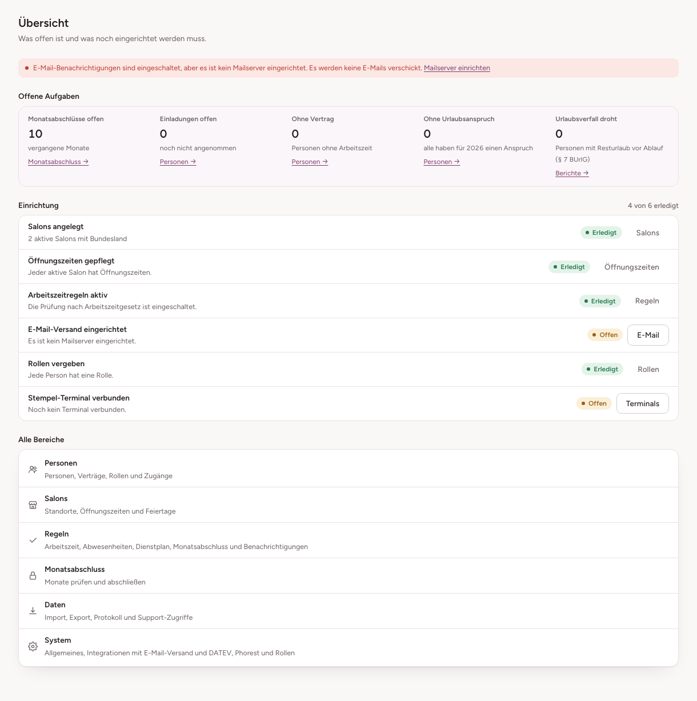

# Verwalten

Der Bereich **Verwalten** ist für die Verwaltung des Unternehmens: Personen anlegen, Arbeitszeit- und Urlaubsregeln festlegen, Rechte vergeben, Monate abschließen, Daten importieren und exportieren. Welche Seiten du siehst, hängt von deinen Rechten ab. Eine Seite, die dir fehlt, ist für deine Rolle nicht freigegeben.

## Verwalten › Übersicht

Die Übersicht zeigt oben deine **offenen Aufgaben** in Zahlen und eine Liste **Einrichtung**. Dort siehst du auf einen Blick, was für den Start noch fehlt: Salons angelegt, Öffnungszeiten gepflegt, Arbeitszeitregeln aktiv, E-Mail-Versand eingerichtet, Rollen vergeben und Stempel-Terminal verbunden. Jede Zeile steht auf „Erledigt“ oder „Offen“ und führt dich zur passenden Seite. Fehlt der Mailserver, weist ein Hinweis dich darauf hin. Darunter listet die Übersicht alle Bereiche, die du öffnen darfst.

<!-- SCREENSHOT file=bilder/verwalten-01.png role=admin url=/verwalten show="Verwalten Übersicht mit den offenen Aufgaben, der Einrichtungsliste und der Liste aller Bereiche" -->

## Ich möchte …

| Ich möchte …                                                                          | Seite in Clokr                                                             | Handbuch                                                                       |
| ------------------------------------------------------------------------------------- | -------------------------------------------------------------------------- | ------------------------------------------------------------------------------ |
| eine Person anlegen, einladen, ändern oder deaktivieren                               | **Verwalten › Personen**                                                   | [Personen](personen.md)                                                        |
| ein Arbeitszeitmodell zuweisen oder ändern                                            | **Verwalten › Personen › Vertrag**                                         | [Arbeitszeitmodelle](arbeitszeitmodelle.md)                                    |
| Vorgaben für Arbeitszeit, Pausen und Überstunden festlegen                            | **Verwalten › Regeln › Arbeitszeit & Verträge**                            | [Arbeitszeitmodelle](arbeitszeitmodelle.md#vorgaben-für-das-ganze-unternehmen) |
| Urlaubsanspruch, Übertrag, Sonderurlaub, Betriebsurlaub und Urlaubsgrenzen einstellen | **Verwalten › Regeln › Abwesenheiten**                                     | [Abwesenheiten und Urlaub](abwesenheiten-und-urlaub.md)                        |
| Rollen vergeben und eigene Rollen anlegen                                             | **Verwalten › System › Rollen & Rechte**                                   | [Rollen und Rechte](rollen-und-rechte.md)                                      |
| Salons, Bundesland und Feiertage pflegen                                              | **Verwalten › Salons**                                                     | [Salons und Feiertage](salons-und-feiertage.md)                                |
| einen Monat abschließen                                                               | **Verwalten › Monatsabschluss**                                            | [Monatsabschluss](monatsabschluss.md)                                          |
| Firmendaten, Anmelderegeln, E-Mail-Versand, Terminals und DATEV einrichten            | **Verwalten › System › Allgemein**, **Verwalten › System › Integrationen** | [System und Daten](system-und-daten.md)                                        |
| Daten per CSV importieren oder exportieren, das Protokoll lesen                       | **Verwalten › Daten › CSV-Import**, **Export**, **Protokoll**              | [System und Daten](system-und-daten.md)                                        |
| festlegen, wann und worüber Clokr benachrichtigt                                      | **Verwalten › Regeln › Benachrichtigungen & E-Mail**                       | [System und Daten](system-und-daten.md#benachrichtigungen-und-e-mail)          |
| Schichtvorlagen, Bedarfsregeln und Wochenmuster pflegen                               | **Verwalten › Regeln › Dienstplan**                                        | [System und Daten](system-und-daten.md#dienstplan)                             |
| festlegen, ob ein Monat mit Lücken abgeschlossen werden darf                          | **Verwalten › Regeln › Monatsabschluss**                                   | [Monatsabschluss](monatsabschluss.md#regeln-für-den-abschluss)                 |
| sehen, wann der Betreiber auf meine Daten zugegriffen hat                             | **Verwalten › Daten › Support-Zugriffe**                                   | [System und Daten](system-und-daten.md#support-zugriffe)                       |
| Schichten aus Phorest übernehmen                                                      | **Verwalten › System › Phorest**                                           | [Phorest](phorest.md)                                                          |

Rechtliche Hintergründe zu Arbeitszeit, Urlaub, Datenschutz und Aufbewahrung stehen unter [Compliance und Revisionssicherheit](../hintergrund/compliance.md). Antworten auf häufige Fragen findest du in den [Häufigen Fragen](../hintergrund/faq.md).
