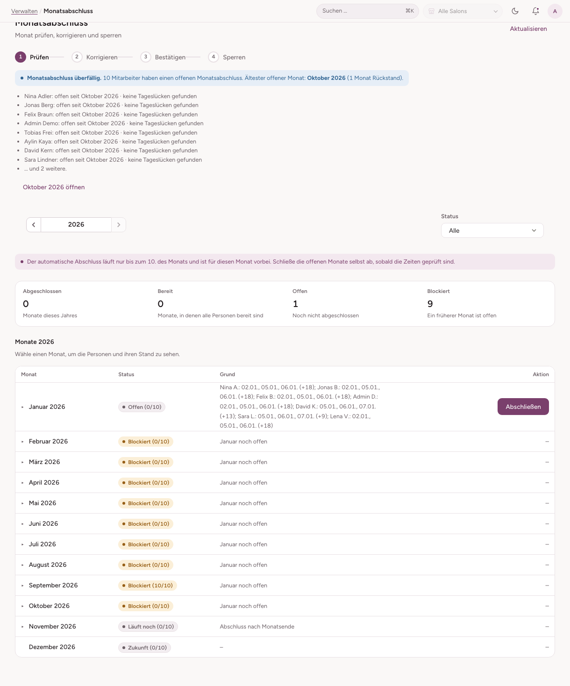

# Monatsabschluss

Der Monatsabschluss sperrt die Zeiterfassung eines Monats revisionssicher. Danach lassen sich Einträge nicht mehr direkt ändern, sondern nur noch über eine Korrektur, die Clokr im laufenden Monat bucht. Die Seite dazu ist **Verwalten › Monatsabschluss**. Wann ein Monat abgeschlossen werden darf, legst du unter **Verwalten › Regeln › Monatsabschluss** fest.

## Die Schritte

Oben zeigt eine Leiste die vier Schritte **Prüfen**, **Korrigieren**, **Bestätigen** und **Sperren**. Der Abschluss läuft pro Monat, du kannst ihn aber auch für einzelne Personen vornehmen.

<!-- SCREENSHOT file=bilder/monatsabschluss-01.png role=admin url=/verwalten/monatsabschluss show="Monatsabschluss mit der Schrittleiste, den Kennzahlen und der Monatstabelle eines Jahres" -->

### Prüfen

1. Wähle oben das **Jahr** und bei Bedarf einen **Status**.
2. Die Tabelle zeigt jeden Monat mit seinem Status und, wie viele Personen schon abgeschlossen sind. Unter dem Status steht der Grund, zum Beispiel fehlende Tage. Die Spalte **Aktion** gibt es nur, wenn du Monate abschließen darfst.
3. Klicke auf einen Monat, um die Personen und ihren Stand zu sehen: Personalnummer, **Fehlende Tage** und ein Hinweis, wenn Krankheitstage ohne Attest über die Karenzzeit nach § 5 EFZG hinausgehen.

Die Monate haben diese Stände:

| Stand             | Bedeutung                                                                 |
| ----------------- | ------------------------------------------------------------------------- |
| **Bereit**        | alle Voraussetzungen sind erfüllt                                         |
| **Teilweise**     | ein Teil der Personen ist schon abgeschlossen                             |
| **Offen**         | es fehlen noch Einträge, die Tabelle nennt sie                            |
| **Blockiert**     | ein früherer Monat ist noch offen. Schließe die Monate der Reihe nach.    |
| **Abgeschlossen** | der Monat ist gesperrt                                                    |
| **Keine Daten**   | im Zeitraum wurde nichts erfasst                                          |
| **Läuft noch**    | der Monat ist noch nicht zu Ende. Abgeschlossen wird nach dem Monatsende. |
| **Zukunft**       | ein späterer Monat                                                        |

Ist ein Abschluss überfällig, erscheint oben die Warnung „Monatsabschluss überfällig“ mit den betroffenen Personen und dem ältesten offenen Monat.

### Korrigieren

Fehlen Einträge oder stimmen Pausen nicht, klärst du das, bevor du abschließt: unter [Team › Zeiten](../team/zeiten.md) ergänzt oder korrigierst du Einträge, offene Anträge entscheidest du unter [Team › Aufgaben](../team/aufgaben.md).

### Bestätigen und sperren

Klicke bei dem ersten offenen Monat auf **Monat abschließen**, oder bei einer einzelnen Person auf **Abschließen**. Im Dialog steht der Hinweis: „Diese Aktion ist nicht rückgängig. Alle Zeiteinträge dieses Monats werden gesperrt. Korrekturen sind danach nur noch durch Storno-Buchungen möglich.“

Gibt es Tage ohne Eintrag, zeigt Clokr sie dir und warnt: Diese Tage werden als 0 Stunden gewertet, zählen also mit vollem Soll und machen den Saldo entsprechend negativ. Du musst bestätigen, dass du die fehlenden Tage zur Kenntnis genommen hast. Siehst du nicht, welche Tage fehlen, bittest du die Salonleitung, die Zeiten vorher zu prüfen.

Ein automatischer Abschluss versucht es bis zum 10. des Monats. Ein Hinweis über der Tabelle sagt dir, was für den Monat gilt. Ist der automatische Abschluss vorbei, schließt du offene Monate selbst ab, sobald die Zeiten geprüft sind.

## Gesperrte Monate

Ist ein Monat abgeschlossen, sind seine Einträge unveränderlich. Korrekturen gehen nur über neue, auf den Eintrag verweisende Buchungen, nie durch Überschreiben.

Soll an einem abgeschlossenen Monat etwas korrigiert werden, fragt die betroffene Person oder eine Führungskraft eine **Korrektur** an. Die Anfrage verändert den abgeschlossenen Monat nicht. Genehmigt sie jemand, der weder die Anfrage gestellt hat noch die betroffene Person ist, bucht Clokr sie als Kontobewegung im laufenden Monat. Die Entscheidung triffst du unter **Team › Aufgaben**, die Art „Zeitkorrektur“.

### Monat entsperren

Mit **Entsperren** in der Zeile einer Person öffnest du einen abgeschlossenen Monat wieder. Das ist die Ausnahme:

1. Klicke auf **Entsperren**. Der Dialog „Monat entsperren“ öffnet sich.
2. Trage den **Grund für die Entsperrung** ein. Er ist Pflicht und wird dauerhaft gespeichert.
3. Bestätige. Die Entsperrung und ihr Grund stehen im Protokoll unter **Verwalten › Daten › Protokoll**.

Ob du entsperren darfst, hängt von deinen Rechten ab.

## Regeln für den Abschluss

Unter **Verwalten › Regeln › Monatsabschluss** stellst du zwei Dinge ein:

- **Abschluss trotz fehlender Einträge erlauben** (Monatsabschluss mit Lücken): Ist die Option an, darfst du einen Monat abschließen, obwohl an Arbeitstagen Einträge fehlen. Die fehlenden Tage zählen mit 0 Stunden gegen das volle Soll.
- **Abschluss bei offenen Pausenbefunden sperren**: Ist die Option aus, erscheint bei offenen Pausenbefunden nur eine Warnung. Die Einstellung wirkt nur, solange die Pausen-Bestätigung unter **Verwalten › Regeln › Arbeitszeit & Verträge** eingeschaltet ist.

## Was der Abschluss für das Konto bedeutet

Mit dem Abschluss wird der Saldo des Monats **bestätigt**. Er geht als Übertrag in den nächsten Monat. Auf **Ich › Konto** sehen die Personen ihren bestätigten Saldo getrennt von der Prognose für den laufenden, noch offenen Zeitraum.
