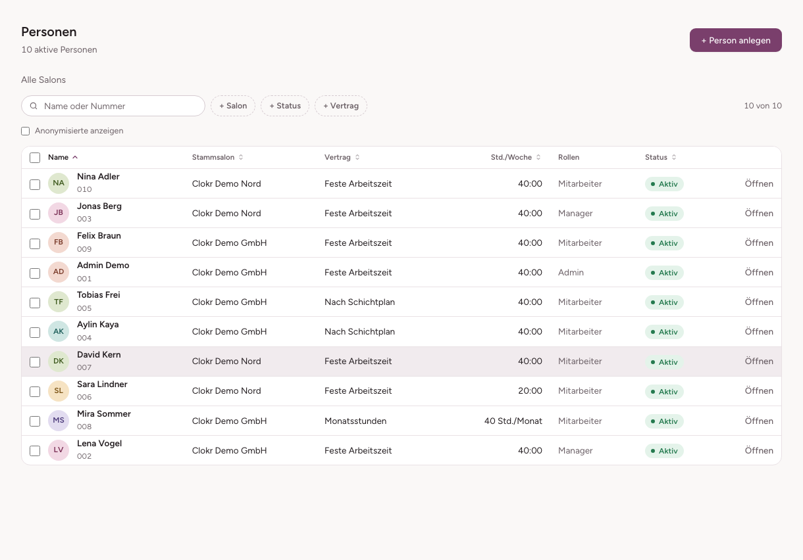

# Personen

Unter **Verwalten › Personen** legst du Personen an, pflegst ihre Stammdaten, ihren Vertrag und ihren Zugang, und du anonymisierst sie, wenn sie gehen. Hier arbeitet die Verwaltung. Teamleitungen schlagen Personen nur unter **Team › Personen** nach.

## Die Liste

Die Liste zeigt alle Personen mit Name und Personalnummer, **Stammsalon**, Vertrag, Wochenstunden, Rollen und Status. Du suchst, sortierst und filterst nach Salon, Status und Vertrag. Mit **Anonymisierte anzeigen** blendest du auch bereits anonymisierte Personen ein. Fehlt bei Auszubildenden das Geburtsdatum, steht dort der Hinweis „Geburtsdatum fehlt“. Er erinnert dich daran, dass der gesetzliche Mindesturlaub dann nicht geprüft werden kann.

Wählst du mehrere Personen aus, stehen oben Sammelaktionen bereit:

- **Als CSV exportieren**: die ausgewählten Personen als Datei.
- **Einladung erneut senden**: für Personen, die ihr Konto noch nicht aktiviert haben.
- **Rolle zuweisen**: dieselbe Rolle für alle gewählten Personen. Eine Vorschau zeigt vorher, wen es betrifft und wer übersprungen wird.

<!-- SCREENSHOT file=bilder/personen-01.png role=admin url=/verwalten/personen show="Die Personenliste mit Suche, Filtern, Spalten und der Schaltfläche Person anlegen" -->

## Person anlegen

1. Klicke auf **Person anlegen**. Der Dialog führt dich durch vier Schritte.
2. **Person**: Vorname, Nachname, E-Mail-Adresse, Personalnummer und Eintrittsdatum sind Pflicht. Das **Geburtsdatum** ist optional. Aus dem Alter ergeben sich der gesetzliche Mindesturlaub und der Jugendarbeitsschutz.
3. **Salon & Rolle**: Gibt es nur einen aktiven Salon, ordnet Clokr die Person ihm als Stammsalon zu. Bei mehreren Salons wählst du den **Stammsalon**, denn er ist dann Pflicht. Weitere Einsatzsalons trägst du später bei der Person ein. Unter **Rollen** legst du fest, was die Person darf, siehe [Rollen und Rechte](rollen-und-rechte.md).
4. **Vertrag**: Wähle das **Arbeitszeitmodell** und trage die Werte ein, siehe [Arbeitszeitmodelle](arbeitszeitmodelle.md). Außerdem wählst du die **Personalkategorie**. Die Kategorie bringt sinnvolle Vorgaben für **Schicht-Gewicht** und **Aufsichtspflichtig** mit, die du einzeln überschreiben kannst, mit **Auf Standard zurück** stellst du sie wieder her. Bei **Urlaubstage pro Jahr (5-Tage-Woche)** schlägt Clokr den Wert des Unternehmens vor, bei Auszubildenden den eigenen Wert für Azubis.
5. **Einladung**: Entweder lädst du die Person **per E-Mail** ein. Die Person bekommt einen Link und vergibt ihr Passwort selbst. Oder du wählst **Passwort setzen** und vergibst ein Passwort mit mindestens 8 Zeichen. Dann kann sich die Person sofort anmelden. Eine Zusammenfassung zeigt dir alles vor dem Anlegen.

Der Vertrag beginnt am Eintrittsdatum. Spätere Änderungen am Vertrag gelten jeweils ab dem Ersten eines Monats.

::: tip Hinweis
Das Einladen ist kein eigener Vorgang. Die Einladung ist der letzte Schritt beim Anlegen. Hat jemand die Mail nicht bekommen, verschickst du sie bei der Person unter **Zugang** noch einmal.
:::

## Person bearbeiten

Ein Klick auf eine Person öffnet ihre Seite mit fünf Reitern.

### Person

Hier pflegst du in getrennten Abschnitten, die du einzeln speicherst:

- **Persönliche Daten**: Name, Mitarbeiter-Nr., Geburtsdatum und die **NFC-Karten-ID**. Die Karten-ID ist optional und erlaubt der Person, an einem Terminal zu stempeln.
- **Personalstruktur**: Personalkategorie, Schicht-Gewicht und Aufsichtspflicht.
- **Austritt und Urlaubsbasis**: das **Austrittsdatum** (der Jahresurlaub wird dann anteilig berechnet, § 5 Abs. 2 BUrlG) und **Urlaubstage pro Jahr (5-Tage-Woche)** als persönlicher Basiswert. Bleibt das Feld leer, gilt der Wert des Unternehmens. Der Wert gilt für künftige Urlaubsjahre. Bestehende Ansprüche änderst du auf dem Reiter **Urlaub**.
- **Zeiterfassungs-Pflicht**: der Schalter **Keine Zeiterfassungs-Pflicht (§ 18 ArbZG)** für Inhaberinnen, Geschäftsführung und leitende Angestellte. Er blendet das Stempeln für die Person aus. Der Urlaubsanspruch der Person bleibt davon unberührt. Clokr fragt vor dem Umschalten nach.

### Vertrag

Das Arbeitszeitmodell, die Wochenstunden und Arbeitstage, Überstunden-Regeln und der Vertragsverlauf. Mehr dazu auf der Seite [Arbeitszeitmodelle](arbeitszeitmodelle.md).

### Urlaub

Das Urlaubskonto der Person: Urlaubsanspruch des Jahres mit Urlaubstagen gesamt, Resturlaub aus dem Vorjahr, Verfalldatum und Übertragsgrund. Jede Änderung wird protokolliert. Unter dem gesetzlichen Mindesturlaub speichert Clokr keinen neuen Wert. Die Regeln dahinter stehen auf der Seite [Abwesenheiten und Urlaub](abwesenheiten-und-urlaub.md).

### Salons

Die **Salonzuordnungen** der Person mit Verlauf. Mit **Stammsalon ändern** wechselst du den Stammsalon und mit **Einsatzsalon hinzufügen** ordnest du die Person zusätzlich einem anderen Salon zu, optional mit Zeitraum und Wochentagen. Eine Person in mehreren Salons ist eine Springerin oder ein Springer. Der Stammsalon entscheidet über Urlaub und Feiertage der Person.

### Zugang

- **Rollen**: welche Rollen die Person in welchem Bereich hat.
- **Anmeldung und Austritt**: E-Mail, Status und letzter Login. Mit **Einladung erneut senden** schickst du die Mail noch einmal. **Austritt eintragen** legt den letzten Arbeitstag fest und sperrt danach den Zugang. Eine Vorschau zeigt, welche Abwesenheiten danach enden. **Zugang reaktivieren** schaltet den Zugang wieder frei. Die Zeitdaten bleiben in jedem Fall erhalten.
- **Daten anonymisieren und löschen**: siehe unten.

## Löschen heißt anonymisieren

Clokr löscht Daten von Personen nicht hart. Zeiten, Urlaub und Konten unterliegen Aufbewahrungsfristen. Stattdessen **anonymisierst** du eine Person nach Art. 17 DSGVO. Die Schritte stehen im Abschnitt „Daten anonymisieren und löschen“ auf dem Reiter **Zugang**:

1. Klicke auf **Person anonymisieren** und bestätige.
2. Clokr ersetzt den Namen, anonymisiert die E-Mail-Adresse, sperrt das Konto und entfernt Notizen in Zeiteinträgen, Anträgen und Abwesenheiten. Einladungen und Zugangsschlüssel werden gelöscht.
3. **Zeiten, Urlaubsanträge und Salden bleiben erhalten.** Diese Daten unterliegen der gesetzlichen Aufbewahrungspflicht.

Erst nach Ablauf der Aufbewahrungsfrist lässt sich der Datensatz mit **Endgültig löschen** vollständig entfernen. Solange die Frist läuft, nennt Clokr das Datum und verlangt eine ausdrückliche Bestätigung. Eine vorzeitige Löschung geht nur mit der Freigabe einer zweiten Administratorin oder eines zweiten Administrators. Diese Schritte lassen sich nicht rückgängig machen, und das Protokoll hält sie fest. Die Fristen stehen unter [Compliance und Revisionssicherheit](../hintergrund/compliance.md#aufbewahrungsfristen).
