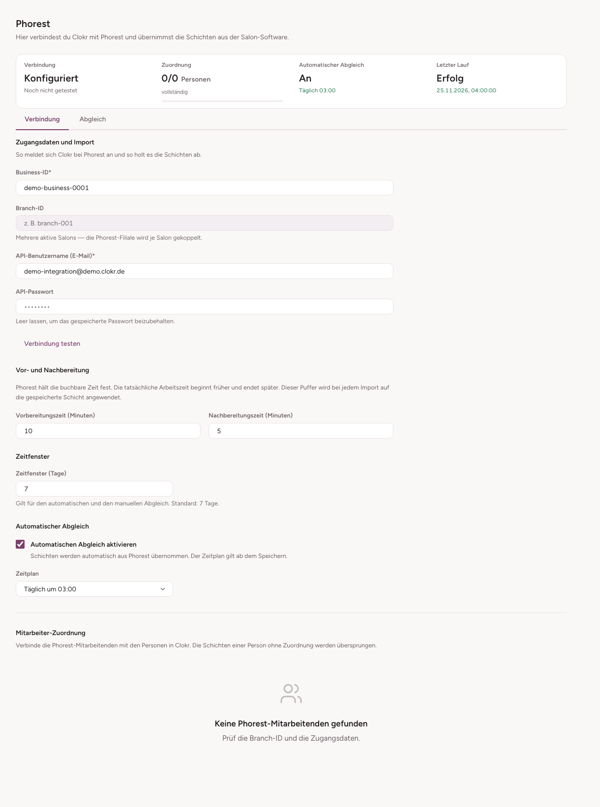

# Phorest

Mit der Phorest-Anbindung übernimmt Clokr Schichten aus der Salon-Software **Phorest**. Der Abgleich läuft in eine Richtung: Phorest bleibt die Quelle der Schichtplanung, Clokr übernimmt die Daten. Clokr schreibt nichts nach Phorest zurück, auch keine Abwesenheiten. Die Seite dazu ist **Verwalten › System › Phorest**.

## Verbindung

Auf dem Reiter **Verbindung** trägst du die Zugangsdaten deines Phorest-Kontos im Abschnitt „Zugangsdaten und Import“ ein:

- **Business-ID**
- **Branch-ID**: Gibt es nur einen aktiven Salon, trägst du sie hier ein. Bei mehreren aktiven Salons ist das Feld gesperrt, weil die Phorest-Filiale dann je Salon gekoppelt wird („Mehrere aktive Salons — die Phorest-Filiale wird je Salon gekoppelt.“).
- **API-Benutzername (E-Mail)**
- **API-Passwort**: Aus Sicherheitsgründen steht es nie im Feld. Lass es leer, um das gespeicherte Passwort zu behalten.

So gehst du vor:

1. Fülle die Felder aus und klicke auf **Phorest-Einstellungen speichern**.
2. Erst danach lässt sich die Verbindung mit **Verbindung testen** prüfen. Vorher steht dort „Speichere zuerst die Zugangsdaten“.

<!-- SCREENSHOT file=bilder/phorest-01.png role=admin url=/verwalten/system/phorest show="Phorest mit dem Reiter Verbindung: Zugangsdaten, Vor- und Nachbereitung und Zuordnung der Mitarbeitenden" -->

### Import-Einstellungen

- **Vorbereitungszeit** und **Nachbereitungszeit** (in Minuten): Phorest hält die buchbare Zeit fest, die tatsächliche Arbeitszeit beginnt früher und endet später. Clokr verlängert eine importierte Schicht um diese Zeiten. Pro Person lassen sie sich im Vertrag der Person überschreiben.
- **Zeitfenster (Tage)**: wie weit in die Zukunft Schichten übernommen werden. Standard sind 7 Tage. Es gilt für den automatischen und den manuellen Abgleich.
- **Automatischen Abgleich aktivieren** mit einem **Zeitplan**, zum Beispiel täglich um 03:00 Uhr.

### Mitarbeitende zuordnen

Phorest-Mitarbeitende werden mit Personen in Clokr verknüpft. Clokr schlägt eine Zuordnung vor (Chip „Vorschlag“), du bestätigst sie oder wählst selbst. Wer **nicht zugeordnet** ist, wird beim Abgleich übersprungen. Ordne also alle Personen zu, deren Schichten du in Clokr brauchst.

## Abgleich

Auf dem Reiter **Abgleich** holst du Schichten ab:

1. Optional trägst du **Von** und **Bis** ein. Ohne Angabe gilt das Zeitfenster der Verbindung.
2. Klicke auf **Jetzt abgleichen**.

Der Abschnitt „Letzter Lauf“ und der **Verlauf** zeigen je Lauf den Status und die Zahlen: importiert, aktualisiert, ersetzt, abgesagt, wegen Berufsschule übersprungen und ohne Zuordnung. Der Status „Verdächtig“ erscheint, wenn ein Lauf ein leeres Ergebnis liefert, obwohl vorher aktive Schichten da waren. Das schützt vor einer versehentlichen Massenabsage durch eine gestörte Anbindung. In dem Fall sagt Clokr keine Schichten ab.

### Berufsschule geht vor

Kollidiert eine Schicht aus Phorest mit einem Berufsschultag in Clokr, hat die Berufsschule Vorrang. Die Schicht wird beim Abgleich übersprungen.

### Jugendarbeitsschutz

Plant Phorest eine Person unter 18 länger, als das Jugendarbeitsschutzgesetz erlaubt, übernimmt Clokr die Schicht unverändert und benachrichtigt alle, die den Dienstplan des Salons planen. Pass den Plan dann in Phorest an.

## Termine

Termine aus Phorest hält Clokr nur als schreibgeschützten Zwischenspeicher ohne Personendaten vor. Es werden keine Kundennamen, Leistungen, Preise oder Kontaktdaten gespeichert, nur die Person in Phorest, Datum und Uhrzeit. Auf dieser Grundlage zeigt Clokr Warnungen, wenn sich Urlaub oder eine Schichtänderung mit gebuchten Kundenterminen überschneidet, zum Beispiel „Kundentermine im Zeitraum gebucht“. Clokr verändert dabei nichts in Phorest.

## Was die Schichten in Clokr bedeuten

Importierte Schichten erscheinen im [Dienstplan](../team/dienstplan.md) wie alle anderen. Bei Personen mit dem Arbeitszeitmodell „Nach Schichtplan“ bestimmen sie das Soll und gehen in den Saldo ein.
